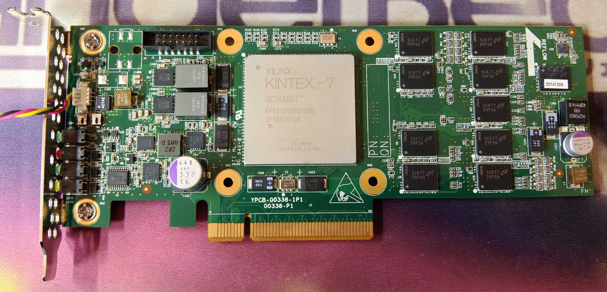

# YPCB-00338-1P1: Kintex-7 480T accelerator card


A PCIe x8 compute accelerator card with a Xilinx Kintex-7 XC7K480T FPGA and 4 GB of DDR3L with ECC.
The only external interfaces are PCIe and JTAG; the card also has 3 LEDs, a temperature sensor and 2 buttons.

| | |
|---|---|
| Silkscreen | `YPCB-00338-1P1`, `00338-P1` |
| Label | `PN: YZCA-00338-101` |
| Reverse engineering | TiferKing: [blog post](https://www.tiferking.cn/index.php/2024/12/19/650/) (2024-12-19) and the [ypcb_00338_1p1_hack](https://github.com/TiferKing/ypcb_00338_1p1_hack) repo (MIT) |
| Local copy | [`submodules/ypcb_00338_1p1_hack`](../../submodules/ypcb_00338_1p1_hack) |

---

## 1. Main ICs

| Ref | Function | Part | Notes |
|---|---|---|---|
| — | FPGA | Xilinx **XC7K480T-2FFG1156I** | Kintex-7, speed grade -2, industrial temperature range |
| U5–U13 | DDR3L channel 0 | 9× Micron **MT41K256M8DA-125:K** | 2 Gb (256M×8) each; 1.35 V DDR3L, 1.5 V compatible; rated DDR3L-1600 (-125). Package marking `D9PSH` |
| U1, U14–U21 | DDR3L channel 1 | 9× Micron **MT41K256M8DA-125:K** | Same part as channel 0 |
| — | Configuration flash | Micron **MT28GU512AAA1EGC-0SIT** | StrataFlash, 512 Mb (32M×16) parallel NOR (BPI x16), 1.7–2.0 V core and I/O |
| U22 | Temperature sensor | TI **LM73CIMKX** | I²C, address **0x4A**, with an ALERT output |
| U26 | PCIe SMBus | (part not identified) | Listed next to the PCIe SMBus pins in the pinout sheet |
| — | Oscillators | 1× 50 MHz single-ended, 2× 200 MHz LVDS | Part numbers unknown |

**FPGA resources** (from the 7-series selection guide):

- Logic: 477,760 logic cells, 74,650 slices, 597,200 flip-flops
- Memory: 955 × 36 Kb block RAM (34,380 Kb in total), 6,788 Kb distributed RAM
- 1,920 DSP48 slices and 8 CMTs
- Transceivers and PCIe: 32 GTX transceivers (12.5 Gb/s max) and one PCIe Gen2 hard block
- I/O: the FFG1156 package has 400 HR (high-range) I/Os and no HP banks

---

## 2. Clocks, reset, LEDs and I²C

All single-ended user I/O is **LVCMOS18**.

| Signal | FPGA pin | Standard | Notes |
|---|---|---|---|
| 50 MHz system clock | AA28 | LVCMOS18 | Single-ended, on the back of the board |
| 200 MHz clock 1 (P/N) | AH27 / AH28 | LVDS, `DQS_BIAS=TRUE` | Reference clock for DDR3 **CH0** (bank 12) |
| 200 MHz clock 2 (P/N) | G25 / G26 | LVDS, `DQS_BIAS=TRUE` | Reference clock for DDR3 **CH1** (bank 17) |
| PCIe reference clock (P/N) | J8 / J7 | MGT | 100 MHz from the edge connector; buffer it with `IBUFDSGTE` |
| PCIe `PERST#` | Y26 | LVCMOS18 | Active low |
| **SW2**: user reset | R28 | LVCMOS18 | Push button, active low. Board-file name `resetn` / `SW_RESET` |
| **SW1** | `INIT_B` | — | Wired to the FPGA's `INIT_B` pin. According to the author, pressing it resets the whole chip |
| LED red | P30 | LVCMOS18 | GPIO bit 0, active high |
| LED green | M30 | LVCMOS18 | GPIO bit 1, active high |
| LED yellow | N30 | LVCMOS18 | GPIO bit 2, active high |
| LM73 SCL / SDA | N24 / N25 | LVCMOS18 | I²C bus to U22 |
| LM73 ALERT | P25 | LVCMOS18 | Input to the FPGA (temperature alert interrupt) |
| PCIe SMBus SCL / SDA | R26 / R27 | LVCMOS18 | The pinout sheet lists these under "U26 / PCIE" |

---

## 3. DDR3 memory

The board has two independent 72-bit channels: 64 data bits plus 8 ECC bits each. That gives **2 GB usable per channel, 4 GB in total**.

| | CH0 | CH1 |
|---|---|---|
| Chips | U5–U13 | U1, U14–U21 |
| FPGA banks | 11, 12, 13 (address/control in 12) | 16, 17, 18 (address/control in 17) |
| System clock | 200 MHz clock 1: AH27/AH28 | 200 MHz clock 2: G25/G26 |
| Pin files | `constraints/MEMORY_CH0.ucf`, `mig_0.prj` | `constraints/MEMORY_CH1.ucf`, `mig_1.prj` |

### MIG settings used by the board presets (`mig_0.prj`, `mig_1.prj`, `mig_01.prj`)

**Speed and clocks**
- **1875 ps clock period, i.e. 533 MHz, so the interface runs at DDR3-1066.** The chips are rated for 1600 MT/s, but the presets do not run them that fast.
- PHY-to-controller ratio 4:1, so the user interface clock (`ui_clk`) is about 133 MHz.
- 200 MHz differential input clock, with the reference clock set to "Use System Clock".

**Memory and AXI configuration**
- Memory part `MT41K256M8XX-125`: 72-bit data width, ECC on, no data mask.
- 15 row, 10 column and 3 bank address bits; `BANK_ROW_COLUMN` address mapping.
- Mode registers: burst length 8, CAS latency 7, CAS write latency 6.
- AXI4 slave port: 512-bit data, 31-bit address, 4-bit ID, arbitration `RD_PRI_REG`.

**Electrical settings**
- 1.5 V memory voltage setting. RTT_NOM RZQ/4, dynamic ODT off, output drive RZQ/7.
- DCI on; internal termination 50 Ω on the HR banks.
- The MIG instantiates the XADC.
- `sys_rst` is active low.

**Which preset to use:** `mig_01.prj` is a single MIG core with both controllers (board interface `ddr3_sdram_ch01`). Its pins are exactly the combination of `mig_0.prj` and `mig_1.prj`.

<details>
<summary>DDR3 address/control pins</summary>

| Signal | CH0 | CH1 |
|---|---|---|
| A0 | AK27 | E27 |
| A1 | AN23 | C27 |
| A2 | AL24 | B28 |
| A3 | AK26 | D27 |
| A4 | AH24 | C24 |
| A5 | AH25 | D24 |
| A6 | AL26 | C25 |
| A7 | AJ24 | A24 |
| A8 | AJ25 | A25 |
| A9 | AM23 | J24 |
| A10 | AL28 | F26 |
| A11 | AL25 | D26 |
| A12 | AM25 | H25 |
| A13 | AK24 | D25 |
| A14 | AM27 | B26 |
| BA0 | AM26 | F24 |
| BA1 | AP24 | J25 |
| BA2 | AN28 | E24 |
| CK_P | AN25 | B25 |
| CK_N | AP25 | A26 |
| CKE | AP27 | A28 |
| CS# | AK28 | F28 |
| RAS# | AJ29 | E28 |
| CAS# | AP26 | E26 |
| WE# | AN27 | F25 |
| ODT | AK29 | B27 |
| RESET# | AD31 | F18 |

</details>

<details>
<summary>DDR3 data pins: which chip drives which byte lane</summary>

**CH0**

| Byte | Chip | DQ bits | DQ pins (bit order) | DQS P / N |
|---|---|---|---|---|
| 0 | U5 | 7:0 | AG17 AG16 AH17 AJ19 AH18 AH19 AJ16 AJ17 | AK16 / AK17 |
| 1 | U6 | 15:8 | AL20 AN17 AL19 AM16 AL18 AL16 AM20 AN18 | AM17 / AM18 |
| 2 | U7 | 23:16 | AL23 AN20 AK23 AP19 AN22 AN19 AM22 AP20 | AP21 / AP22 |
| 3 | U8 | 31:24 | AJ21 AH22 AK21 AG21 AG22 AG20 AH23 AG23 | AH20 / AJ20 |
| 4 | U9 | 39:32 | AJ32 AK32 AK31 AL30 AL34 AL31 AK34 AL29 | AK33 / AL33 |
| 5 | U10 | 47:40 | AJ34 AH32 AJ30 AH34 AF31 AG30 AG31 AF30 | AG33 / AH33 |
| 6 | U11 | 55:48 | AE32 AC33 AF33 AC32 AD34 AC34 AE33 AE31 | AE34 / AF34 |
| 7 | U12 | 63:56 | AE26 AF29 AE24 AF28 AF24 AG25 AF26 AF25 | AE27 / AE28 |
| 8 (ECC) | U13 | 71:64 | AN34 AP30 AM33 AN29 AP32 AP29 AM31 AP31 | AN32 / AP33 |

**CH1**

| Byte | Chip | DQ bits | DQ pins (bit order) | DQS P / N |
|---|---|---|---|---|
| 0 | U1 | 7:0 | A29 B33 A31 C33 C32 A30 B30 A33 | B31 / B32 |
| 1 | U14 | 15:8 | D31 F33 D30 D29 E33 E34 E31 F34 | D34 / C34 |
| 2 | U15 | 23:16 | B23 A21 C23 B20 B22 A23 C20 B21 | A19 / A20 |
| 3 | U16 | 31:24 | G31 G32 F29 F31 E29 G33 H33 H32 | H29 / H30 |
| 4 | U17 | 39:32 | B18 C17 C19 B16 A18 A16 C18 B17 | D16 / D17 |
| 5 | U18 | 47:40 | K27 L24 K24 L28 K26 M27 L25 M26 | K28 / K29 |
| 6 | U19 | 55:48 | F16 E18 E16 H19 H17 H20 E17 H18 | G17 / G18 |
| 7 | U20 | 63:56 | D20 F21 E23 G21 G20 D21 F20 F23 | G22 / G23 |
| 8 (ECC) | U21 | 71:64 | L34 K34 K31 K33 L31 J30 L33 J34 | K32 / J32 |

</details>

---

## 4. BPI configuration flash

The flash both configures the FPGA and is readable/writable from user logic.

- **Connections:** 25 address lines `A[25:1]` (there is no `A0`; the flash is word addressed), 16 data lines `DQ[15:0]`, and the control lines `ADV#`, `CE#`, `OE#` and `WE#`. All LVCMOS18.
- **In Vivado:** board interface `bpi_flash`, driven by `axi_emc`. The preset sets a 16-bit memory width and flash timing values. The example design maps the flash as a 64 MB window at `0x6000_0000`.
- **Programming:** choose configuration memory part **`mt28gu512aax1e-bpi-x16`** (Micron, BPI x16).

<details>
<summary>Flash pins</summary>

| Signal | Pin | Signal | Pin | Signal | Pin |
|---|---|---|---|---|---|
| A1 | AD26 | A10 | AB26 | A19 | U33 |
| A2 | AC25 | A11 | AA26 | A20 | T31 |
| A3 | AC29 | A12 | AA31 | A21 | T30 |
| A4 | AC28 | A13 | AA30 | A22 | U31 |
| A5 | AD27 | A14 | AB33 | A23 | U30 |
| A6 | AC27 | A15 | AB32 | A24 | N34 |
| A7 | AB25 | A16 | Y32 | A25 | P34 |
| A8 | AB28 | A17 | P32 | | |
| A9 | AB27 | A18 | R32 | | |

| Signal | Pin | Signal | Pin | Signal | Pin |
|---|---|---|---|---|---|
| DQ0 | AA33 | DQ6 | W31 | DQ12 | W29 |
| DQ1 | AA34 | DQ7 | W32 | DQ13 | V28 |
| DQ2 | Y33 | DQ8 | W30 | DQ14 | W24 |
| DQ3 | Y34 | DQ9 | V25 | DQ15 | Y24 |
| DQ4 | V32 | DQ10 | W25 | | |
| DQ5 | V33 | DQ11 | V29 | | |

| Signal | Pin |
|---|---|
| ADV# | M31 |
| CE# | V30 |
| OE# | T33 |
| WE# | T34 |

</details>

---

## 5. PCI Express

The link is up to **x8 Gen2 (5.0 GT/s)** using the Kintex-7 hard PCIe block at `X0Y0`. The 100 MHz reference clock comes in on J8/J7.

| Lane | RX P / N | TX P / N | GT channel | GT bank |
|---|---|---|---|---|
| 0 | H6 / H5 | F2 / F1 | GTXE2_CHANNEL_X0Y23 | 116 |
| 1 | J4 / J3 | H2 / H1 | GTXE2_CHANNEL_X0Y22 | 116 |
| 2 | K6 / K5 | K2 / K1 | GTXE2_CHANNEL_X0Y21 | 116 |
| 3 | L4 / L3 | M2 / M1 | GTXE2_CHANNEL_X0Y20 | 116 |
| 4 | M6 / M5 | N4 / N3 | GTXE2_CHANNEL_X0Y19 | 115 |
| 5 | P6 / P5 | P2 / P1 | GTXE2_CHANNEL_X0Y18 | 115 |
| 6 | R4 / R3 | T2 / T1 | GTXE2_CHANNEL_X0Y17 | 115 |
| 7 | T6 / T5 | U4 / U3 | GTXE2_CHANNEL_X0Y16 | 115 |

The lane order runs opposite to the GT numbering: lane 0 is on X0Y23.

> **Known issue:** Vivado sometimes leaves the PCIe transceiver ports unconstrained. To fix it, add
> `examples/YPCB_00338_1P1_systest/YPCB_00338_1P1_systest.srcs/constrs_1/new/pcie_port.xdc`
> to your project. That file sets both the package pins and the `GTXE2_CHANNEL` LOCs above.
> The cell paths in it assume an XDMA instance at `top_i/xdma_0`; change them if your hierarchy differs.

---

## 6. JTAG

The card has a 14-pin header with the standard Xilinx pinout. It works with a Xilinx USB cable or a JTAG-HS3. The FPGA is the only device in the chain.

```
GND  1 | 2  VREF
GND  3 | 4  TMS
GND  5 | 6  TCK
GND  7 | 8  TDO
GND  9 | 10 TDI
GND 11 | 12 --
GND 13 | 14 SRST
```

---

## 7. Vivado board files

**Install:**
1. Copy `ypcb003381p1/` into `Vivado/<version>/data/boards/board_files/`. Create `board_files/` if it doesn't exist.
2. Create a new project and pick **"YPCB-00338-1P1 Accelerator Card"**. You can filter by vendor `tiferking.cn` to find it.

**Identifiers:**
- Board part: `tiferking.cn:ypcb003381p1:part0:1.0`
- FPGA part: `xc7k480tffg1156-2`

**Board interfaces** (shown in the *Board* tab of the block design):

| Interface | Default IP | Preset |
|---|---|---|
| `default_50mhz_clk0` | `clk_wiz` | 50 MHz single-ended input |
| `default_200mhz_clk1`, `default_200mhz_clk2` | `clk_wiz`, `util_ds_buf` | 200 MHz differential input |
| `ddr3_sdram_ch0` / `ddr3_sdram_ch1` / `ddr3_sdram_ch01` | `mig_7series` | `mig_0.prj` / `mig_1.prj` / `mig_01.prj` (2 GB / 2 GB / 4 GB) |
| `bpi_flash` | `axi_emc` | 16-bit linear flash |
| `led_3bits` | `axi_gpio` (also `iomodule` / `microblaze_mcs` GPO) | 3 outputs |
| `alert_lm73` | `axi_gpio` | 1 input, interrupt on |
| `iic_lm73`, `iic_pcie` | `axi_iic` | — |
| `resetn` | `proc_sys_reset` | Active low |
| `pci_express_x1` / `x2` / `x4` / `x8` | `xdma` (also `pcie_7x`, `axi_pcie`) | 5.0 GT/s at the chosen width |
| `pcie_perstn` | `xdma`, `pcie_7x` | Active low, type `PCIE_PERST` |
| `pcie_refclk` | `util_ds_buf` | `IBUFDSGTE`, 100 MHz |

**Constraints for non-block-design (HDL) flows** are in `constraints/`:
- `ypcb003381p1.xdc`: PCIe, sensor, SMBus, LED, clock, reset and flash pins.
- `MEMORY_CH0.ucf` and `MEMORY_CH1.ucf`: DDR3 pins.
- `physical_pinout.xlsx`: pin map with the chip designators.

---

## 8. Example design: `examples/YPCB_00338_1P1_systest` (Vivado 2022.2)

A MicroBlaze system test that uses every board interface. The project ships with:
- the pre-built hardware export `top_wrapper.xsa` (bitstream included);
- the synthesized and routed design checkpoints (DCPs).

| Block | Configuration |
|---|---|
| MicroBlaze | 36-bit address bus, 512 KB of local (LMB) block RAM, debug enabled, D-cache on, I-cache off |
| MDM (debug module) | JTAG debug plus **JTAG UART** (`C_USE_UART=1`). This is the console; the board has no physical UART |
| `clk_wiz` | 50 MHz in; 100 MHz out (CPU and peripherals) and 250 MHz out |
| MIG | Dual controller (`ddr3_sdram_ch01`); `ui_clk` is about 133 MHz per channel |
| XDMA | Gen2 x8, AXI memory-mapped, 128-bit at 250 MHz, 2 H2C + 2 C2H channels, MSI. IDs: vendor `10EE`, device `7028`, subsystem `10EE:0007`, class `070001` |
| Other | `axi_emc` (flash), 2× `axi_iic` (100 kHz), `axi_gpio` (channel 1 = LEDs, channel 2 = LM73 alert), `axi_intc` |
| Reset | SW2 (`SYS_RSTN`) resets the `clk_wiz` (through an inverter), the processor reset block and the MIG |

**Interrupt inputs** (into the interrupt controller): 0 = LM73 I²C, 1 = PCIe SMBus I²C, 2 = MIG CH0, 3 = MIG CH1, 4 = GPIO (LM73 alert).

**MicroBlaze address map:**

| Address | Size | Peripheral |
|---|---|---|
| `0x0000_0000` | 512 KB | Local block RAM |
| `0x4000_0000` | 64 KB | AXI GPIO |
| `0x4080_0000` | 64 KB | AXI IIC 0 (LM73) |
| `0x4081_0000` | 64 KB | AXI IIC 1 (PCIe SMBus) |
| `0x4120_0000` | 64 KB | AXI interrupt controller |
| `0x4140_0000` | 4 KB | MDM |
| `0x6000_0000` | 64 MB | BPI flash (AXI EMC) |
| `0x7600_0000` | 64 KB | XDMA control registers (`S_AXI_LITE`) |
| `0x7610_0000` / `0x7620_0000` | 1 MB each | MIG CH0 / CH1 control (ECC) registers |
| `0x1_0000_0000` | 2 GB | DDR3 CH0 |
| `0x1_8000_0000` | 2 GB | DDR3 CH1 |

**PCIe host view (XDMA `M_AXI`):**
- DDR3 CH0 at `0x0000_0000` (2 GB).
- DDR3 CH1 at `0x8000_0000` (2 GB).
- The flash is not mapped for the host.

### Vitis software: `examples/YPCB_00338_1P1_software.zip` (Vitis 2022.2)

Import the zip into Vitis. It contains:
- the platform `YPCB_00338_1P1_plat` (standalone, `microblaze_0`);
- the application `YPCB_00338_1P1_App`, built from the *memory_tests* template.

Open the MDM JTAG UART console and press one of these keys:

| Key | Action |
|---|---|
| `r` / `g` / `y` | Toggle the red / green / yellow LED |
| `m` | Memory test on both DDR3 channels. It only checks the first 4 KB of each channel, using 32-, 16- and 8-bit patterns |
| `t` | Read the LM73 at I²C address 0x4A and print °C (raw 16-bit value / 128) |

The MicroBlaze app has no XDMA code. To test PCIe from the host, use Xilinx AR 65444 (Windows XDMA driver and tools: `xdma_rw`, `xdma_test`, `simple_dma` and others), which is included in `documents/`.

---

## 9. Programming

1. Connect a Xilinx USB cable to the JTAG header.
2. **Load into the FPGA (volatile):** in Vivado Hardware Manager, program the `.bit` file.
3. **Write to the flash (persistent):** in Hardware Manager, use *Add Configuration Memory Device*, choose Micron, type `bpi`, part **`mt28gu512aax1e-bpi-x16`**, and program the configuration file.

---

## 10. Repository contents

| Path | Contents |
|---|---|
| `ypcb003381p1/1.0/` | Vivado board files: `board.xml`, `part0_pins.xml`, `preset.xml`, `mig_0/1/01.prj`, `xitem.json`, board photo |
| `constraints/` | `ypcb003381p1.xdc`, `MEMORY_CH0.ucf`, `MEMORY_CH1.ucf`, `physical_pinout.xlsx` |
| `examples/YPCB_00338_1P1_systest/` | Vivado 2022.2 example project (block design, XSA, DCPs, `pcie_port.xdc`) |
| `examples/YPCB_00338_1P1_software.zip` | Vitis 2022.2 platform and test application (includes `top_wrapper.bit`) |
| `documents/` | Datasheets (7-series selection guide, LM73, MT28GU512, MT41K256M8) and Xilinx AR 65444 (Windows XDMA drivers) |
