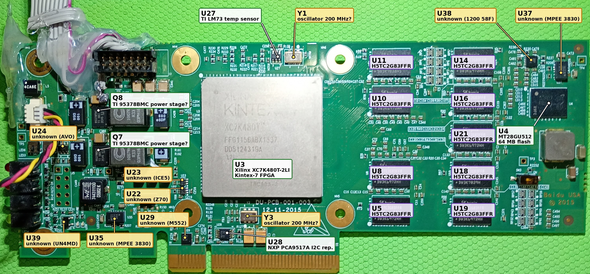
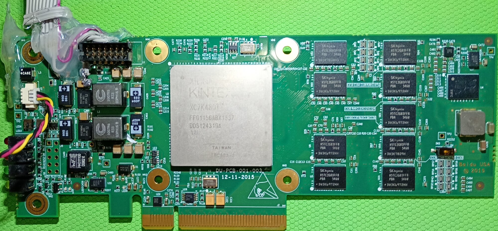
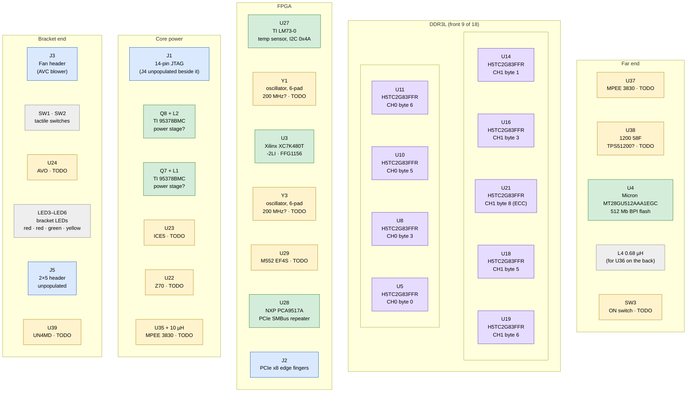
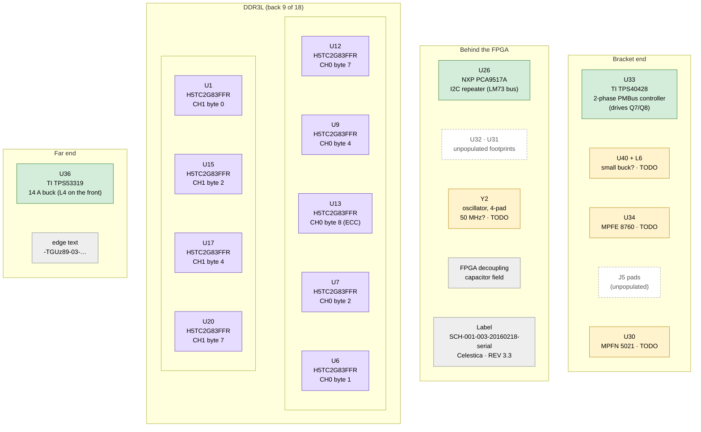
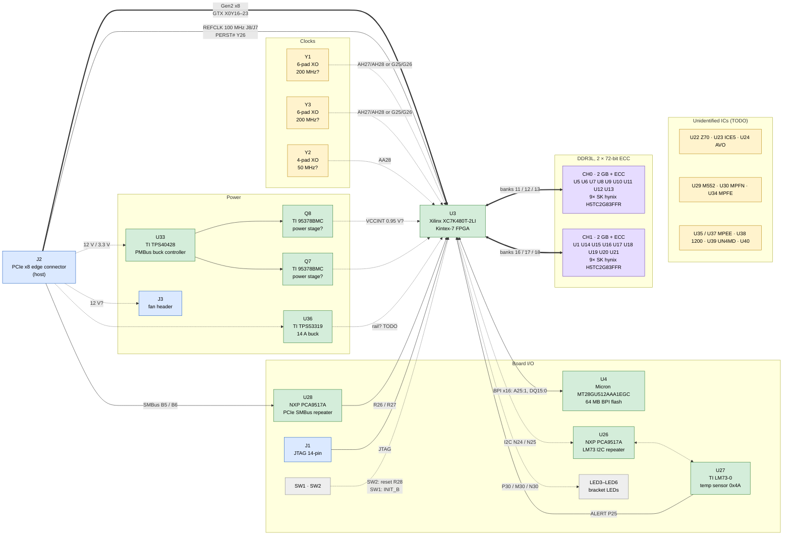
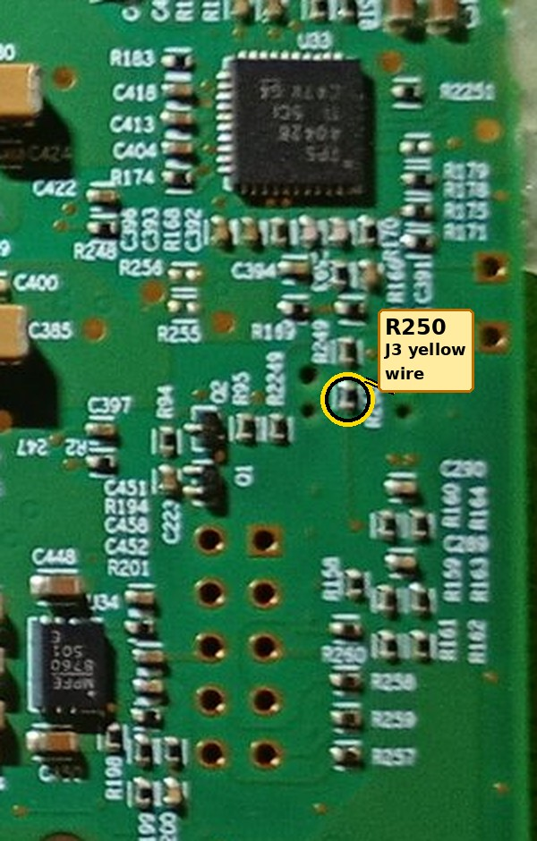

# DU-PCB-001-003 (SCH-001-003): Kintex-7 480T accelerator card




*This workspace's unit (serial `0265`), with every IC labelled.*
- **Label colours:** white box with green border = identified, yellow = unidentified (TODO), grey = not populated. The purple labels sit on the DRAM chips.
- **Size:** the images are 3000 px wide; open them full size to read the small parts.
- **Details:** each IC is described in [§3](#3-integrated-circuits).

**Contents**
1. [Overview](#1-overview): what the card is, how to identify it, how it relates to YPCB-00338-1P1
2. [Board map](#2-board-map): front, back and connection diagrams
3. [Integrated circuits](#3-integrated-circuits): every chip, with photo, marking and datasheet
4. [Connectors, switches and LEDs](#4-connectors-switches-and-leds)
5. [FPGA I/O banks and power](#5-fpga-io-banks-and-power): banks, VCCO, GTX quads, supply rails
6. [Interfaces and pinout](#6-interfaces-and-pinout): clocks, DDR3, flash, PCIe, I²C, LEDs, JTAG, fan, full pin map
7. [Working with Vivado](#7-working-with-vivado): board files, constraints, programming
8. [Example design](#8-example-design): the MicroBlaze system test and host software
9. [Known issues, open questions and TODOs](#9-known-issues-open-questions-and-todos)
10. [Reference](#10-reference): repository contents, history, links

**Conventions.** **TODO** marks open work. **TODO?** marks a value that no file or photo backs up.

---

## 1. Overview

### 1.1 At a glance

A PCIe x8 FPGA accelerator card. The silkscreen says it was designed by Baidu USA in 2015; the label on the back says it was built by Celestica.

| | |
|---|---|
| FPGA | Xilinx Kintex-7 **XC7K480T-L2FFG1156I**: the low-power -2LI grade (marked `L2I`), Vivado part `xc7k480tiffg1156-2L` ([U3](#u3-xilinx-xc7k480t-l2ffg1156i)) |
| Memory | 18 × SK hynix DDR3L, forming two independent 72-bit ECC channels: **4 GB usable** ([§6.2](#62-ddr3-memory)) |
| Configuration flash | Micron 512 Mb (64 MB) parallel NOR, BPI x16 ([§6.3](#63-bpi-configuration-flash)) |
| Host interface | PCIe Gen2 x8 ([§6.4](#64-pci-express)) |
| Other | LM73 temperature sensor, PCIe SMBus, 14-pin JTAG header, fan header, 4 bracket LEDs, 2 push buttons ([§4](#4-connectors-switches-and-leds), [§6](#6-interfaces-and-pinout)) |
| Vivado support | Corrected board files in this folder ([§7.1](#71-board-files)); constraints and a MicroBlaze/XDMA example inherited from YPCB-00338-1P1 ([§7.2](#72-constraints-for-hdl-flows), [§8](#8-example-design)) |

### 1.2 Identification

| | |
|---|---|
| Silkscreen (front) | `DU-PCB-001-003`, `12-11-2015`, `Baidu USA © 2015` |
| Label (back) | `SCH-001-003-20160218-<serial>`, `Product by Celestica`, `REV 3.3`, plus a barcode. The last field differs per board, so it is a serial number |
| Other names | SCH-001-003; "Baidu 2015 FPGA board" |
| PCB markings (back) | UL mark `MV28 94V-0 017-6`; edge text `-TGUz89-03-…` (differs per board); some units carry an ink stamp (`YS26.06` on unit 0300) |
| Support repository | [SergeRuff/DU-PCB-001-003](https://github.com/SergeRuff/DU-PCB-001-003) (MIT), checked out locally at [`submodules/DU-PCB-001-003`](../../submodules/DU-PCB-001-003) |
| Earlier work | TiferKing's YPCB-00338-1P1 hack: [repo](https://github.com/TiferKing/ypcb_00338_1p1_hack) and [blog post](https://www.tiferking.cn/index.php/2024/12/19/650/) (2024-12-19). omasanori: [sch-001-003-hack](https://github.com/omasanori/sch-001-003-hack) |

### 1.3 Relationship to YPCB-00338-1P1

The card is a close relative of the Inspur **YPCB-00338-1P1** ([sibling README](../YPCB-00338-1P1-kintex7-480t/README.md)). The DU-PCB-001-003 support repository copies TiferKing's YPCB-00338-1P1 board files, constraints and examples **byte for byte**.

> [!IMPORTANT]
> **Every pin assignment in this document comes from the YPCB-00338-1P1 files.** Only one connection has been checked on this card: the PCIe SMBus goes through U28 (continuity test on unit 0265). Treat all other pin data as inherited, not verified.
>
> **Evidence that the two boards share a layout:**
> - All 18 DRAMs carry exactly the designators the YPCB pinout sheet uses (U1 and U5–U21).
> - The upstream README says the card "has some compatibility with YPCB-00338-1P1".
>
> **Evidence that the designators don't all match:**
> - The sheet calls the LM73 "U22"; on this card the LM73 is **U27** ([U27](#u27-ti-lm73-0-temperature-sensor)).
> - The sheet ties the PCIe SMBus to "U26"; on this card the SMBus goes through **U28** (continuity-checked on unit 0265), and U26 serves the LM73 ([§6.5](#65-i2c-buses)).

### 1.4 The two documented units

The two boards look identical; only the lot and date codes, the U4 sticker and the modifications differ.

| | Unit 0300 (upstream repo photos) | Unit 0265 (this workspace, photographed 2026-11-10) |
|---|---|---|
| Photos |   |   |
| Label | `SCH-001-003-20160218-0300` | `SCH-001-003-20160218-0265` |
| Edge text | `-TGUz89-03-036-930` | `-TGUz89-03-001-008` |
| FPGA marking | `FFG1156ACX1533`, `DF5113101A`, `L2I` (faint) | `FFG1156ABX1537`, `DD5124319A`, **`L2I`** (clear) |
| DRAM date codes | `546V` (front), `547V` (back) | `546V` (both sides) |
| U4 (flash) | Covered by a `001` sticker | No sticker: Micron logo, `57AB7` / `RB119` / `X9FC` |
| Modifications | None visible | Fan on J3; ribbon cable soldered to J1 ([§6.7](#67-jtag)) |
| Electrical checks | None documented | Continuity: U28 connects to the PCIe SMBus fingers ([§6.5](#which-repeater-is-which)); the fan's yellow wire on J3 goes to R250 ([§6.8](#68-fan-header)) |

---

## 2. Board map

These diagrams are Mermaid sketches, not to scale; positions are approximate and read off the photos of both units.
- **Colours:** green = identified IC, purple = DDR3L, yellow = unidentified (TODO), blue = connector, grey = other, dashed outline = unpopulated.
- **Details:** each IC is described in [§3](#3-integrated-circuits).

### 2.1 Front side

Component side up, bracket on the left, PCIe fingers at the bottom.



### 2.2 Back side

Drawn **as seen when the card is flipped** (like the back photo): the far end is on the left and the bracket on the right.



### 2.3 How the chips connect

- **Solid lines** come from the repo's pin data (`part0_pins.xml`, the MIG `.prj` files, the XDC), plus one link checked on the board: the PCIe SMBus through U28.
- **Dashed lines** are inferred or unverified: the oscillator-to-pin assignment, the power rails, the LM73's repeater (U26, by elimination), the LED mapping and which switch is which.



---

## 3. Integrated circuits

Every IC found on the photos, grouped by function. The photos come from unit 0265.

| Group | Ref | Part | Status |
|---|---|---|---|
| [FPGA](#31-fpga) | [U3](#u3-xilinx-xc7k480t-l2ffg1156i) | Xilinx XC7K480T-L2FFG1156I | Identified |
| [Memory](#32-memory) | [U1, U5–U21](#u1-u5u21-sk-hynix-h5tc2g83ffr-pba-ddr3l) | 18× SK hynix H5TC2G83FFR-PBA DDR3L | Identified; no official datasheet link (TODO) |
| | [U4](#u4-micron-mt28gu512aaa1egc-0sit-flash) | Micron MT28GU512AAA1EGC-0SIT BPI flash | Identified |
| [Board management](#33-board-management) | [U27](#u27-ti-lm73-0-temperature-sensor) | TI LM73CIMKX-0 temperature sensor | Identified |
| | [U26](#u26-nxp-pca9517a-i2c-repeater), [U28](#u28-nxp-pca9517a-i2c-repeater) | NXP PCA9517A I²C repeaters | Identified. U28 = PCIe SMBus (continuity-checked), U26 = LM73 bus (by elimination) |
| [Power](#34-power) | [U33](#u33-ti-tps40428-buck-controller) | TI TPS40428 buck controller | Identified |
| | [Q8](#q8-power-stage-marked-95378bmc), [Q7](#q7-power-stage-marked-95378bmc) | Marked `95378BMC` (TI) | Marking matches TI's CSD95378B power stage, package doesn't (TODO?) |
| | [U36](#u36-ti-tps53319-buck-converter) | TI TPS53319 buck converter | Identified |
| [Oscillators](#35-oscillators) | [Y1](#y1-oscillator-probably-200-mhz), [Y3](#y3-oscillator-probably-200-mhz), [Y2](#y2-oscillator-probably-50-mhz) | Unknown makers | TODO |
| [Unidentified](#36-unidentified-ics) | U22, U23, U24, U29, U30, U34, U35, U37, U38, U39, U40 | — | TODO |
| [Unpopulated](#37-unpopulated-footprints) | U31, U32 | — | Empty footprints |

### 3.1 FPGA

#### U3: Xilinx XC7K480T-L2FFG1156I


| | |
|---|---|
| Marking | `XILINX KINTEX-7`, `XC7K480T`, `FFG1156ABX1537` (date code 2015, week 37), `DD5124319A`, **`L2I`**, `TAIWAN` |
| Package / location | FFG1156 (35 × 35 mm, 1.0 mm pitch), front, centre. The silkscreen `U3` sits at its left edge |
| Datasheets | [DS182, Kintex-7 DC and AC switching characteristics](https://docs.amd.com/v/u/en-US/ds182_Kintex_7_Data_Sheet); local [7-series product selection guide](../../submodules/DU-PCB-001-003/documents/7-series-product-selection-guide.pdf) |

**Speed grade: -2LI, Vivado part `xc7k480tiffg1156-2L`.**
- **Marking:** the line under the lot code reads **`L2I`**, clearly on unit 0265 and faintly on unit 0300. In the DS180 ordering scheme that is speed grade `-L2` (the low-power -2L) and temperature range `I` (industrial), so the ordering code is **XC7K480T-L2FFG1156I**. The upstream README says "XC7K480T-2FFG1156I", and the submodule's board files target the plain `xc7k480tffg1156-2`.
- **Core voltage:** DS182 says -2L industrial devices run only at **VCCINT = 0.95 V**, where they have the same speed specifications as -2, except where noted. **TODO:** measure VCCINT ([§9](#measurements-to-make-on-the-board)).
- **Vivado part:** DS182 (v2.19, "Selecting the Correct Speed Grade and Voltage in the Vivado Tools") names a -2LI part as the device name, then `i`, then the package, then the speed grade; its example is `xc7k325tiffg900-2L`. For this chip that gives **`xc7k480tiffg1156-2L`**, supported since Vivado 2014.4. The look-alikes are other grades: `xc7k480tffg1156-2L` is -2LE at 1.0 V and `xc7k480tlffg1156-2L` is -2LE at 0.9 V. This folder's board files use `xc7k480tiffg1156-2L` ([§7.1](#71-board-files)); it has not been checked in Vivado yet ([§9](#9-known-issues-open-questions-and-todos)).

**Resources** (from the selection guide):

| | |
|---|---|
| Logic | 477,760 logic cells, 74,650 slices, 597,200 CLB flip-flops |
| Memory | 955 × 36 Kb block RAM (34,380 Kb in total), 6,788 Kb distributed RAM |
| DSP and clocking | 1,920 DSP48E1 slices, 8 CMTs |
| Hard blocks | 1 PCIe Gen2 block, 1 XADC, 1 AES/HMAC configuration block |
| Transceivers | 32 GTX. The family maximum is 12.5 Gb/s; the limit depends on speed grade, see DS182 |
| I/O | 400 HR I/Os in 8 banks, **no HP banks**, up to 192 differential pairs ([§5.1](#51-io-banks)) |

### 3.2 Memory

#### U1, U5–U21: SK hynix H5TC2G83FFR-PBA DDR3L


| | |
|---|---|
| Marking | `SKhynix`, `H5TC2G83FFR`, `PBA`, a date code (`546V` or `547V`) and a lot code (`DW3K6972HH`, `DW3K7028H1` and others) |
| Package | 78-ball FBGA (x8); 9 chips on each side of the card |
| Datasheet | **TODO:** SK hynix no longer hosts it. An unofficial copy of the FFR family datasheet (Rev 1.0, Nov 2012) is listed at [dtsheet.com](https://dtsheet.com/model/1811300) |

**What the part is:** a 2 Gb (256M × 8) DDR3L chip, 1.35 V and 1.5 V capable, with 8 banks, 32K rows and 1K columns.
- **Speed bin:** `PB` is very likely the DDR3L-1600 (11-11-11) bin. `A` should be the commercial-temperature suffix. **TODO?** confirm both in the FFR datasheet.
- **On YPCB-00338-1P1** these positions hold Micron MT41K256M8DA-125:K chips, which have the same geometry. The MIG presets still target the Micron part ([§6.2](#micron-presets-on-sk-hynix-chips)).
- **Positions:** which chip serves which byte lane, and which side it is on, is listed in [§6.2](#byte-lanes-and-pins).

#### U4: Micron MT28GU512AAA1EGC-0SIT flash


| | |
|---|---|
| Marking (unit 0265) | Micron logo, `57AB7`, **`RB119`** (Micron FBGA code), `X9FC`. On unit 0300 the chip is under a `001` sticker |
| Package / location | 64-ball TBGA, 10 × 8 mm (8 × 8 ball grid on the silkscreen); front, far end of the card |
| Datasheet | Local copy: [256Mb/512Mb/1Gb StrataFlash, Micron Rev I](../../submodules/DU-PCB-001-003/documents/MT28GU512AAA1EGC-0SIT.pdf). Part page: [Octopart](https://octopart.com/part/micron/MT28GU512AAA1EGC-0SIT). **TODO:** link Micron's official page, or decode `RB119` with Micron's FBGA decoder |

**What the part is:** a 512 Mb (64 MB) parallel NOR flash, x16, 1.7–2.0 V, 96 ns initial access. It holds the FPGA configuration and can also be read and written from user logic. Specifications, pins and Vivado settings are in [§6.3](#63-bpi-configuration-flash).

### 3.3 Board management

#### U27: TI LM73-0 temperature sensor


| | |
|---|---|
| Marking | **`T730`** = LM73CIMK(X)**-0**, according to TI's orderable addendum (the `-1` variant is marked `T731`) |
| Package / location | SOT-23-6, front, top edge, next to Y1 |
| Datasheet | [TI LM73](https://www.ti.com/lit/ds/symlink/lm73.pdf) (SNIS141F), local [copy](../../submodules/DU-PCB-001-003/documents/lm73.pdf) |

**What the part is:** an I²C/SMBus temperature sensor.
- **Supply and bus:** 2.7–5.5 V supply; SMBus/I²C up to 400 kHz, with a bus time-out; SDA and ALERT are open-drain.
- **Address 0x4A:** the LM73-0 answers at 0x48 (ADDR floating), 0x49 (ADDR to GND) or **0x4A (ADDR to VDD)**; the LM73-1 at 0x4C, 0x4D or 0x4E. This board uses 0x4A, so ADDR is tied to VDD.
- **Data:** 11 to 14 bits; the default is 11-bit, 0.25 °C/LSB, 14 ms per conversion. Values are left-justified two's complement, so °C = raw16 / 128. Accuracy is ±1 °C from −10 to 80 °C.
- **Wiring:** SCL N24, SDA N25, ALERT P25. SCL/SDA go through U26 (by elimination, since U28 is on the PCIe SMBus; [§6.5](#65-i2c-buses)).
- **Correction:** the YPCB pinout sheet calls the LM73 "U22". On this card U22 is a different part ([U22](#u22-z70)).

| Pointer | Register | Access | Reset value |
|---|---|---|---|
| 0x00 | Temperature | Read-only | `7FFCh` |
| 0x01 | Configuration | Read/write | `40h` |
| 0x02 | THIGH | Read/write | `7FE0h` (255.75 °C) |
| 0x03 | TLOW | Read/write | `8000h` |
| 0x04 | Control/status | Read/write | `08h` |
| 0x07 | ID | Read-only | `0190h` |

#### U26: NXP PCA9517A I2C repeater


| | |
|---|---|
| Marking | `9517A`, `11 22`, `S31`. NXP uses the top mark `9517A` for the PCA9517ADP (TSSOP8) |
| Package / location | TSSOP-8 (3 mm), back, near the top edge, **directly behind the LM73** |
| Datasheet | [NXP PCA9517A](https://www.nxp.com/docs/en/data-sheet/PCA9517A.pdf) (Rev 4.1, 2016). TI makes a second source: [TI PCA9517A](https://www.ti.com/lit/ds/symlink/pca9517a.pdf) |

**What the part is:** a level-translating I²C/SMBus repeater for **one** bus; its two channels are that bus's SCL and SDA.
- **Port A** is the low-voltage side (0.9–5.5 V). **Port B** is the 2.7–5.5 V side.
- **TSSOP8 pinout:** 1 VCC(A), 2 SCLA, 3 SDAA, 4 GND, 5 EN, 6 SDAB, 7 SCLB, 8 VCC(B).
- **Which bus:** the LM73 bus. U28 was continuity-checked to the PCIe SMBus, so U26 serves the LM73 by elimination, which matches its placement. The YPCB sheet's "U26 = PCIe SMBus" is wrong for this card ([§6.5](#which-repeater-is-which)).

#### U28: NXP PCA9517A I2C repeater


| | |
|---|---|
| Marking | `9517A`, `11 22`, `S31` |
| Package / location | TSSOP-8, front, next to the PCIe edge connector, below Y3 |
| Datasheet | [NXP PCA9517A](https://www.nxp.com/docs/en/data-sheet/PCA9517A.pdf) |

The same part as U26. It serves the **PCIe SMBus** (SMCLK on finger B5, SMDAT on B6): a continuity test on unit 0265 confirmed it, and it sits next to the short segment of the edge connector that carries those fingers. See [§6.5](#65-i2c-buses).

### 3.4 Power

What each regulator supplies is not documented; the rails are summarised in [§5.3](#53-supplies-and-regulators).

#### U33: TI TPS40428 buck controller


| | |
|---|---|
| Marking | `TPS 40428`, `TI 5CI`, `C47V G4` |
| Package / location | 40-pin QFN, back, bracket end |
| Datasheet | [TI TPS40428](https://www.ti.com/lit/ds/symlink/tps40428.pdf) |

**What the part is:** a dual-output or two-phase synchronous buck controller with PMBus. It is "driverless": it drives external smart power stages, probably Q7 and Q8.
- **Probable rail:** with Q7/Q8 and the 0.33 µH inductors L1/L2 (marked `1007R6 R33`), it most likely produces the FPGA core rail, VCCINT (0.95 V for -2LI). **Not verified.**
- **PMBus:** pins 5 (SMBALERT), 6 (PMBDATA) and 7 (PMBCLK), with SMBus logic levels (VIH 2.1 V, VIL 0.8 V) and rated to 5.5 V. Where they are wired is unknown (**TODO**). If they reach the FPGA or the host, `READ_VOUT` (0x8B) and `READ_IOUT` (0x8C) would report the core rail's voltage and current.
- **PMBus address:** set by resistors from pin 11 (ADDR1) and pin 12 (ADDR0) to ground. Each picks one octal digit: 8.45 kΩ = 0, 16.2 kΩ = 1, 25.5 kΩ = 2, 37.4 kΩ = 3, 54.9 kΩ = 4, 84.5 kΩ = 5, 133 kΩ = 6, 200 kΩ = 7. The 7-bit address is 8 × ADDR1 + ADDR0. Out-of-range values give 0x7F.

#### Q8: power stage (marked 95378BMC)


| | |
|---|---|
| Marking | `95378BMC`, `TI 5B3`, `ZCV5 E3` |
| Package / location | About 22 leads on its two long sides, plain epoxy top; front, left of the FPGA (the upper of the two), feeding inductor L2 |
| Datasheet | Probably [TI CSD95378BQ5MC](https://www.ti.com/lit/ds/symlink/csd95378bq5mc.pdf). **TODO?** see the note below |

**What the part probably is:** a synchronous buck smart power stage (driver plus high- and low-side FETs), forming one phase of the U33 regulator.

> **Conflict:** the marking matches TI's naming for the CSD95378BQ5MC. But TI lists that part as a **12-pin** 5 × 6 mm SON with a metal DualCool top, while the chip on the board has about 22 leads and a plain top. The exact part is unconfirmed (**TODO?**).

#### Q7: power stage (marked 95378BMC)


| | |
|---|---|
| Marking | `95378BMC`, `TI 5B3`, `ZCV5 E3` |
| Package / location | Same package as Q8; front, the lower of the two, feeding inductor L1 |
| Datasheet | Same as Q8 (**TODO?**) |

The same part as Q8: the second phase (or second output) of the U33 regulator.

#### U36: TI TPS53319 buck converter


| | |
|---|---|
| Marking | `53319DQP`, `TI 5BI`, `AGVD E4` (the same on both units) |
| Package / location | 22-pin LSON-CLIP (5 × 6 mm), back, far end of the card |
| Datasheet | [TI TPS53319](https://www.ti.com/lit/ds/symlink/tps53319.pdf) |

**What the part is:** a 14 A synchronous buck converter with integrated MOSFETs and Eco-mode. Its inductor is probably **L4** (0.68 µH), on the front directly opposite. **TODO:** which rail it produces (perhaps the DDR3 or an auxiliary rail).

### 3.5 Oscillators

The repo defines three clocks: two 200 MHz differential clocks and one 50 MHz single-ended clock ([§6.1](#61-clocks-and-reset)). The package shapes suggest which oscillator is which.

#### Y1: oscillator, probably 200 MHz


| | |
|---|---|
| Marking | `100192`, `ACV08U`(?), `1550` |
| Package / location | 6-pad ceramic, roughly 7 × 5 mm; front, top edge, between U27 and MH6 |
| Datasheet | **TODO:** identify the maker and part |

6-pad packages are typical of differential (LVDS) oscillators, so this is probably one of the two 200 MHz clocks: AH27/AH28 (CH0) or G25/G26 (CH1).

#### Y3: oscillator, probably 200 MHz


| | |
|---|---|
| Marking | `100192`, `ACV08U`(?), `1550`, the same as Y1 |
| Package / location | 6-pad ceramic, front, below the FPGA, next to the `DU-PCB-001-003` silkscreen |
| Datasheet | **TODO:** identify the maker and part |

Probably the other 200 MHz clock.

#### Y2: oscillator, probably 50 MHz


| | |
|---|---|
| Marking | Unreadable |
| Package / location | 4-pad, roughly 3.2 × 2.5 mm; back, near the centre (close to R126/R132) |
| Datasheet | **TODO:** identify the part |

4 pads means a single-ended output, so this is probably the 50 MHz system clock on AA28. The YPCB notes also put the 50 MHz clock on the back.

### 3.6 Unidentified ICs

Markings were read from the photos; web searches found nothing for them. **TODO:** identify all of these.

#### U22 (`Z70`)


| | |
|---|---|
| Marking | `Z70` (it could also read `270` or `Z7Q`) |
| Package / location | SOT-23-6, front, below the FPGA's lower-left corner, next to U23 |

The YPCB pinout sheet calls U22 the LM73, but the LM73 is U27 on this card.

#### U23 (`ICE5`)


| | |
|---|---|
| Marking | `ICE5` |
| Package / location | SOT-23-5, front, directly above U22 |

#### U24 (`AVO`)


| | |
|---|---|
| Marking | `AVO`, with a bar at one end (unit 0300's photo reads like `DAY`); the orientation is uncertain |
| Package / location | SOT-23-6, front, next to SW1/SW2 near the bracket |

Being next to the push buttons, it could be a reset or supervisor IC.

#### U29 (`M552 EF4S`)


| | |
|---|---|
| Marking | `M552`, `EF4S` |
| Package / location | Small QFN/DFN, front, right above the short segment of the PCIe edge connector (pins B1–B11) |

#### U30 (`MPFN 5021 B485`)


| | |
|---|---|
| Marking | `MPFN`, `5021`, `B485` (the same on both units) |
| Package / location | Leadless, pins on two sides (about 20 pins); back, near the edge connector at the bracket end |

#### U34 (`MPFE 8760 501E`)


| | |
|---|---|
| Marking | `MPFE`, `8760`, `501E` |
| Package / location | QFN/DFN, back, bracket end, next to J5's pads |

It has the same marking style as U30, U35 and U37.

#### U35 (`MPEE 3830 854 M`)


| | |
|---|---|
| Marking | `MPEE`, `3830`, `854`, `M` |
| Package / location | DFN (pins on two sides), front, bracket end, next to the Würth 744311100 10 µH inductor |

It is the same part as U37. The 10 µH power inductor next to it suggests a DC-DC converter or controller.

#### U37 (`MPEE 3830 854 M`)


| | |
|---|---|
| Marking | `MPEE`, `3830`, `854`, `M` |
| Package / location | DFN, front, far end of the card, next to U4 and TP4 |

The same part as U35.

#### U38 (`1200 58F S06Z`)


| | |
|---|---|
| Marking | `1200`, `58F`, `S06Z` |
| Package / location | Small QFN (roughly 3 × 3 mm), front, far end of the card near U37 |
| Datasheet | If it is a TPS51200: [TI TPS51200](https://www.ti.com/lit/ds/symlink/tps51200.pdf) |

**Lead:** possibly a TI **TPS51200** DDR termination regulator. Distributor listings give its top marking as `1200`, and it comes in a 3 × 3 mm 10-pin SON. It would make the DDR3 VTT and VTTREF (both VDDQ / 2) from VDDQ. **TODO?** confirm by measuring its pins against the datasheet pinout.

#### U39 (`UN4MD`)


| | |
|---|---|
| Marking | `UN4MD` |
| Package / location | SOT-23-5, front, bracket end, next to the LED stack and LED7/LED8 |

#### U40 (marking unreadable)


| | |
|---|---|
| Marking | Unreadable on the photos |
| Package / location | Small 8-pin package, back, next to the small inductor L6 |

With L6 next to it, it is probably a small buck converter.

### 3.7 Unpopulated footprints


- **U31 and U32** are empty footprints on the back near the top edge, next to C363, on both units. U32 is an 8-pad TSSOP/MSOP footprint and U31 a smaller one.
- **U2 and U25** appear on no photo; they may be unused designators.
- **J4 and J5** (connectors) are also unpopulated ([§4](#4-connectors-switches-and-leds)).

---

## 4. Connectors, switches and LEDs

Everything here was seen on the photos. The pins behind the LEDs and buttons are in [§6.6](#66-leds-and-buttons).

| Ref | What | Notes |
|---|---|---|
| J2 | PCIe x8 edge connector | Pins A1–A49 on the back and B1–B49 on the front; B1 is the finger nearest the bracket on the short segment ([§6.4](#64-pci-express)) |
| J1 | 14-pin (2×7) shrouded header | JTAG ([§6.7](#67-jtag)). Pin 1 is marked by a triangle next to the `J1` label; the even pins are on the row nearest the board edge |
| J3 | 4-pin white wire-to-board connector | **Fan header** (confirmed on unit 0265, which has an AVC BAZA0509R2U blower on it). The yellow wire goes to R250 on the back. Wiring and open questions in [§6.8](#68-fan-header) |
| J4 | Unpopulated footprint | 4 SMD pads and 2 holes, left of J1. On unit 0265 it is buried under hot glue |
| J5 | Unpopulated 2×5 through-hole header | Near the bracket LEDs. Purpose unknown |
| LED3–LED6 | 4 right-angle LEDs at the bracket edge | **Red, red, green, yellow** (unit 0265, seen from the back). The board files define only 3 user LEDs ([§6.6](#66-leds-and-buttons)) |
| LED7, LED8, LED9, LED12 | Small SMD LEDs | LED7 and LED8 are next to U39, LED9 next to R157 and LED12 next to J3. There may be more. None is mentioned in any file |
| SW1, SW2 | 2 ALPS tactile switches | Near the bracket. According to the YPCB notes (TiferKing's blog), SW2 is the user reset on R28 and SW1 drives `INIT_B` ([§6.6](#66-leds-and-buttons)) |
| SW3 | 1-position slide/DIP switch, marked `ON` | Front, far end of the card near TP3. Not mentioned in any file; function unknown (TODO) |
| TP1–TP6 | Test points | TP1, TP2, TP5 and TP6 are at the bracket end; TP3 and TP4 are at the far end |
| MH1–MH6 | Mounting holes | Six plated holes. The blower's black shroud may be part of the original heatsink assembly (not confirmed) |

---

## 5. FPGA I/O banks and power

The XC7K480T in the FFG1156 package has:
- **8 HR (high-range) I/O banks**, numbered 11–18, with 50 I/Os each;
- the dedicated configuration bank **0**;
- **8 GTX quads**, numbered 111–118.

It has **no HP banks**, so `LVDS` (only `LVDS_25` at 2.5 V VCCO), DCI and VCCAUX_IO don't exist on this device. Several upstream settings assume they do ([§6.1](#61-clocks-and-reset), [§6.2](#mig-presets)).

**How the tables were built.**
- **Banks:** every pin used by the board files and MIG presets was looked up in Xilinx's package file [`xc7k480tffg1156pkg.txt`](https://www.xilinx.com/support/packagefiles/k7packages/xc7k480tffg1156pkg.txt).
- **VCCO:** inferred from the I/O standards on each bank's pins in the example design, since all standards in one bank must share one VCCO. **Nobody has measured these on this card.**

### 5.1 I/O banks

| Bank | Type | VCCO | Why we think so | Pins assigned / I/Os | What is on it |
|---|---|---|---|---|---|
| 0 | Dedicated configuration | **TODO?** (probably 1.8 V) | No file says. J1's VREF pin (pin 2) normally sits at VCCO_0, so measure there | 21 dedicated pins | JTAG TCK/TMS/TDI/TDO to [J1](#67-jtag); CCLK, DONE, PROGRAM_B; INIT_B (SW1 on the YPCB); mode pins M[2:0] (**TODO?** probably strapped to `010`, master BPI); CFGBVS (**TODO?** must be GND for 1.8 V); XADC dedicated inputs (the XADC is used by [MIG](#mig-presets)) |
| 11 | HR | 1.5 V (**TODO?** measure) | `SSTL15` / `DIFF_SSTL15` in the example design | 40 / 50 | [DDR3 CH0](#62-ddr3-memory) byte lanes 0–3: DQ[31:0], DQS0–3 |
| 12 | HR | 1.5 V (**TODO?** measure) | As bank 11 | 38 / 50 | DDR3 CH0 address, command and CK; CH0 byte lane 7 (DQ[63:56]); [200 MHz clock 1](#61-clocks-and-reset) on AH27/AH28, an SRCC pair, fed by [Y1 or Y3](#y1-oscillator-probably-200-mhz) |
| 13 | HR | 1.5 V (**TODO?** measure) | As bank 11, plus `LVCMOS15` on RESET# | 41 / 50 | DDR3 CH0 byte lanes 4–6 and ECC lane 8 (DQ[71:32]); CH0 RESET# on AD31 |
| 14 | HR, multi-function configuration | 1.8 V | `LVCMOS18` in the board files; must match the 1.8 V [flash](#u4-micron-mt28gu512aaa1egc-0sit-flash) | 35 / 50 | [BPI flash](#63-bpi-configuration-flash) DQ[15:0] (pins D00–D15), A[16:1] (pins A00–A15) and CE# (FCS_B); [50 MHz clock](#y2-oscillator-probably-50-mhz) on AA28 (MRCC); [PCIe PERST#](#64-pci-express) on Y26 (MRCC) |
| 15 | HR, multi-function configuration | 1.8 V | `LVCMOS18` in the board files | 21 / 50 | [BPI flash](#63-bpi-configuration-flash) A[25:17] (pins A16–A24), ADV# (ADV_B), OE# (FOE_B), WE# (FWE_B); [user LEDs and reset](#66-leds-and-buttons) P30/M30/N30 and R28; [LM73](#u27-ti-lm73-0-temperature-sensor) SCL N24, SDA N25, ALERT P25; [PCIe SMBus](#65-i2c-buses) R26/R27 |
| 16 | HR | 1.5 V (**TODO?** measure) | As bank 11 | 40 / 50 | [DDR3 CH1](#62-ddr3-memory) byte lanes 0, 1, 3 and ECC lane 8 |
| 17 | HR | 1.5 V (**TODO?** measure) | As bank 11 | 38 / 50 | DDR3 CH1 address, command and CK; CH1 byte lane 5; [200 MHz clock 2](#61-clocks-and-reset) on G25/G26, an SRCC pair, fed by [Y1 or Y3](#y3-oscillator-probably-200-mhz) |
| 18 | HR | 1.5 V (**TODO?** measure) | As bank 11, plus `LVCMOS15` on RESET# | 41 / 50 | DDR3 CH1 byte lanes 2, 4, 6, 7; CH1 RESET# on F18 |

**Notes**
- **Flash address numbering:** the FPGA's configuration address pins A00–A24 drive flash A1–A25, because the flash is word-addressed. The `D16`–`D31` names on the bank-14 address pins only matter in x32 modes.
- **Why `axi_emc` can reach the flash:** banks 14 and 15 read the flash during configuration and become ordinary user I/O afterwards. That is what lets `axi_emc` use the same pins.
- **Unassigned pins:** 9 to 29 I/Os per bank appear in no file. The small SMD LEDs, SW3, U24 and the fan header may connect to some of them (**TODO?**).
- **DDR3 voltage:** the DDR banks are assumed to run at 1.5 V because the example design uses `SSTL15` and was built for that. The DRAMs are DDR3L and would also run at 1.35 V, so measure VCCO/VDDQ before relying on it.

### 5.2 GTX quads

| Quad (bank) | Channels | Used for | Reference clock |
|---|---|---|---|
| 116 | GTXE2_CHANNEL_X0Y20–X0Y23 | [PCIe](#64-pci-express) lanes 0–3 (lane 0 is on X0Y23) | MGTREFCLK0_116 on J8/J7: the 100 MHz PCIe reference clock from the edge connector |
| 115 | X0Y16–X0Y19 | PCIe lanes 4–7 (lane 4 is on X0Y19) | Shares quad 116's clock. Its own MGTREFCLK0/1 pins (R8/R7, U8/U7) appear in no file (**TODO?**). This quad also holds MGTRREF/MGTAVTTRCAL (T9/T10), the GTX calibration-resistor pins |
| 111–114, 117, 118 | X0Y0–X0Y15, X0Y24–X0Y31 | Not used by any file. The card has no other high-speed connector, so probably unconnected (**TODO?**) | — |

### 5.3 Supplies and regulators

| Rail | Value | Source / likely regulator |
|---|---|---|
| VCCINT | 0.95 V? | The FPGA is marked -2LI ([U3](#u3-xilinx-xc7k480t-l2ffg1156i)). Probably [U33](#u33-ti-tps40428-buck-controller) with [Q7/Q8](#q8-power-stage-marked-95378bmc). **TODO?** measure |
| VCCBRAM | **TODO?** | — |
| VCCAUX | 1.8 V | Fixed for the 7-series (DS182) |
| VCCAUX_IO | Not present | This package has no HP banks and no VCCAUX_IO pins |
| VCCO_0, VCCO_11 … VCCO_18 | See [§5.1](#51-io-banks) | — |
| DDR3 VDDQ | 1.5 V? (or 1.35 V) | Follows the bank-11/12/13/16/17/18 VCCO. Possibly [U36](#u36-ti-tps53319-buck-converter). **TODO?** measure |
| DDR3 VREF | 0.75 V? | MIG uses an external VREF (internal VREF disabled), so the DDR banks' VREF pins need VCCO/2. **TODO?** measure |
| DDR3 VTT | 0.75 V? | Termination for the address and command lines, VDDQ / 2. Possibly [U38](#u38-1200-58f-s06z) if it is a TPS51200. **TODO?** measure |
| MGTAVCC / MGTAVTT / MGTVCCAUX | **TODO?** (DS182 nominal: 1.0 V / 1.2 V / 1.8 V) | The package has two GTX power groups, G10 and G11 |

Other converters ([U35](#u35-mpee-3830-854-m) with its 10 µH inductor, [U40](#u40-marking-unreadable) with L6) probably produce auxiliary rails (**TODO?**).

---

## 6. Interfaces and pinout

Sources: `part0_pins.xml`, the MIG `.prj` files, `constraints/ypcb003381p1.xdc` and `physical_pinout.xlsx`. Bank numbers come from [§5.1](#51-io-banks).

### 6.1 Clocks and reset

| Signal | FPGA pin (bank) | I/O standard | Notes |
|---|---|---|---|
| 50 MHz system clock | AA28 (14) | LVCMOS18 | Single-ended, probably from [Y2](#y2-oscillator-probably-50-mhz). Board interface `default_50mhz_clk0`; port `SYS_CLK` in the XDC |
| 200 MHz clock 1 (P / N) | AH27 / AH28 (12) | `DIFF_SSTL15`, `DQS_BIAS=TRUE` | SRCC pair. System clock for DDR3 **CH0**; from [Y1 or Y3](#y1-oscillator-probably-200-mhz) |
| 200 MHz clock 2 (P / N) | G25 / G26 (17) | `DIFF_SSTL15`, `DQS_BIAS=TRUE` | SRCC pair. System clock for DDR3 **CH1**; from [Y1 or Y3](#y3-oscillator-probably-200-mhz) |
| PCIe reference clock (P / N) | J8 / J7 (quad 116) | MGT | 100 MHz from the edge connector. Buffer it with `IBUFDSGTE` |
| PCIe `PERST#` | Y26 (14) | LVCMOS18 | Active low |

The user reset button (R28) is listed with the LEDs in [§6.6](#66-leds-and-buttons).

> [!WARNING]
> **The submodule's board files get the 200 MHz clocks wrong.** They give the pins `LVDS`, which Vivado accepts only in HP banks (this package has only HR banks, [§5](#5-fpga-io-banks-and-power)), and set `util_ds_buf` to `IBUFDSGTE`, a transceiver reference-clock buffer. This folder's board files use `DIFF_SSTL15`, as MIG does in the example design, and `IBUFDS` ([§7.1](#71-board-files)). With the submodule's files, override both yourself.

### 6.2 DDR3 memory

The card has two independent channels. Each channel is 72 bits wide: 9 x8 chips ([U1, U5–U21](#u1-u5u21-sk-hynix-h5tc2g83ffr-pba-ddr3l)) giving 64 data bits plus 8 ECC bits.

| | CH0 | CH1 |
|---|---|---|
| Capacity | 2 GB data + 256 MB ECC | 2 GB data + 256 MB ECC |
| Chips | U5–U13 | U1, U14–U21 |
| FPGA banks | 11, 12, 13 (address/control in bank 12) | 16, 17, 18 (address/control in bank 17) |
| System clock | 200 MHz clock 1: AH27/AH28 (bank 12) | 200 MHz clock 2: G25/G26 (bank 17) |
| Pin files | `constraints/MEMORY_CH0.ucf`, `mig_0.prj` | `constraints/MEMORY_CH1.ucf`, `mig_1.prj` |

In total that is **4 GB usable** and 4.5 GB raw (18 × 256 MB).

#### MIG presets

The board files offer three presets (MIG 7 Series v4.2): `mig_0.prj`, `mig_1.prj` and `mig_01.prj`.
- **Which to use:** `mig_01.prj` is one MIG core with both controllers (board interface `ddr3_sdram_ch01`, 4 GB).
- **Pin check:** its pin set is exactly the union of `mig_0.prj` and `mig_1.prj`, and both `.ucf` files match their `.prj` files pin for pin (checked with a script).
- **Target FPGA:** the submodule's presets target `xc7k480t-ffg1156/-2`; this folder's copies target `xc7k480ti-ffg1156/-2L` and are otherwise identical.

**Speed and clocks**

| Setting | Value |
|---|---|
| Clock period | **1875 ps**: 533.33 MHz memory clock, so the interface runs at **DDR3-1066**. The chips are rated faster |
| PHY-to-controller ratio | 4:1, so `ui_clk` is about 133 MHz |
| PLL | 200 MHz input × 16 / 3 = 1066.67 MHz VCO |
| Input clock | 200 MHz differential; reference clock set to "Use System Clock" |
| `sys_rst` | Active low |

**Memory and controller**

| Setting | Value |
|---|---|
| Memory part | `DDR3_SDRAM/Components/MT41K256M8XX-125`; the equivalent part is MT41K256M8DA-125 |
| Width | 72 bits, **ECC enabled**, data mask disabled |
| Addressing | 15 row, 10 column and 3 bank address bits; `BANK_ROW_COLUMN` mapping |
| Controller | 4 bank machines, normal ordering |
| Mode registers | BL8 (fixed), sequential bursts, CL 7, CWL 6, AL 0, DLL on |
| Drive and termination | Output drive RZQ/7, RTT_NOM RZQ/4, dynamic ODT off |
| Refresh | Auto self-refresh on, full-array self-refresh, normal temperature range |
| Timing | tCKE 5, tFAW 30 ns, tRAS 35 ns, tRCD 13.75 ns, tREFI 7.8 µs, tRFC 160 ns, tRP 13.75 ns, tRRD 6 ns, tRTP 7.5 ns, tWTR 7.5 ns |
| AXI4 slave port | 512-bit data, 31-bit address (2 GB), 4-bit ID, `RD_PRI_REG` arbitration, no narrow bursts |

**Electrical and I/O**

| Setting | Value |
|---|---|
| Memory voltage option | 1.5 V. The preset also sets VCCAUX_IO = 1.8 V, which has no effect: this package has no VCCAUX_IO pins |
| DCI and termination | The DCI option is set, but HR banks have no DCI; the 50 Ω untuned split on-die termination is what gets used. Internal VREF is off, so the DDR banks' VREF pins need an external 0.75 V reference (**TODO?** measure) |
| I/O power reduction | On |
| XADC | MIG instantiates the XADC for temperature tracking. The device has only one XADC, so to use it yourself, disable it in MIG and drive `device_temp_i` |
| I/O standards in the example's routed checkpoint | `SSTL15` on address, command and DQ; `DIFF_SSTL15` on CK and DQS; `IN_TERM UNTUNED_SPLIT_50` on DQ/DQS; `LVCMOS15` on `RESET#`; fast slew |

#### Micron presets on SK hynix chips

> [!NOTE]
> **The presets were built for the YPCB's Micron chips.** This card has SK hynix H5TC2G83FFR chips; the presets target the Micron MT41K256M8DA-125.
>
> **What the two parts share:**
> - **Geometry:** both are 2 Gb, x8, with 8 banks, 32K rows (A[14:0]) and 1K columns (A[9:0]); 8K refresh every 64 ms.
> - **Supply:** both are DDR3L at 1.35 V (Micron: 1.283–1.45 V) that also work at 1.5 V. Both come in a 78-ball FBGA (Micron: 8 × 10.5 mm).
> - **Speed:** the Micron `-125` is DDR3-1600 at CL 11 (tRCD = tRP = CL = 13.75 ns) and backward compatible with DDR3-1066 at CL 7 ([local datasheet](../../submodules/DU-PCB-001-003/documents/MT41K256M8DA-125.PDF)).
>
> **Why this should work:** the presets run at DDR3-1066 with JEDEC-typical 2 Gb timings, which should be conservative for a 1600-rated Hynix chip.
>
> **Caveats:** that reasoning was **not** checked against a Hynix datasheet, and the board's actual VDDQ (1.35 V or 1.5 V) is undocumented. **TODO:** measure VDDQ.

#### Byte lanes and pins

Bank and byte-group placement, from the MIG `datasheet.txt`:

| Bank | T0 | T1 | T2 | T3 |
|---|---|---|---|---|
| 11 (CH0) | DQ[23:16] | DQ[15:8] | DQ[7:0] | DQ[31:24] |
| 12 (CH0) | Addr/Ctrl-1 | Addr/Ctrl-0 | Addr/Ctrl-2 | DQ[63:56] |
| 13 (CH0) | DQ[55:48] | DQ[47:40] | DQ[39:32] | DQ[71:64] |
| 16 (CH1) | DQ[7:0] | DQ[15:8] | DQ[31:24] | DQ[71:64] |
| 17 (CH1) | Addr/Ctrl-2 | Addr/Ctrl-0 | Addr/Ctrl-1 | DQ[47:40] |
| 18 (CH1) | DQ[55:48] | DQ[63:56] | DQ[39:32] | DQ[23:16] |

Every DDR3 pin, for both channels and all 18 chips, is listed in [§6.9](#69-full-pin-map).

### 6.3 BPI configuration flash

The flash ([U4](#u4-micron-mt28gu512aaa1egc-0sit-flash)) can be read and written from user logic. It presumably holds the power-up configuration as well: the upstream README backs up the "original configuration" from it. The mode pins that would select BPI boot are unverified ([§5.1](#51-io-banks)).

**Wiring.** The flash is connected through 25 address lines `A[25:1]`, 16 data lines `DQ[15:0]`, and the control lines `ADV#`, `CE#`, `OE#` and `WE#`, all LVCMOS18 in banks 14 and 15.
- There is no `A0` because the flash is word-addressed: 2^25 words × 2 bytes = 64 MB.
- No `WAIT` or `CLK` pin is mapped, so only asynchronous access is possible.

**Part summary** (from the Micron datasheet in `documents/`):

| Item | Value |
|---|---|
| Density and interface | 512 Mb, x16, non-multiplexed (part-number code `1`), 65 nm, die revision A |
| Supply | Core and I/O 1.7–2.0 V |
| Array | 256 KB uniform blocks (256 blocks), 8 partitions of 64 Mb |
| Read | 96 ns initial access; synchronous burst up to 133 MHz (not used here) |
| Program and erase | Buffered programming, 2.0 µs per word (typical); block erase 0.9 s (typical) |
| Interface standard | CFI |
| Security | 64-bit unique ID plus 2112 bits of user OTP |
| Package | 64-ball TBGA, 10 × 8 × 1.2 mm (`GC`) |
| Temperature | –40…+85 °C |
| Endurance | 100k erase cycles per block, 20 years data retention |

**In Vivado.** The board interface `bpi_flash` uses `axi_emc` with the preset below. The example design maps the flash as a 64 MB window at `0x6000_0000`. To program it, see [§7.3](#73-programming-and-booting-from-flash).

| Setting | Value |
|---|---|
| Memory type | Linear flash, asynchronous (`C_MEM0_TYPE=2`) |
| Width | 16-bit memory (`C_MEM0_WIDTH`, `C_MAX_MEM_WIDTH`) |
| Read timing | tAVDV 96 ns, tCEDV 96 ns, tHZCE 9 ns, tHZOE 9 ns |
| Write timing | tWC 40 ns, tWP 40 ns, tWPH 20 ns, tLZWE 20 ns, write recovery 200 ns |
| Example's extra settings | 32-bit AXI, data-width matching on, synchronous burst off, no `STARTUP` primitive |

<details>
<summary>Flash pins</summary>

| Signal | Pin | Signal | Pin | Signal | Pin |
|---|---|---|---|---|---|
| A1 | AD26 | A10 | AB26 | A19 | U33 |
| A2 | AC25 | A11 | AA26 | A20 | T31 |
| A3 | AC29 | A12 | AA31 | A21 | T30 |
| A4 | AC28 | A13 | AA30 | A22 | U31 |
| A5 | AD27 | A14 | AB33 | A23 | U30 |
| A6 | AC27 | A15 | AB32 | A24 | N34 |
| A7 | AB25 | A16 | Y32 | A25 | P34 |
| A8 | AB28 | A17 | P32 | | |
| A9 | AB27 | A18 | R32 | | |

| Signal | Pin | Signal | Pin | Signal | Pin |
|---|---|---|---|---|---|
| DQ0 | AA33 | DQ6 | W31 | DQ12 | W29 |
| DQ1 | AA34 | DQ7 | W32 | DQ13 | V28 |
| DQ2 | Y33 | DQ8 | W30 | DQ14 | W24 |
| DQ3 | Y34 | DQ9 | V25 | DQ15 | Y24 |
| DQ4 | V32 | DQ10 | W25 | | |
| DQ5 | V33 | DQ11 | V29 | | |

| Signal | Pin |
|---|---|
| ADV# | M31 |
| CE# | V30 |
| OE# | T33 |
| WE# | T34 |

</details>

### 6.4 PCI Express

The link is up to **x8 Gen2 (5.0 GT/s)**, using the hard PCIe block at `X0Y0` and GTX quads 115/116 ([§5.2](#52-gtx-quads)). The 100 MHz reference clock comes from the edge connector on J8/J7, and `PERST#` arrives on Y26.

| Lane | RX P / N | TX P / N | GT channel |
|---|---|---|---|
| 0 | H6 / H5 | F2 / F1 | GTXE2_CHANNEL_X0Y23 |
| 1 | J4 / J3 | H2 / H1 | GTXE2_CHANNEL_X0Y22 |
| 2 | K6 / K5 | K2 / K1 | GTXE2_CHANNEL_X0Y21 |
| 3 | L4 / L3 | M2 / M1 | GTXE2_CHANNEL_X0Y20 |
| 4 | M6 / M5 | N4 / N3 | GTXE2_CHANNEL_X0Y19 |
| 5 | P6 / P5 | P2 / P1 | GTXE2_CHANNEL_X0Y18 |
| 6 | R4 / R3 | T2 / T1 | GTXE2_CHANNEL_X0Y17 |
| 7 | T6 / T5 | U4 / U3 | GTXE2_CHANNEL_X0Y16 |

Lane order runs opposite to the GT numbering: lane 0 is on X0Y23. The PCIe SMBus (SMCLK on B5, SMDAT on B6) is covered in [§6.5](#65-i2c-buses).

> **Known issue.** Vivado sometimes leaves the transceiver ports unconstrained. To fix it, add `examples/YPCB_00338_1P1_systest/YPCB_00338_1P1_systest.srcs/constrs_1/new/pcie_port.xdc` to your project.
> - It sets each TX P pin and the `GTXE2_CHANNEL` LOC for each lane.
> - Its cell paths assume an XDMA instance at `top_i/xdma_0`; edit them if your hierarchy differs.
> - `constraints/ypcb003381p1.xdc` only constrains the TX P pins, `pcie_refclk_clk_p` and `PERST#`. Vivado infers the N and RX pins from those.

### 6.5 I2C buses

The FPGA drives two separate I²C buses, each through its own [PCA9517A](https://www.nxp.com/docs/en/data-sheet/PCA9517A.pdf) repeater. For SMBus background, see [NXP/Freescale AN4471, "SMBus Quick Start Guide"](https://www.nxp.com/docs/en/application-note/AN4471.pdf).

| Bus (board interface) | FPGA pins (bank 15) | Other end | Repeater | Who controls it |
|---|---|---|---|---|
| `iic_lm73` | SCL N24, SDA N25; ALERT P25 | [LM73](#u27-ti-lm73-0-temperature-sensor) U27, address 0x4A | [U26](#u26-nxp-pca9517a-i2c-repeater), by elimination | The FPGA (the only controller) |
| `iic_pcie` | SCL R26, SDA R27 | PCIe edge connector: SMCLK on B5, SMDAT on B6 | [U28](#u28-nxp-pca9517a-i2c-repeater), continuity-checked. The YPCB sheet wrongly says U26 | The host. Its system-management controller (BMC) is normally the master, and the card answers as a target |

The SCL/SDA pins use `LVCMOS18` with 8 mA drive and slow slew; ALERT is an `LVCMOS18` input. The example design gives each bus its own `axi_iic` core: IIC 0 at `0x4080_0000`, IIC 1 at `0x4081_0000` ([§8.1](#81-vivado-project)).

**ALERT** is not an I²C line, so it does not need the repeater. Because it is open-drain, it can be pulled up to 1.8 V directly for the FPGA (**TODO?** confirm on the board).

#### Why two I2C repeaters?

**Short answer:** each repeater carries one bus, and there are two buses.

1. **There are two independent buses**, on different FPGA pins (table above).
2. **Both buses need level translation.**
   - The FPGA pins are `LVCMOS18` in a 1.8 V bank. 7-series HR inputs tolerate only VCCO + 0.55 V (DS182), about 2.35 V here, so a 3.3 V bus would overstress them.
   - SMBus requires a nominal bus voltage of 2.7–5.5 V with fixed logic thresholds: VIL ≤ 0.8 V, VIH ≥ 2.1 V (AN4471, Table 2). The PCIe SMBus runs at 3.3 V.
   - The LM73 needs a 2.7–5.5 V supply, and its open-drain bus is pulled up to that supply.
   - So each bus gets a PCA9517A: **port A** on the FPGA's 1.8 V side, **port B** on the 3.3 V side.
3. **One PCA9517A carries one bus.** "2 channel" in the datasheet means SCL and SDA of a single bus, so two buses need two chips.
4. **Why not merge the sensor onto the host's SMBus and save a chip?**
   - **Ownership:** the PCIe SMBus belongs to the host and can be shared with other cards. On a private bus, the host never sees the LM73 or collides with address 0x4A, and the FPGA is the only controller on the sensor's bus.
   - **Power:** the host's SMBus may stay alive while the card is switched off. AN4471 says powered-down devices must not load the bus. The PCA9517A's I²C pins go high-impedance when it is unpowered (datasheet feature list), so a switched-off card stays invisible to the host.
   - **Capacitance:** each side of a PCA9517A may carry up to 400 pF, so the card's internal wiring does not add to the host bus's load.

#### Which repeater is which?

**U28 is the PCIe SMBus repeater; U26 is the LM73's.** A continuity test on unit 0265 showed U28 connected to the PCIe SMBus. U26 is the only other repeater, and it sits **directly behind the LM73**, so it serves the LM73 bus.

The YPCB pinout sheet lists the PCIe SMBus pins under "U26", so its designators are wrong here. That is its second error on this card, after the LM73 ("U22").

To repeat the check on another unit, or to confirm U26 directly with the LM73 rows below, test with the board unpowered and the multimeter in continuity mode.
- **Finding the fingers:** PCIe finger B1 is the one nearest the bracket on the short segment, on the front side.
- **Finding pin 1:** on the TSSOP8 repeaters, pin 1 is the corner next to the dot.

| Probe from | Probe to (try both chips) | A beep means |
|---|---|---|
| Edge finger B5 (SMCLK) | U28 pin 7 (SCLB); U26 pin 7 | That chip is the PCIe SMBus repeater |
| Edge finger B6 (SMDAT) | U28 pin 6 (SDAB); U26 pin 6 | Confirms it |
| U27 pin 4 (LM73 SMBCLK) | U26 pin 7 (SCLB); U28 pin 7 | That chip is the LM73 repeater |
| U27 pin 6 (LM73 SMBDAT) | U26 pin 6 (SDAB); U28 pin 6 | Confirms it |

LM73 (SOT-23-6) pinout: 1 ADDR, 2 GND, 3 VDD, 4 SMBCLK, 5 ALERT, 6 SMBDAT.

### 6.6 LEDs and buttons

| Signal | FPGA pin (bank) | I/O standard | Notes |
|---|---|---|---|
| LED red / green / yellow | P30 / M30 / N30 (15) | LVCMOS18, 8 mA, slow slew | GPIO bits 0 / 1 / 2, active high. Board interface `led_3bits` |
| User reset (`SW_RESET` / `SYS_RSTN`) | R28 (15) | LVCMOS18 | Push button, active low; the board files name it `SW_RESET`. SW2 according to the YPCB notes. Board interface `resetn` |
| `INIT_B` | Bank 0 (dedicated) | — | SW1 according to the YPCB notes, which say pressing it resets the whole chip. Not in any repo file |

The card has **4 bracket LEDs** (red, red, green, yellow) but the board files define only 3 user LEDs. Which LED each pin drives, and what drives the 4th LED and the small SMD LEDs, is unverified (**TODO**). The switches are described in [§4](#4-connectors-switches-and-leds).

### 6.7 JTAG

J1 is a 14-pin header with the standard Xilinx pinout, according to the upstream README. The FPGA is the only device in the JTAG chain (`board.xml`), and the JTAG pins sit in bank 0 ([§5.1](#51-io-banks)).

```
GND  1 | 2  VREF
GND  3 | 4  TMS
GND  5 | 6  TCK
GND  7 | 8  TDO
GND  9 | 10 TDI
GND 11 | 12 NC
GND 13 | 14 NC (some cables use it for SRST)
```

The authors used a Xilinx-compatible cable; the Vitis debug script in the example uses a **Digilent JTAG-HS1** through `hw_server`.

**Unit 0265 has a hard-wired cable.** A gray multi-conductor ribbon (one magenta conductor) is soldered to J1.
- **Signal row:** the ribbon runs to J1's board-edge row of legs, which carries the even pins (VREF, TMS, TCK, TDO, TDI in the Xilinx pinout).
- **Other joints:** there are more solder joints at J1's pin-1 corner and on two nearby capacitor pads, probably ground or reference connections.
- **Strain relief:** hot glue holds it all, covers the J4 footprint and wraps around the board edge to the back.
- **TODO:** record which conductor goes to which signal.

### 6.8 Fan header



J3 is a 4-pin white header on the front, at the bracket end. No board file defines a fan pin.

On unit 0265 an AVC **BAZA0509R2U** blower is plugged in: 12 V, 0.18 A, hydraulic bearing, revision `.002`. It has three wires, and J3's 4th position is empty.

| Wire | Probable function | Where it goes |
|---|---|---|
| Black | Ground | TODO? |
| Red | +12 V | TODO? |
| Yellow | Speed signal: tach output or PWM input (**TODO**, see below) | One side of **R250** on the back (checked on unit 0265). Not traced past R250 |

**Where R250 is:** on the back at the bracket end, just below U33's lower-right corner, directly under R249. The unpopulated J5 pads (2 × 5 holes) are below it, and transistors Q1 and Q2 are just to its left (photo above).

**Tach or PWM?** A 3-wire fan normally has no PWM input; its third wire is the tach output, an open-collector signal that pulses twice per revolution. To tell which it is here, unplug the fan, power the board and measure J3's yellow-wire pin:
- a steady voltage (e.g. 3.3 V or 12 V) means the board pulls it up and reads it: a **tach input**;
- 0 V, or a square wave on a scope, means the board drives it: a **PWM output**.

**Next steps (board unpowered):**
1. Measure R250's value.
2. Beep R250's other side against Q1 and Q2, the J5 pads, U33 and the 3.3 V and 1.8 V rails (a pull-up would show here).
3. If it disappears into a via and nothing beeps, it probably goes to an unassigned FPGA pin ([§5.1](#51-io-banks)), likely through Q1/Q2 or another level shifter, because the FPGA's I/O banks run at 1.8 V or less. A test bitstream that watches all unassigned pins while the fan spins would find it: the tach pin toggles at twice the fan's revolutions per second.

### 6.9 Full pin map

The corrected content of `constraints/physical_pinout.xlsx`. The pins match `part0_pins.xml`, `ypcb003381p1.xdc` and the MIG presets, but like them they are inherited from the YPCB-00338-1P1 ([§1.3](#13-relationship-to-ypcb-00338-1p1)). PCIe lanes, flash and JTAG are not in the sheet; see [§6.4](#64-pci-express), [§6.3](#63-bpi-configuration-flash) and [§6.7](#67-jtag).

**Sensors, buses, LEDs, clocks and reset**

| Group | Signal | FPGA pin | Bank | Notes |
|---|---|---|---|---|
| [U27](#u27-ti-lm73-0-temperature-sensor) LM73 | I²C SCL | N24 | 15 | Through repeater [U26](#u26-nxp-pca9517a-i2c-repeater) |
| | I²C SDA | N25 | 15 | Through U26 |
| | ALERT | P25 | 15 | Open-drain |
| PCIe SMBus via [U28](#u28-nxp-pca9517a-i2c-repeater) | SMCLK (edge finger B5) | R26 | 15 | |
| | SMDAT (edge finger B6) | R27 | 15 | |
| [LEDs](#66-leds-and-buttons) | Red, GPIO bit 0 | P30 | 15 | Active high |
| | Green, GPIO bit 1 | M30 | 15 | Active high |
| | Yellow, GPIO bit 2 | N30 | 15 | Active high |
| PCIe | `PERST#` | Y26 | 14 | Active low |
| [Clocks](#61-clocks-and-reset) | 50 MHz `SYS_CLK` | AA28 | 14 | Probably from [Y2](#y2-oscillator-probably-50-mhz) |
| | 200 MHz clock 1 (CH0), P / N | AH27 / AH28 | 12 | |
| | 200 MHz clock 2 (CH1), P / N | G25 / G26 | 17 | |
| Reset | User reset `SYS_RSTN` | R28 | 15 | Push button, active low |

**DDR3 address and control** (CH0 in bank 12, CH1 in bank 17; `RESET#` is in bank 13 for CH0 and bank 18 for CH1)

| Signal | CH0 | CH1 |
|---|---|---|
| A0 | AK27 | E27 |
| A1 | AN23 | C27 |
| A2 | AL24 | B28 |
| A3 | AK26 | D27 |
| A4 | AH24 | C24 |
| A5 | AH25 | D24 |
| A6 | AL26 | C25 |
| A7 | AJ24 | A24 |
| A8 | AJ25 | A25 |
| A9 | AM23 | J24 |
| A10 | AL28 | F26 |
| A11 | AL25 | D26 |
| A12 | AM25 | H25 |
| A13 | AK24 | D25 |
| A14 | AM27 | B26 |
| BA0 | AM26 | F24 |
| BA1 | AP24 | J25 |
| BA2 | AN28 | E24 |
| CK_P | AN25 | B25 |
| CK_N | AP25 | A26 |
| CKE | AP27 | A28 |
| CS# | AK28 | F28 |
| RAS# | AJ29 | E28 |
| CAS# | AP26 | E26 |
| WE# | AN27 | F25 |
| ODT | AK29 | B27 |
| RESET# | AD31 | F18 |

**DDR3 data, by chip**

**CH0**

| Byte | Chip | Side | Bank | DQ bits | DQ pins (bit order, low to high) | DQS P / N |
|---|---|---|---|---|---|---|
| 0 | U5 | front | 11 | 7:0 | AG17 AG16 AH17 AJ19 AH18 AH19 AJ16 AJ17 | AK16 / AK17 |
| 1 | U6 | back | 11 | 15:8 | AL20 AN17 AL19 AM16 AL18 AL16 AM20 AN18 | AM17 / AM18 |
| 2 | U7 | back | 11 | 23:16 | AL23 AN20 AK23 AP19 AN22 AN19 AM22 AP20 | AP21 / AP22 |
| 3 | U8 | front | 11 | 31:24 | AJ21 AH22 AK21 AG21 AG22 AG20 AH23 AG23 | AH20 / AJ20 |
| 4 | U9 | back | 13 | 39:32 | AJ32 AK32 AK31 AL30 AL34 AL31 AK34 AL29 | AK33 / AL33 |
| 5 | U10 | front | 13 | 47:40 | AJ34 AH32 AJ30 AH34 AF31 AG30 AG31 AF30 | AG33 / AH33 |
| 6 | U11 | front | 13 | 55:48 | AE32 AC33 AF33 AC32 AD34 AC34 AE33 AE31 | AE34 / AF34 |
| 7 | U12 | back | 12 | 63:56 | AE26 AF29 AE24 AF28 AF24 AG25 AF26 AF25 | AE27 / AE28 |
| 8 (ECC) | U13 | back | 13 | 71:64 | AN34 AP30 AM33 AN29 AP32 AP29 AM31 AP31 | AN32 / AP33 |

**CH1**

| Byte | Chip | Side | Bank | DQ bits | DQ pins (bit order, low to high) | DQS P / N |
|---|---|---|---|---|---|---|
| 0 | U1 | back | 16 | 7:0 | A29 B33 A31 C33 C32 A30 B30 A33 | B31 / B32 |
| 1 | U14 | front | 16 | 15:8 | D31 F33 D30 D29 E33 E34 E31 F34 | D34 / C34 |
| 2 | U15 | back | 18 | 23:16 | B23 A21 C23 B20 B22 A23 C20 B21 | A19 / A20 |
| 3 | U16 | front | 16 | 31:24 | G31 G32 F29 F31 E29 G33 H33 H32 | H29 / H30 |
| 4 | U17 | back | 18 | 39:32 | B18 C17 C19 B16 A18 A16 C18 B17 | D16 / D17 |
| 5 | U18 | front | 17 | 47:40 | K27 L24 K24 L28 K26 M27 L25 M26 | K28 / K29 |
| 6 | U19 | front | 18 | 55:48 | F16 E18 E16 H19 H17 H20 E17 H18 | G17 / G18 |
| 7 | U20 | back | 18 | 63:56 | D20 F21 E23 G21 G20 D21 F20 F23 | G22 / G23 |
| 8 (ECC) | U21 | front | 16 | 71:64 | L34 K34 K31 K33 L31 J30 L33 J34 | K32 / J32 |

---

## 7. Working with Vivado

### 7.1 Board files

This folder has its own, corrected copy of the board files in [`dupcb001003/1.0/`](dupcb001003/1.0/). It is based on the submodule's `dupcb001003/1.0/`, which is TiferKing's YPCB-00338-1P1 board files under a new folder name.

**Install** (either way works):
- Copy `dupcb001003/` into `<Vivado>/<version>/data/boards/board_files/`, creating `board_files/` if needed.
- Or point Vivado at this folder, for example in `Vivado_init.tcl`: `set_param board.repoPaths [list <path-to>/boards/DU-PCB-001-003]`.

In a new project, choose **"DU-PCB-001-003 Accelerator Card"** (vendor `johndoe`). It has its own board ID, so it can be installed next to TiferKing's `ypcb003381p1` files.

**Identifiers**

| | |
|---|---|
| Board part | `johndoe:dupcb001003:part0:1.0` (`board.xml` schema 2.2, file version 1.0) |
| Board revision | 3.3, from the `REV 3.3` on the board label |
| FPGA part | **`xc7k480tiffg1156-2L`**: the -2LI (0.95 V) speed specifications ([U3](#u3-xilinx-xc7k480t-l2ffg1156i)) |
| Power-estimation parameters | `heat_sink_type` = medium, heat-sink temperature 20–30 °C |
| JTAG chain | `part0` only |

**What differs from the submodule's board files**

| File | Change |
|---|---|
| `board.xml`, `xitem.json` | Vendor `johndoe` instead of `tiferking.cn`, name `dupcb001003` instead of `ypcb003381p1`, display name, description, URL and credits (TiferKing, Sergey Ershov) |
| `board.xml`, `part0_pins.xml` | FPGA part `xc7k480tiffg1156-2L` instead of `xc7k480tffg1156-2` |
| `mig_0.prj`, `mig_1.prj`, `mig_01.prj` | Target FPGA `xc7k480ti-ffg1156/-2L` instead of `xc7k480t-ffg1156/-2`. Nothing else changed: same pins, timing and Micron memory part ([§6.2](#mig-presets)) |
| `part0_pins.xml` | The 200 MHz clocks use `DIFF_SSTL15` instead of `LVDS`, which is invalid on this chip ([§6.1](#61-clocks-and-reset)) |
| `preset.xml` | `util_ds_buf` on the 200 MHz clocks is `IBUFDS` instead of `IBUFDSGTE` (the transceiver buffer). The PCIe reference clock keeps `IBUFDSGTE` |
| `board.xml` | Compatible board revision 3.3 (from the label) instead of 1.0 |
| `board.xml` | Component descriptions name the parts and designators: U3, U27 (`LM73CIMKX-0`) behind U26, the PCIe SMBus behind U28, U4 |
| `dupcb001003_image.jpg` | Photo of unit 0265 (a real JPEG, not an LFS pointer) |

All pins are unchanged. **These files have not been loaded in Vivado yet.** **TODO:** open them in Vivado and build a test design.

**Board interfaces** (shown in the *Board* tab of the block design):

| Interface | Preferred IP | Preset |
|---|---|---|
| `default_50mhz_clk0` | `clk_wiz` | `PRIM_IN_FREQ=50`, single-ended clock-capable pin |
| `default_200mhz_clk1`, `default_200mhz_clk2` | `clk_wiz`, `util_ds_buf` | `clk_wiz`: 200 MHz, differential clock-capable pin. `util_ds_buf`: `IBUFDS` (the submodule's files say `IBUFDSGTE`, which is wrong; [§6.1](#61-clocks-and-reset)) |
| `ddr3_sdram_ch0` / `ch1` / `ch01` | `mig_7series` | `mig_0.prj` / `mig_1.prj` / `mig_01.prj` (2 GB / 2 GB / 4 GB; [§6.2](#mig-presets)) |
| `bpi_flash` | `axi_emc` | 16-bit linear flash with the timings in [§6.3](#63-bpi-configuration-flash) |
| `led_3bits` | `axi_gpio`, `iomodule`, `microblaze_mcs` | 3 outputs on GPIO channel 1 or 2, or 3-bit GPO1–4 |
| `alert_lm73` | `axi_gpio` | 1 input with interrupt, on GPIO channel 1 or 2 |
| `iic_lm73`, `iic_pcie` | `axi_iic` | — |
| `resetn` | `proc_sys_reset` | Active low (`SW_RESET`) |
| `pci_express_x1` / `x2` / `x4` / `x8` | `xdma`, then `pcie_7x`, then `axi_pcie` | `xdma`: 5.0 GT/s at the chosen width, block `X0Y0` |
| `pcie_perstn` | `xdma`, `pcie_7x`, `axi_pcie` | Active low, type `PCIE_PERST` |
| `pcie_refclk` | `util_ds_buf` | `IBUFDSGTE`, 100 MHz |

**Automatic association rules:**
- MIG `C0_SYS_CLK` connects to `default_200mhz_clk1` and `C1_SYS_CLK` to `default_200mhz_clk2`.
- MIG `C0_DDR3` and `C1_DDR3` prefer `ddr3_sdram_ch01`.
- XDMA prefers `pci_express_x8`.
- `sys_rst_n` connects to `pcie_perstn`.
- `util_ds_buf` `CLK_IN_D` connects to `pcie_refclk`.

### 7.2 Constraints for HDL flows

For designs without a block design, `constraints/` in the submodule provides:

| File | Contents |
|---|---|
| `ypcb003381p1.xdc` | PCIe TX P pins, refclk P and `PERST#`; LM73 I²C and ALERT; SMBus; LEDs; `SYS_CLK` (AA28) and `SYS_RSTN` (R28); all flash pins. Port names match the example's `top_wrapper.v`. It does **not** constrain the 200 MHz clocks or the DDR3 pins |
| `MEMORY_CH0.ucf`, `MEMORY_CH1.ucf` | DDR3 pin LOCs for each channel (117 nets each). **These are ISE-format UCF files, which Vivado does not read.** Either translate them to XDC (`set_property PACKAGE_PIN ...`) or let MIG generate the constraints from the `.prj` |
| `physical_pinout.xlsx` | One-sheet pin map: DDR pins grouped by chip, the 200 MHz and 50 MHz clocks, LM73, SMBus, LEDs, `PERST#` and reset. Two of its designators are wrong for this card; the corrected content is in [§6.9](#69-full-pin-map) |

For transceiver placement, also add `pcie_port.xdc` ([§6.4](#64-pci-express)).

### 7.3 Programming and booting from flash

**Load a bitstream (volatile):** connect a JTAG cable to [J1](#67-jtag) and program the `.bit` file from Vivado Hardware Manager.

**Back up the original flash first.** These steps are from the upstream README:
1. Open the Hardware Manager and choose *Open Target → Auto Connect*.
2. Right-click `xc7k480t_0` and choose *Add Configuration Memory Device...*.
3. Filter by Micron, density 512, width 16, type `bpi`, and pick **`mt28gu512aax1e-bpi-x16`** (or a similar part).
4. Right-click the memory device and choose *Readback Configuration Memory Device...*.

**Build a flash image.** None of the constraint files set any configuration properties, and neither does the example's routed checkpoint. Add something like the lines below to your design.

The voltage settings are inferred, not documented: the flash and its pins are 1.8 V, so the configuration banks must be 1.8 V. Check against the board before relying on them ([§5.1](#51-io-banks)).

```tcl
set_property CFGBVS GND                          [current_design]
set_property CONFIG_VOLTAGE 1.8                  [current_design]
set_property CONFIG_MODE BPI16                   [current_design]
set_property BITSTREAM.CONFIG.BPI_SYNC_MODE Disable [current_design]
set_property BITSTREAM.GENERAL.COMPRESS TRUE     [current_design]
```

```tcl
write_cfgmem -format mcs -size 64 -interface BPIx16 \
    -loadbit {up 0x00000000 top_wrapper.bit} -force -file top_wrapper.mcs
```

**Write it to the flash (persistent):** add the configuration memory device as in the backup steps (`mt28gu512aax1e-bpi-x16`), then program the `.mcs` file.

---

## 8. Example design

### 8.1 Vivado project

`examples/YPCB_00338_1P1_systest` is a Vivado 2022.2 MicroBlaze system test that uses every board interface. It is built on the submodule's board part `tiferking.cn:ypcb003381p1:part0:1.0` (part `xc7k480tffg1156-2`), with Vivado's default synthesis and implementation settings. To use it with this folder's board files ([§7.1](#71-board-files)), change the project's board part and let Vivado upgrade the IP. The project ships with:
- the block design (`top.bd`) and the generated `top_wrapper.v`;
- the hardware export `top_wrapper.xsa` (it contains `top_wrapper.bit`, `.mmi` and `.hwh` files);
- the synthesized and routed checkpoints;
- `pcie_port.xdc`.

The project file contains absolute paths from the author's machine, so install board files before opening it.

| Block | Configuration |
|---|---|
| MicroBlaze v11.0 | 100 MHz, 32-bit data, **36-bit addresses**, 512 KB of LMB block RAM (128K × 32, true dual port). D-cache: 4 KB, write-through, cacheable range `0x1_0000_0000`–`0x1_FFFF_FFFF`. No I-cache. Barrel shifter and hardware multiplier; no divider, FPU or MMU. Debug: 8 PC breakpoints, 2 read and 2 write watchpoints |
| MDM v3.2 | JTAG debug plus **JTAG UART** (`C_USE_UART=1`) on BSCAN USER2. This is the console; the board has no physical UART |
| AXI interrupt controller | Fast interrupts, 5 inputs. Inputs 0, 1 and 4 are level-triggered; inputs 2 and 3 are edge-triggered |
| `clk_wiz` (MMCM) | 50 MHz in, 1000 MHz VCO. `clk_out1` = 100 MHz (CPU and peripherals); `clk_out2` = 250 MHz, used only as SmartConnect `aclk4` |
| MIG | Dual controller (`ddr3_sdram_ch01`). Each channel's `ui_clk` (about 133 MHz) has its own `proc_sys_reset` |
| XDMA v4.1 | **Gen2 x8**, AXI memory-mapped, 64-bit AXI address, 128-bit data at 250 MHz. 2 H2C and 2 C2H channels (64 read IDs, 32 write IDs). BAR0 = 64 KB, 64-bit, prefetchable (DMA registers). MSI with 1 vector, 64-bit; legacy INTA; MSI-X off; max payload 256 bytes. `S_AXI_LITE` enabled. IDs: vendor `10EE`, device `7028`, subsystem `10EE:0007`, class `070001` (all XDMA defaults) |
| Interconnect | An AXI Interconnect with 9 masters (M00 interrupt controller, M01 MDM, M02/M03 MIG CH0/CH1 control, M04 GPIO, M05 IIC0, M06 IIC1, M07 XDMA `S_AXI_LITE`, M08 EMC). A SmartConnect with 2 slaves (MicroBlaze `M_AXI_DC`, XDMA `M_AXI`) and 2 masters (MIG S0, MIG S1) |
| Other | `axi_emc` (flash); 2× `axi_iic` (100 kHz, 7-bit addressing); `axi_gpio` (dual channel: channel 1 = 3 LED outputs, channel 2 = LM73 ALERT input, interrupt on) |
| Reset | `SYS_RSTN` (R28) goes to MIG `sys_rst` directly, to `clk_wiz` reset through an inverter, and to the processor reset block. The MDM's `Debug_SYS_Rst` can also reset the processor |

**Interrupt inputs:** 0 = LM73 I²C, 1 = PCIe SMBus I²C, 2 = MIG CH0 (ECC), 3 = MIG CH1 (ECC), 4 = GPIO (LM73 alert).

**MicroBlaze address map:**

| Address | Size | Peripheral |
|---|---|---|
| `0x0000_0000` | 512 KB | Local block RAM (instructions and data) |
| `0x4000_0000` | 64 KB | AXI GPIO |
| `0x4080_0000` | 64 KB | AXI IIC 0 (LM73) |
| `0x4081_0000` | 64 KB | AXI IIC 1 (PCIe SMBus) |
| `0x4120_0000` | 64 KB | AXI interrupt controller |
| `0x4140_0000` | 4 KB | MDM |
| `0x6000_0000` | 64 MB | BPI flash (AXI EMC) |
| `0x7600_0000` | 64 KB | XDMA control registers (`S_AXI_LITE`) |
| `0x7610_0000` / `0x7620_0000` | 1 MB each | MIG CH0 / CH1 control (ECC) registers |
| `0x1_0000_0000` | 2 GB | DDR3 CH0 |
| `0x1_8000_0000` | 2 GB | DDR3 CH1 |

**PCIe host view (XDMA `M_AXI`):**
- DDR3 CH0 at `0x0000_0000` (2 GB).
- DDR3 CH1 at `0x8000_0000` (2 GB).
- The flash is excluded from this address space.

### 8.2 Vitis software

Import `examples/YPCB_00338_1P1_software.zip` (Vitis 2022.2) into Vitis. It contains:
- the platform `YPCB_00338_1P1_plat` (standalone 8.0 on `microblaze_0`, built from `top_wrapper.xsa`);
- the application `YPCB_00338_1P1_App`, from the *memory_tests* template (Debug configuration);
- the bitstream `top_wrapper.bit` and `top_wrapper.mmi`;
- a debugger script.

The linker script puts everything in the LMB RAM (`0x50`–`0x7FFFF`), with a 1 KB stack and a 2 KB heap.

Open the MDM JTAG UART console and press a key:

| Key | Action |
|---|---|
| `r` / `g` / `y` | Toggle the red / green / yellow LED (GPIO channel 1, bits 0 / 1 / 2) |
| `m` | Memory test on both DDR3 channels with `Xil_TestMem32/16/8` (patterns `0xAAAA5555`, `0xAA55` and `0xA5`, all test types). **It only covers the first 4 KB of each 2 GB region**, and the D-cache is not enabled |
| `t` | Read 2 bytes from the LM73 at I²C address 0x4A (the pointer register defaults to temperature) and print °C as raw / 128 |

Quirks in the app:
- The temperature's fractional part is not zero-padded, so 25.03 °C prints as `25.3`.
- Negative temperatures print incorrectly because the raw value is unsigned.

### 8.3 Host software

The app has no XDMA code, so test PCIe from the host. `documents/Xilinx_Answer_65444_Windows.pdf` and `_Files.zip` (Xilinx AR 65444) contain the Windows XDMA driver and tools.
- **Driver:** `XDMA.sys`, `.inf` and `.cat` for Windows 7 and 10 x64, in Debug and Release builds. It is test-signed, so Windows must have test signing enabled.
- **Tools:** `xdma_test`, `xdma_info`, `xdma_rw`, `simple_dma`, `streaming_dma` and `user_event`.
- **Device ID:** the driver's ID list includes `PCI\VEN_10ee&DEV_7028`, which is the example design's ID.
- **Linux:** use Xilinx's [dma_ip_drivers](https://github.com/Xilinx/dma_ip_drivers) (not included in the repo).

---

## 9. Known issues, open questions and TODOs

**Open questions**
- **Is `xc7k480tiffg1156-2L` the right Vivado part?** It follows from the `L2I` marking and DS182's naming rule ([U3](#u3-xilinx-xc7k480t-l2ffg1156i)), but has not been checked in Vivado. **TODO:** run `get_parts xc7k480tiffg1156-2L`; it should print the name back.
- **Do this folder's board files work?** They have not been loaded in Vivado yet. **TODO:** install them and build a test design ([§7.1](#71-board-files)).
- **Is the inherited pinout right for this card?** All pin data comes from the YPCB-00338-1P1 files ([§1.3](#13-relationship-to-ypcb-00338-1p1)). Only the PCIe SMBus → U28 connection has been checked on the board.

**Known issues**
- **The submodule's board files** declare TiferKing's board ID (`tiferking.cn:ypcb003381p1`), target `xc7k480tffg1156-2`, and give the 200 MHz clocks `LVDS` and `IBUFDSGTE`. All of these are fixed in this folder's copy ([§7.1](#71-board-files)).
- **The MIG presets target Micron MT41K256M8, but the card has SK hynix H5TC2G83FFR chips** ([§6.2](#micron-presets-on-sk-hynix-chips)).
- **`physical_pinout.xlsx` has two wrong designators:** "U22" for the LM73 (it is U27) and "U26" for the SMBus repeater (it is U28). The corrected content is in [§6.9](#69-full-pin-map).
- **Constraints:** no file sets the configuration properties, and the DDR3 `.ucf` files are ISE format ([§7.2](#72-constraints-for-hdl-flows), [§7.3](#73-programming-and-booting-from-flash)).
- **Example coverage:** the memory test checks only 4 KB per channel, and there is no XDMA test ([§8](#8-example-design)).

#### Measurements to make on the board

Voltages need the board powered, in a PC slot (a riser cable makes the back reachable). Continuity and resistance checks need it unpowered.

| # | What | How / where | Expected, and what it settles |
|---|---|---|---|
| 1 | VCCINT, VCCAUX, VCCBRAM | Vivado Hardware Manager reads them from the XADC over JTAG, even with no bitstream loaded | VCCINT 0.95 V confirms -2LI; VCCAUX 1.8 V ([§5.3](#53-supplies-and-regulators)) |
| 2 | Mode pins M[2:0] | Hardware Manager: the device's configuration status register (STAT bits 10:8 in UG470) | `010` means master BPI, so the card boots from the flash ([§6.3](#63-bpi-configuration-flash)) |
| 3 | DDR3 VDDQ, VREF and VTT | DRAM decoupling capacitors; the output side of L4 (U36); U38's pins | VDDQ 1.5 or 1.35 V decides the MIG voltage setting; VREF and VTT should be VDDQ / 2. A VDDQ / 2 output on U38 supports the TPS51200 lead ([U38](#u38-1200-58f-s06z)) |
| 4 | Every regulator's output | The output side of each inductor: L1/L2 (Q7/Q8), L4 (U36), the 10 µH next to U35, L6 (U40) | Maps each regulator to its rail ([§5.3](#53-supplies-and-regulators)) |
| 5 | Bank 0 voltage (VCCO_0) | J1 pin 2 (VREF) | Probably 1.8 V; CFGBVS must match ([§5.1](#51-io-banks)) |
| 6 | Repeater and sensor supplies | U26/U28 pin 1 (VCCA) and pin 8 (VCCB); U27 pins 1 (ADDR), 3 (VDD) and 5 (ALERT) | 1.8 V and 3.3 V sides; ADDR = VDD (address 0x4A); ALERT's idle level ([§6.5](#65-i2c-buses)) |
| 7 | Oscillators | Y1, Y3 and Y2 output pads with a scope, and their supply pads | 200, 200 and 50 MHz; LVDS or LVPECL levels ([§3.5](#35-oscillators)) |
| 8 | U26 directly | Continuity: U27 pin 4 → U26 pin 7, U27 pin 6 → U26 pin 6 | Confirms U26 is the LM73 repeater ([§6.5](#which-repeater-is-which)) |
| 9 | U33's PMBus | Continuity from U33 pins 5–7 to J5, fingers B5/B6 and both sides of U26/U28; resistance from pins 11 and 12 to ground | Whether the core-rail telemetry is reachable, and U33's address ([U33](#u33-ti-tps40428-buck-controller)) |
| 10 | Fan signal | J3's yellow-wire pin with the fan unplugged and the board powered; then R250's other side | Tach input or PWM output, and where it goes ([§6.8](#68-fan-header)) |
| 11 | J5, SW3, SW1/SW2 and U24 | Voltages on J5's pins and on SW3 in both positions; continuity from the switches to U24 | What these parts do ([§4](#4-connectors-switches-and-leds)) |
| 12 | LEDs | A test bitstream driving the 3 LED pins; diode mode for the 4th bracket LED and the SMD LEDs | Which LED each pin lights ([§6.6](#66-leds-and-buttons)) |
| 13 | JTAG ribbon on unit 0265 | Continuity from each conductor to J1 | Records the hard-wired cable ([§6.7](#67-jtag)) |
| 14 | Q7/Q8 package | Count the leads and measure the body | Settles the `95378BMC` package conflict ([Q8](#q8-power-stage-marked-95378bmc)) |

#### Parts to identify

U22, U23, U24, U29, U30, U34, U35/U37, U38, U39 and U40, and the oscillators Y1, Y2 and Y3 ([§3.5](#35-oscillators), [§3.6](#36-unidentified-ics)). A loupe or USB microscope with low-angle light may read the unreadable markings (Y2, U40).

---

## 10. Reference

### 10.1 Repository contents

**This folder**

| Path | Contents |
|---|---|
| `README.md` | This document |
| `dupcb001003/1.0/` | Corrected Vivado board files, board part `johndoe:dupcb001003:part0:1.0` ([§7.1](#71-board-files)) |
| `images/unit0265_front_labeled.jpg`, `images/unit0265_back_labeled.jpg` | Unit 0265 with every IC labelled (3000 px wide) |
| `images/unit0265_front.jpg`, `images/unit0265_back.jpg` | Unit 0265, from the photos taken 2026-11-10, downscaled to 2000 px |
| `images/board_front.jpg`, `images/board_back.jpg` | Unit 0300, from the upstream images `image/README/1784059585733.jpg` and `resources/pictures/IMG_20260623_214413.jpg`, downscaled to 2000 px |
| `images/` (everything else) | Cropped photos from unit 0265: one per IC ([§3](#3-integrated-circuits)), plus `r250_fan.jpg` ([§6.8](#68-fan-header)) |

**The submodule (`submodules/DU-PCB-001-003`)**

| Path | Contents |
|---|---|
| `README.md`, `LICENSE` | Upstream overview and the MIT license (© 2026 Tifer King, Masanori Ogino, Sergey Ershov) |
| `dupcb001003/1.0/` | Vivado board files: `board.xml`, `part0_pins.xml`, `preset.xml`, `mig_0.prj`, `mig_1.prj`, `mig_01.prj`, `xitem.json`, `ypcb003381p1_image.jpg` (LFS), and a `LICENSE` (© 2026 Tifer King, Sergey Ershov) |
| `constraints/` | `ypcb003381p1.xdc`, `MEMORY_CH0.ucf`, `MEMORY_CH1.ucf`, `physical_pinout.xlsx` |
| `examples/YPCB_00338_1P1_systest/` | Vivado 2022.2 project, about 106 MB: block design, generated IP, XSA, synthesized and routed checkpoints, `pcie_port.xdc` |
| `examples/YPCB_00338_1P1_software.zip` | Vitis 2022.2 platform and application, 14 MB |
| `documents/` | 7-series selection guide; LM73; MT28GU512AAA1EGC-0SIT; MT41K256M8DA-125 (17 MB); Xilinx AR 65444 (PDF plus a 19.5 MB driver zip) |
| `image/README/` | 4 photos used by the upstream README: board, FPGA, DRAM and flash close-ups (Git LFS) |
| `resources/pictures/` | 10 original photos of unit 0300 (8 JPG and 2 DNG, up to 67 MB each; Git LFS) |

Apart from `README.md`, the two `LICENSE` files, `.gitattributes` and the photos, every file in the submodule is **identical** to [TiferKing/ypcb_00338_1p1_hack](https://github.com/TiferKing/ypcb_00338_1p1_hack). That repo is also checked out at [`submodules/ypcb_00338_1p1_hack`](../../submodules/ypcb_00338_1p1_hack).

### 10.2 History

| Date | Who | What |
|---|---|---|
| 2024-12-13 to 2025-01-01 | TiferKing | YPCB-00338-1P1 hack: board files, constraints, example project and the sensor-pin fixes |
| 2026-07-12 to 2026-07-28 | SergeRuff (Sergey Ershov) | Forked for DU-PCB-001-003: translated the README, added photos (LFS), updated the license, moved the board files to `dupcb001003/` |
| 2026-09-03 | SergeRuff | Revised the "More information" section of the README (latest commit `b8ef274`) |
| 2026-11-10 to 2026-11-11 | This workspace | Photographed unit 0265, wrote this README, made the corrected board files in `dupcb001003/` |

### 10.3 Links

**Repositories**
- Support repo: https://github.com/SergeRuff/DU-PCB-001-003
- Upstream YPCB-00338-1P1 hack: https://github.com/TiferKing/ypcb_00338_1p1_hack
- TiferKing's write-up: https://www.tiferking.cn/index.php/2024/12/19/650/
- omasanori's SCH-001-003 work: https://github.com/omasanori/sch-001-003-hack

**Tutorials**
- [AN4471, SMBus Quick Start Guide](https://www.nxp.com/docs/en/application-note/AN4471.pdf) (Freescale/NXP, Rev 1, 08/2012): SMBus electrical levels, timing, protocols and how SMBus differs from I²C

**Datasheets**
- [AMD DS182, Kintex-7 DC and AC switching characteristics](https://docs.amd.com/v/u/en-US/ds182_Kintex_7_Data_Sheet)
- [TI LM73](https://www.ti.com/lit/ds/symlink/lm73.pdf)
- [NXP PCA9517A](https://www.nxp.com/docs/en/data-sheet/PCA9517A.pdf)
- [TI TPS40428](https://www.ti.com/lit/ds/symlink/tps40428.pdf)
- [TI CSD95378BQ5MC](https://www.ti.com/lit/ds/symlink/csd95378bq5mc.pdf) (probable match for Q7/Q8)
- [TI TPS53319](https://www.ti.com/lit/ds/symlink/tps53319.pdf)
- [TI TPS51200](https://www.ti.com/lit/ds/symlink/tps51200.pdf) (possible match for U38)
- [SK hynix H5TC2G83FFR (unofficial)](https://dtsheet.com/model/1811300)
- Local copies in the submodule's `documents/`: 7-series selection guide, LM73, MT28GU512AAA1EGC-0SIT, MT41K256M8DA-125, Xilinx AR 65444
- Other Xilinx documents referenced by these files (not in the repo): DS180 (7-series overview), UG470 (configuration), UG586 (MIG), PG195 (XDMA), PG054 (7-series PCIe)

**Vendor pages**
- Xilinx package pinout for the XC7K480T-FFG1156 (pin to bank map): https://www.xilinx.com/support/packagefiles/k7packages/xc7k480tffg1156pkg.txt
- Kintex-7 product page (from `board.xml`): https://www.xilinx.com/products/adaptive-socs-and-fpgas/fpga/kintex-7.html
- XDMA Windows driver source request (from AR 65444): https://www.xilinx.com/member/xdma_windows_driver.html
- Linux XDMA driver: https://github.com/Xilinx/dma_ip_drivers

**In this workspace**
- Sibling board: [YPCB-00338-1P1](../YPCB-00338-1P1-kintex7-480t/README.md)
