# DU-PCB-001-003 (SCH-001-003): Kintex-7 480T accelerator card

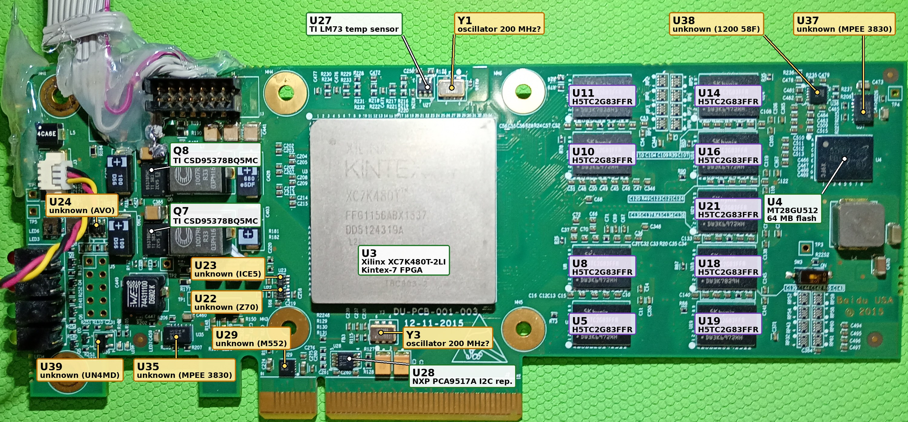

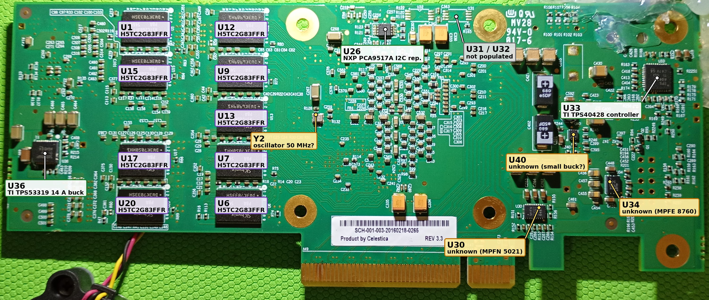

*This workspace's unit (serial `0265`), with every IC labelled.*
- **Label colours:** white box with green border = identified, yellow = unidentified (TODO), grey = not populated. The purple labels sit on the DRAM chips.
- **Size:** the images are 3000 px wide; open them full size to read the small parts.
- **Details:** each IC is described in §1.

| | Front | Back |
|---|---|---|
| Upstream unit (serial `0300`) | 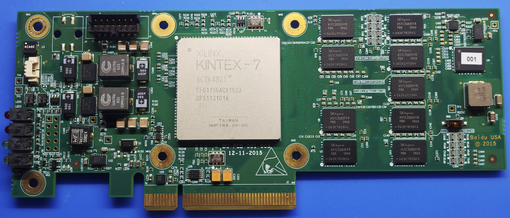 | 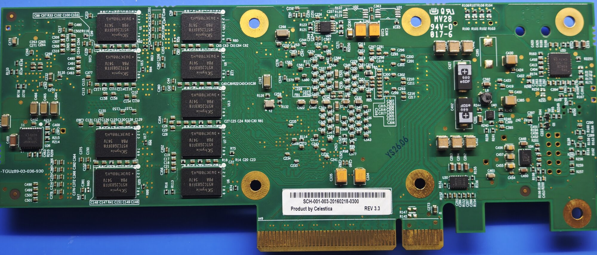 |
| This workspace's unit (serial `0265`) |  | 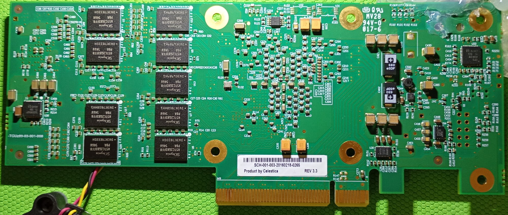 |

A PCIe x8 FPGA accelerator card. The silkscreen says it was designed by Baidu USA in 2015; the label on the back says it was built by Celestica. It carries:

- a Xilinx Kintex-7 **XC7K480T** FPGA (marked **-2LI**, see §1.1),
- 18 SK hynix DDR3L chips, forming two 72-bit ECC channels (4 GB usable),
- a 64 MB parallel NOR flash for configuration,
- an LM73 temperature sensor, a 14-pin JTAG header and a fan connector.

The card is a close relative of the Inspur **YPCB-00338-1P1** ([sibling README](../YPCB-00338-1P1-kintex7-480t/README.md)). Its support repository reuses TiferKing's YPCB-00338-1P1 Vivado board files, constraints and examples **byte for byte**.

| | |
|---|---|
| Silkscreen (front) | `DU-PCB-001-003`, `12-11-2015`, `Baidu USA © 2015` |
| Label (back) | `SCH-001-003-20160218-<serial>`, `Product by Celestica`, `REV 3.3` (barcode) |
| Other names | SCH-001-003, "Baidu 2015 FPGA board" |
| PCB markings (back) | UL `MV28 94V-0 017-6`; edge text `-TGUz89-03-…` (differs per board); some units carry an ink stamp (`YS26.06` on unit 0300) |
| Support repository | [SergeRuff/DU-PCB-001-003](https://github.com/SergeRuff/DU-PCB-001-003) (MIT) |
| Local copy | [`submodules/DU-PCB-001-003`](../../submodules/DU-PCB-001-003) |
| Upstream work | TiferKing: [ypcb_00338_1p1_hack](https://github.com/TiferKing/ypcb_00338_1p1_hack) and [blog post](https://www.tiferking.cn/index.php/2024/12/19/650/) (2024-12-19). omasanori: [sch-001-003-hack](https://github.com/omasanori/sch-001-003-hack) |

**The two units documented here.** The board is identical between them; only the lot and date codes, the U4 sticker and the modifications differ.

| | Unit 0300 (upstream repo photos) | Unit 0265 (this workspace, photographed 2026-11-10) |
|---|---|---|
| Label | `SCH-001-003-20160218-0300` | `SCH-001-003-20160218-0265` |
| Edge text | `-TGUz89-03-036-930` | `-TGUz89-03-001-008` |
| FPGA lot | `FFG1156ACX1533`, `DF5113101A`, `L2I` (faint) | `FFG1156ABX1537`, `DD5124319A`, **`L2I`** (clear) |
| DRAM date codes | `546V` (front), `547V` (back) | `546V` (both sides) |
| U4 (flash) | Covered by a `001` sticker | No sticker: `57AB7` / `RB119` / `X9FC` and a Micron logo |
| Modifications | None visible | Fan on J3; ribbon cable soldered to J1 (§7) |

> [!IMPORTANT]
> **Every pin assignment in this document comes from the YPCB-00338-1P1 files.** The DU-PCB-001-003 repo copies them unchanged and does not document any test results for this board.
>
> **What suggests the two boards share a layout:**
> - All 18 DRAMs carry exactly the designators the YPCB pinout sheet uses (U1 and U5–U21).
> - U26, which the sheet ties to the PCIe SMBus, is an I²C repeater (though its placement suggests it serves the LM73; §1.5).
> - The upstream README says the card "has some compatibility with YPCB-00338-1P1".
>
> **One designator does not match:** the sheet calls the LM73 "U22", but on this card the LM73 is **U27** (§1.4).
>
> Treat anything not marked "seen on the photos" as **inherited, not verified on this card**.

---

## Board map

These diagrams are Mermaid sketches, not to scale. Positions are approximate and read off the photos of both units.
- **Colours:** green = identified IC, purple = DDR3L, yellow = unidentified (TODO), blue = connector, grey = other, dashed outline = unpopulated.
- **Details:** each IC is described in §1.

### Front side

Component side up, bracket on the left, PCIe fingers at the bottom.

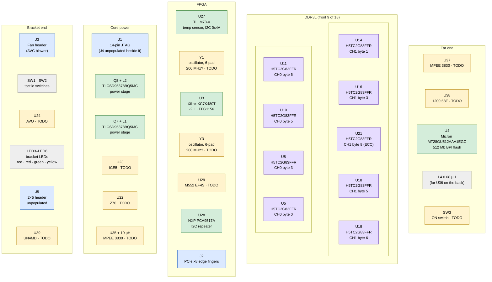

### Back side

Drawn **as seen when the card is flipped** (like the back photo): the far end is on the left and the bracket on the right.


### How the chips connect

- **Solid lines** come from the repo's pin data (`part0_pins.xml`, the MIG `.prj` files, the XDC).
- **Dashed lines** are inferred or unverified: the oscillator-to-pin assignment, the power rails, the I²C repeaters, the LED mapping and which switch is which.

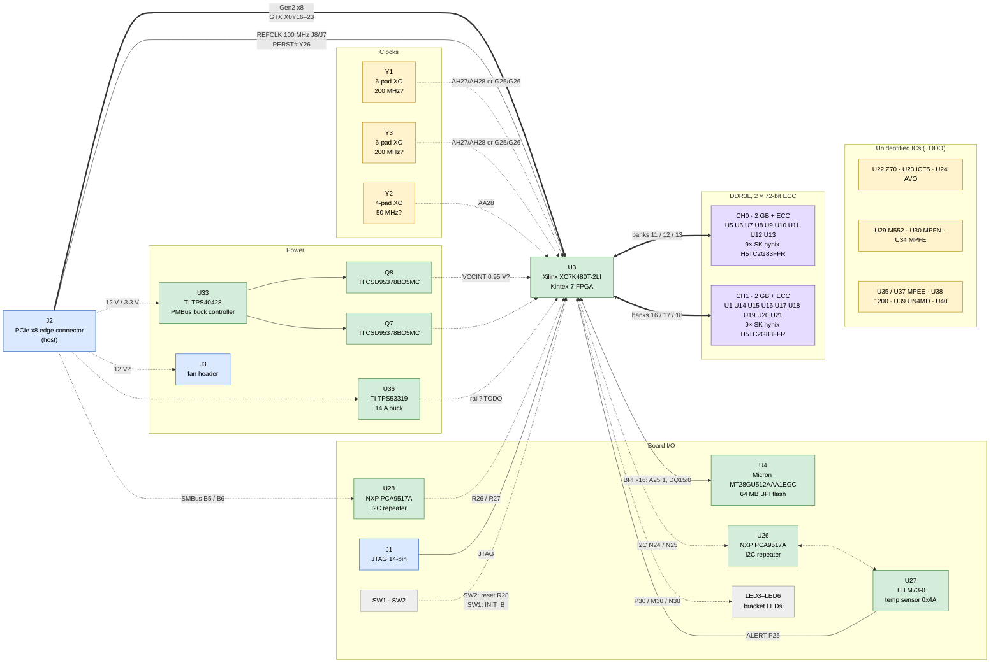

---

## 1. Integrated circuits

Every IC found on the photos, one subsection each. The images come from unit 0265 unless noted. **TODO** marks parts that are not identified or have no datasheet link yet.

| § | Ref | Part | Function | Status |
|---|---|---|---|---|
| [1.1](#11-u3-fpga-xilinx-xc7k480t) | U3 | Xilinx XC7K480T-L2FFG1156I | FPGA | Identified |
| [1.2](#12-u1-u5u21-ddr3l-sk-hynix-h5tc2g83ffr-pba) | U1, U5–U21 | SK hynix H5TC2G83FFR-PBA | DDR3L, 18× | Identified; no official datasheet link (TODO) |
| [1.3](#13-u4-bpi-flash-micron-mt28gu512aaa1egc-0sit) | U4 | Micron MT28GU512AAA1EGC-0SIT | Configuration flash | Identified |
| [1.4](#14-u27-temperature-sensor-ti-lm73-0) | U27 | TI LM73CIMKX-0 | Temperature sensor | Identified |
| [1.5](#15-u26-i2c-repeater-nxp-pca9517a) | U26 | NXP PCA9517ADP | I²C repeater (LM73 bus?) | Identified; role unverified |
| [1.6](#16-u28-i2c-repeater-nxp-pca9517a) | U28 | NXP PCA9517ADP | I²C repeater (PCIe SMBus?) | Identified; role unverified |
| [1.7](#17-u33-ti-tps40428-pmbus-buck-controller) | U33 | TI TPS40428 | Power controller | Identified |
| [1.8](#18-q8-ti-csd95378bq5mc-power-stage) | Q8 | TI CSD95378BQ5MC | Power stage | Identified |
| [1.9](#19-q7-ti-csd95378bq5mc-power-stage) | Q7 | TI CSD95378BQ5MC | Power stage | Identified |
| [1.10](#110-u36-ti-tps53319-buck-converter) | U36 | TI TPS53319 | Buck converter | Identified |
| [1.11](#111-u22-unidentified-z70) to [1.21](#121-u40-unidentified) | U22, U23, U24, U29, U30, U34, U35, U37, U38, U39, U40 | — | — | **TODO** |
| [1.22](#122-y1-oscillator-probably-200-mhz) to [1.24](#124-y2-oscillator-probably-50-mhz) | Y1, Y3, Y2 | — | Oscillators | **TODO** |
| [1.25](#125-u31-and-u32-unpopulated) | U31, U32 | — | Unpopulated footprints | — |

### 1.1 U3: FPGA, Xilinx XC7K480T

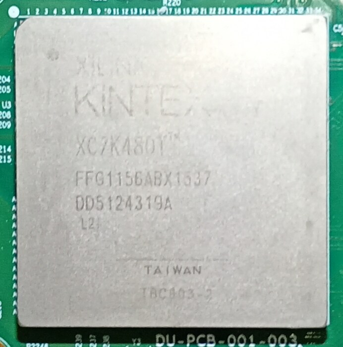

| | |
|---|---|
| Marking | `XILINX KINTEX-7`, `XC7K480T`, `FFG1156ABX1537` (date code 2015, week 37), `DD5124319A`, **`L2I`**, `TAIWAN` |
| Package / location | FFG1156 (35 × 35 mm, 1.0 mm pitch), front, centre. The silkscreen `U3` sits at its left edge |
| Datasheet | [DS182, Kintex-7 DC and AC switching characteristics](https://docs.amd.com/v/u/en-US/ds182_Kintex_7_Data_Sheet); local [7-series product selection guide](../../submodules/DU-PCB-001-003/documents/7-series-product-selection-guide.pdf) |

**Speed grade: probably -2LI, not -2I.**
- The 4th marking line reads **`L2I`**: clearly on unit 0265, faintly on unit 0300. That matches the low-power -2L grade at industrial temperature, ordering code **XC7K480T-L2FFG1156I**.
- The upstream README says "XC7K480T-2FFG1156I", and the board files target `xc7k480tffg1156-2`.
- Per DS182, -2LI devices run at **VCCINT = 0.95 V**, and at that voltage they have the same speed specifications as -2. So timing from the `-2` part is equivalent, but the core supply must be 0.95 V.
- Vivado lists the low-voltage variant under a different part name. Check it with `get_parts xc7k480t*ffg1156*`.
- **TODO:** measure the board's VCCINT. The likely VCCINT regulator is U33 with Q7/Q8.

**Resources** (from the selection guide):

| | |
|---|---|
| Logic | 477,760 logic cells, 74,650 slices, 597,200 CLB flip-flops |
| Memory | 955 × 36 Kb block RAM (34,380 Kb in total), 6,788 Kb distributed RAM |
| DSP and clocking | 1,920 DSP48E1 slices, 8 CMTs |
| Hard blocks | 1 PCIe Gen2 block, 1 XADC, 1 AES/HMAC configuration block |
| Transceivers | 32 GTX. The family maximum is 12.5 Gb/s; the limit depends on speed grade, see DS182 |
| FFG1156 package | 400 HR I/Os and **0 HP I/Os**, up to 192 differential pairs |

### 1.2 U1, U5–U21: DDR3L, SK hynix H5TC2G83FFR-PBA

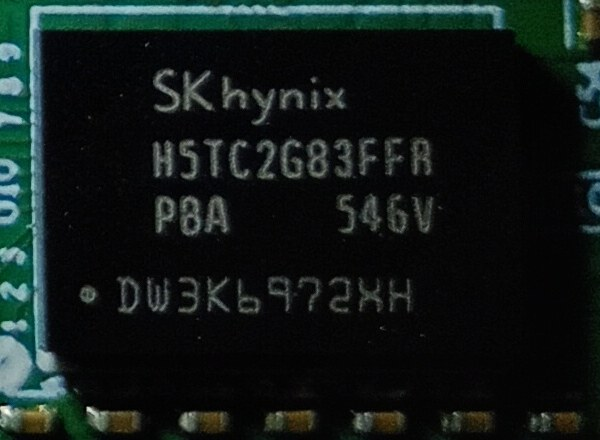

| | |
|---|---|
| Marking | `SKhynix`, `H5TC2G83FFR`, `PBA`, date code (`546V`/`547V`), lot code (`DW3K6972HH`, `DW3K7028H1` and others) |
| Package | 78-ball FBGA (x8) |
| Datasheet | **TODO:** SK hynix no longer hosts it. An unofficial copy of the FFR family datasheet (Rev 1.0, Nov 2012) is listed at [dtsheet.com](https://dtsheet.com/model/1811300). The Micron part the MIG presets target is in the repo: [MT41K256M8DA-125](../../submodules/DU-PCB-001-003/documents/MT41K256M8DA-125.PDF) |

**What the part is:** a 2 Gb (256M × 8) DDR3L chip, 1.35 V and 1.5 V capable, with 8 banks, 32K rows and 1K columns.
- **Speed bin:** `PB` is the DDR3L-1600 (11-11-11) bin in the FFR family datasheet. `A` should be the commercial-temperature suffix (TODO: confirm).
- **On YPCB-00338-1P1** these positions hold Micron MT41K256M8DA-125:K chips, which have the same geometry. See §4 for what that means for the MIG presets.

**Which chip is where:**

| Channel | Byte 0 | 1 | 2 | 3 | 4 | 5 | 6 | 7 | 8 (ECC) |
|---|---|---|---|---|---|---|---|---|---|
| CH0 | U5 (front) | U6 (back) | U7 (back) | U8 (front) | U9 (back) | U10 (front) | U11 (front) | U12 (back) | U13 (back) |
| CH1 | U1 (back) | U14 (front) | U15 (back) | U16 (front) | U17 (back) | U18 (front) | U19 (front) | U20 (back) | U21 (front) |

### 1.3 U4: BPI flash, Micron MT28GU512AAA1EGC-0SIT

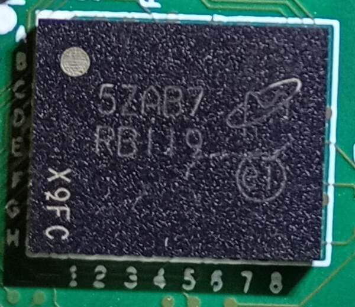

| | |
|---|---|
| Marking (unit 0265) | Micron logo, `57AB7`, **`RB119`** (Micron FBGA code), `X9FC`. On unit 0300 the chip is under a `001` sticker |
| Package / location | 64-ball TBGA, 10 × 8 mm (8 × 8 ball grid on the silkscreen); front, far end of the card |
| Datasheet | Local copy: [256Mb/512Mb/1Gb StrataFlash, Micron Rev I](../../submodules/DU-PCB-001-003/documents/MT28GU512AAA1EGC-0SIT.pdf). Part page: [Octopart](https://octopart.com/part/micron/MT28GU512AAA1EGC-0SIT). **TODO:** link Micron's official page or decode `RB119` with Micron's FBGA decoder |

**What the part is:** 512 Mb (64 MB) parallel NOR flash, x16, 1.7–2.0 V core and I/O, 96 ns initial access. It configures the FPGA in BPI x16 mode and can also be read and written from user logic. See §5 for pins and settings.

### 1.4 U27: Temperature sensor, TI LM73-0

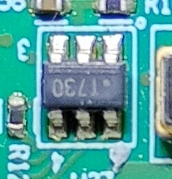

| | |
|---|---|
| Marking | **`T730`** = LM73CIMK(X)**-0**, according to TI's orderable addendum |
| Package / location | SOT-23-6, front, top edge, next to Y1 |
| Datasheet | [TI LM73](https://www.ti.com/lit/ds/symlink/lm73.pdf), local [copy](../../submodules/DU-PCB-001-003/documents/lm73.pdf) |

**What the part is:** an I²C/SMBus temperature sensor with an open-drain ALERT output, 2.7–5.5 V supply.
- **Address:** **0x4A**. On the LM73-0 that means the ADDR pin is tied to VDD, consistent with the marking.
- **Wiring:** SCL N24, SDA N25, ALERT P25.
- **Registers:** see §13.

> **Correction:** the YPCB pinout sheet and earlier notes put the LM73 at U22. On DU-PCB-001-003, U22 is a different part (§1.11).

### 1.5 U26: I2C repeater, NXP PCA9517A

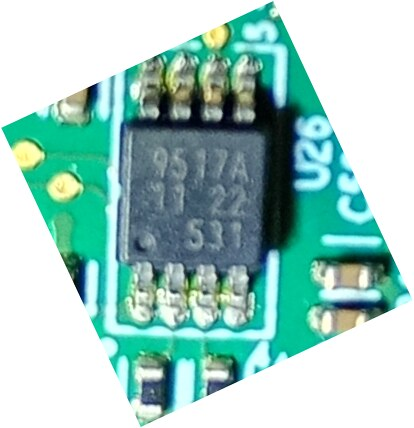

| | |
|---|---|
| Marking | `9517A`, `11 22`, `S31`. NXP uses the top mark `9517A` for the PCA9517ADP (TSSOP8) |
| Package / location | TSSOP-8 (3 mm), back, near the top edge |
| Datasheet | [NXP PCA9517A](https://www.nxp.com/docs/en/data-sheet/PCA9517A.pdf) (Rev 4.1, 2016). TI makes a second source: [TI PCA9517A](https://www.ti.com/lit/ds/symlink/pca9517a.pdf) |
| SMBus background | [NXP/Freescale AN4471, "SMBus Quick Start Guide"](https://www.nxp.com/docs/en/application-note/AN4471.pdf) |

**What the part is:** a level-translating I²C/SMBus repeater for **one** bus; its two channels are that bus's SCL and SDA.
- **Port A** is the low-voltage side (0.9–5.5 V). **Port B** is the 2.7–5.5 V side.
- **TSSOP8 pinout:** 1 VCC(A), 2 SCLA, 3 SDAA, 4 GND, 5 EN, 6 SDAB, 7 SCLB, 8 VCC(B).

**Which bus it serves: probably the LM73 bus, not the PCIe SMBus.**
- The YPCB pinout sheet lists the FPGA's PCIe SMBus pins (R26/R27) under "U26 / PCIE".
- On this card, though, U26 sits on the back **directly behind the LM73 (U27)**, while U28 sits next to the PCIe SMBus contacts.
- The same sheet already gets the LM73's designator wrong (U22 instead of U27), so its "U26" is probably a YPCB designator too.
- **TODO:** confirm with the continuity test in [Why two I2C repeaters?](#why-two-i2c-repeaters)

### 1.6 U28: I2C repeater, NXP PCA9517A

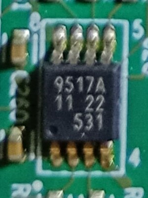

| | |
|---|---|
| Marking | `9517A`, `11 22`, `S31` |
| Package / location | TSSOP-8, front, next to the PCIe edge connector, below Y3 |
| Datasheet | [NXP PCA9517A](https://www.nxp.com/docs/en/data-sheet/PCA9517A.pdf) |
| SMBus background | [NXP/Freescale AN4471, "SMBus Quick Start Guide"](https://www.nxp.com/docs/en/application-note/AN4471.pdf) |

This is the same part as U26. **It probably serves the PCIe SMBus:** it sits next to the short segment of the edge connector, which carries SMCLK (B5) and SMDAT (B6). **TODO:** confirm with the test below.

#### Why two I2C repeaters?

**Short answer:** each repeater carries one bus, and there are two buses.
- The FPGA drives **two separate I²C buses**.
- Both buses run at **3.3 V-class levels**, while the FPGA's pins are **1.8 V**.
- One PCA9517A can carry only **one** bus.

**1. There are two independent buses.** The board files define two I²C interfaces on different FPGA pins, and the example design gives each its own `axi_iic` core (IIC 0 at `0x4080_0000`, IIC 1 at `0x4081_0000`).

| Bus (board interface) | FPGA pins | Other end | Who controls it |
|---|---|---|---|
| `iic_lm73` | SCL N24, SDA N25, plus ALERT on P25 | LM73 temperature sensor U27, address 0x4A | The FPGA (the only controller) |
| `iic_pcie` | SCL R26, SDA R27 | PCIe edge connector, SMCLK on B5 and SMDAT on B6 | The host. Its system-management controller (BMC) is normally the master, and the card answers as a target |

**2. Both buses need level translation.**
- The FPGA pins are `LVCMOS18` in a 1.8 V bank. 7-series HR inputs tolerate only VCCO + 0.55 V (DS182), about 2.35 V here, so a 3.3 V bus would overstress them.
- SMBus requires a nominal bus voltage of 2.7–5.5 V with fixed logic thresholds: VIL ≤ 0.8 V, VIH ≥ 2.1 V (AN4471, Table 2). The PCIe SMBus runs at 3.3 V.
- The LM73 needs a 2.7–5.5 V supply, and its open-drain bus is pulled up to that supply.
- So each bus gets a PCA9517A: **port A** on the FPGA's 1.8 V side, **port B** on the 3.3 V side.

**3. One PCA9517A carries one bus.** "2 channel" in the datasheet means SCL and SDA of a single bus, so two buses need two chips.

**4. Why not merge the sensor onto the host's SMBus and save a chip?**
- **Ownership:** the PCIe SMBus belongs to the host and can be shared with other cards. On a private bus, the host never sees the LM73 or collides with address 0x4A, and the FPGA is the only controller on the sensor's bus.
- **Power:** the host's SMBus may stay alive while the card is switched off. AN4471 says powered-down devices must not load the bus. The PCA9517A's I²C pins go high-impedance when it is unpowered (datasheet feature list), so a switched-off card stays invisible to the host.
- **Capacitance:** each side of a PCA9517A may carry up to 400 pF, so the card's internal wiring does not add to the host bus's load.

**How to check which repeater is which.** Do this with the board unpowered, the multimeter in continuity mode. PCIe finger B1 is the one nearest the bracket on the short segment, on the front side. On the TSSOP8 chips, pin 1 is the corner next to the dot.

| Probe from | Probe to (try both chips) | A beep means |
|---|---|---|
| Edge finger B5 (SMCLK) | U28 pin 7 (SCLB); U26 pin 7 | That chip is the PCIe SMBus repeater |
| Edge finger B6 (SMDAT) | U28 pin 6 (SDAB); U26 pin 6 | Confirms it |
| U27 pin 4 (LM73 SMBCLK) | U26 pin 7 (SCLB); U28 pin 7 | That chip is the LM73 repeater |
| U27 pin 6 (LM73 SMBDAT) | U26 pin 6 (SDAB); U28 pin 6 | Confirms it |

LM73 (SOT-23-6) pinout: 1 ADDR, 2 GND, 3 VDD, 4 SMBCLK, 5 ALERT, 6 SMBDAT.

### 1.7 U33: TI TPS40428 PMBus buck controller

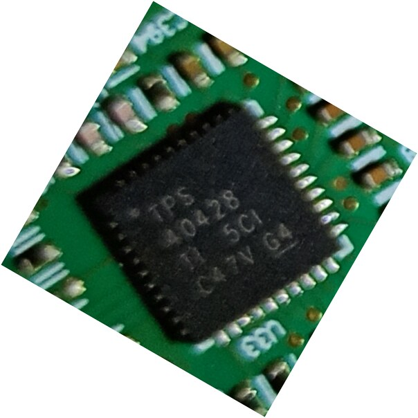

| | |
|---|---|
| Marking | `TPS 40428`, `TI 5CI`, `C47V G4` |
| Package / location | QFN-40 (6 × 6 mm), back, bracket end |
| Datasheet | [TI TPS40428](https://www.ti.com/lit/ds/symlink/tps40428.pdf) |

**What the part is:** a dual-output or two-phase synchronous buck controller with PMBus. It is "driverless", meaning it drives external smart power stages such as Q7 and Q8.
- **Probable rail:** together with Q7/Q8 and the 0.33 µH inductors L1/L2, it most likely forms the FPGA core rail (VCCINT, 0.95 V for a -2LI part). **Not verified.**
- **PMBus:** its PMBus connection (if any) to the FPGA or the edge connector is unknown (TODO).

### 1.8 Q8: TI CSD95378BQ5MC power stage

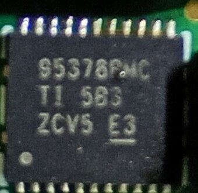

| | |
|---|---|
| Marking | `95378BMC`, `TI 5B3`, `ZCV5 E3` |
| Package / location | SON 5 × 6 mm with DualCool (exposed top); front, left of the FPGA (the upper of the two stages), feeding inductor L2 |
| Datasheet | [TI CSD95378BQ5MC](https://www.ti.com/lit/ds/symlink/csd95378bq5mc.pdf) |

**What the part is:** a synchronous buck NexFET smart power stage: driver plus high- and low-side FETs in one package. It is one phase of the U33 regulator (§1.7).

### 1.9 Q7: TI CSD95378BQ5MC power stage

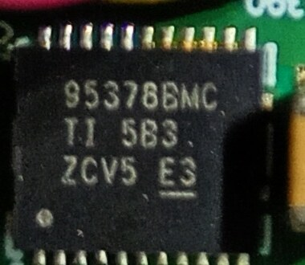

| | |
|---|---|
| Marking | `95378BMC`, `TI 5B3`, `ZCV5 E3` |
| Package / location | SON 5 × 6 mm, front, the lower of the two stages, feeding inductor L1 |
| Datasheet | [TI CSD95378BQ5MC](https://www.ti.com/lit/ds/symlink/csd95378bq5mc.pdf) |

This is the second phase (or second output) of the U33 regulator.

### 1.10 U36: TI TPS53319 buck converter

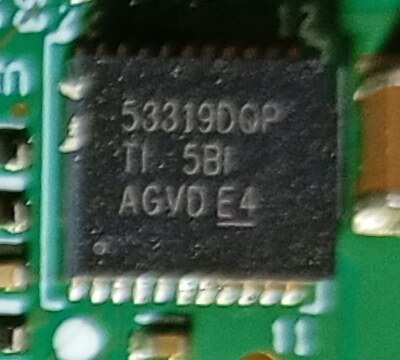

| | |
|---|---|
| Marking | `53319DQP`, `TI 5BI`, `AGVD E4` (the same on both units) |
| Package / location | 22-pin LSON-CLIP (5 × 6 mm), back, far end of the card |
| Datasheet | [TI TPS53319](https://www.ti.com/lit/ds/symlink/tps53319.pdf) |

**What the part is:** a 14 A synchronous buck converter with integrated MOSFETs and Eco-mode. Its inductor is probably **L4** (0.68 µH), on the front directly opposite. **TODO:** which rail it produces (perhaps a DDR3 or auxiliary rail).

### 1.11 U22: Unidentified (`Z70`)

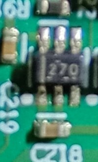

| | |
|---|---|
| Marking | `Z70` (it could also read `270` or `Z7Q`) |
| Package / location | SOT-23-6, front, below the FPGA's lower-left corner, next to U23 |
| Datasheet | **TODO:** identify the part |

The pinout sheet calls U22 the LM73, but the LM73 is U27. This part's function is unknown.

### 1.12 U23: Unidentified (`ICE5`)

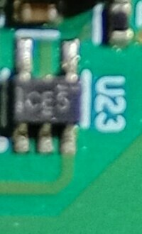

| | |
|---|---|
| Marking | `ICE5` |
| Package / location | SOT-23-5, front, directly above U22 |
| Datasheet | **TODO:** identify the part |

### 1.13 U24: Unidentified (`AVO`)

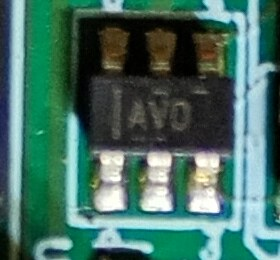

| | |
|---|---|
| Marking | `AVO`, with a bar at one end (unit 0300's photo reads like `DAY`). The orientation is uncertain |
| Package / location | SOT-23-6, front, next to SW1/SW2 near the bracket |
| Datasheet | **TODO:** identify the part. Being next to the push buttons, it could be a reset or supervisor IC |

### 1.14 U29: Unidentified (`M552 EF4S`)

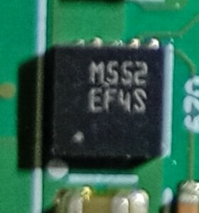

| | |
|---|---|
| Marking | `M552`, `EF4S` |
| Package / location | Small QFN/DFN, front, next to the short segment of the PCIe edge connector (pins B1–B11) |
| Datasheet | **TODO:** identify the part |

### 1.15 U30: Unidentified (`MPFN 5021 B485`)

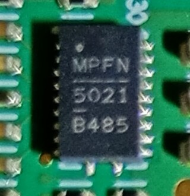

| | |
|---|---|
| Marking | `MPFN`, `5021`, `B485` (the same on both units) |
| Package / location | Leadless package with pins on two sides (about 20 pins), back, near the edge connector at the bracket end |
| Datasheet | **TODO:** identify the part |

### 1.16 U34: Unidentified (`MPFE 8760 501E`)

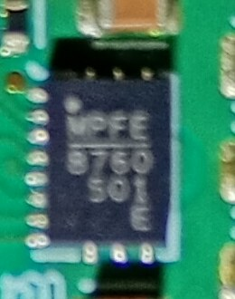

| | |
|---|---|
| Marking | `MPFE`, `8760`, `501E` |
| Package / location | QFN/DFN, back, bracket end, next to J5's pads |
| Datasheet | **TODO:** identify the part. It has the same marking style as U30, U35 and U37 |

### 1.17 U35: Unidentified (`MPEE 3830 854 M`)

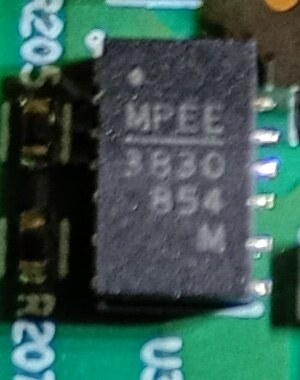

| | |
|---|---|
| Marking | `MPEE`, `3830`, `854`, `M` |
| Package / location | DFN (pins on two sides), front, bracket end, next to the Würth 744311100 10 µH inductor |
| Datasheet | **TODO:** identify the part. It is the same part as U37. Being next to a 10 µH power inductor suggests a DC-DC converter or controller |

### 1.18 U37: Unidentified (`MPEE 3830 854 M`)

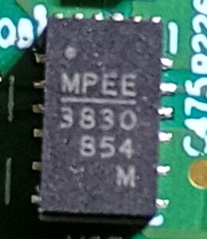

| | |
|---|---|
| Marking | `MPEE`, `3830`, `854`, `M` |
| Package / location | DFN, front, far end of the card next to U4 and TP4 |
| Datasheet | **TODO:** identify the part. It is the same as U35 |

### 1.19 U38: Unidentified (`1200 58F S06Z`)

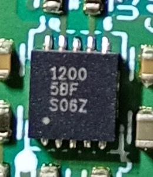

| | |
|---|---|
| Marking | `1200`, `58F`, `S06Z` |
| Package / location | QFN-16 (about 3 × 3 mm), front, far end of the card near U37 |
| Datasheet | **TODO:** identify the part |

### 1.20 U39: Unidentified (`UN4MD`)

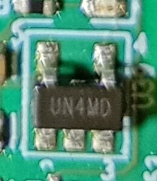

| | |
|---|---|
| Marking | `UN4MD` |
| Package / location | SOT-23-5, front, bracket end next to the LED stack and LED7/LED8 |
| Datasheet | **TODO:** identify the part |

### 1.21 U40: Unidentified

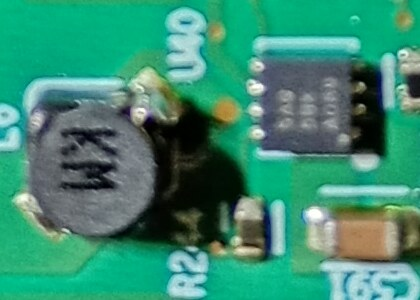

| | |
|---|---|
| Marking | Unreadable on the photos |
| Package / location | Small 8-pin package, back, next to the small inductor L6 |
| Datasheet | **TODO:** identify the part. With L6 next to it, it is probably a small buck converter |

### 1.22 Y1: Oscillator (probably 200 MHz)

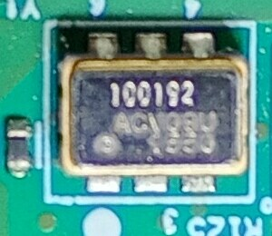

| | |
|---|---|
| Marking | `100192`, `ACV08U`(?), `1550` |
| Package / location | 6-pad ceramic, about 7 × 5 mm; front, top edge, between U27 and MH6 |
| Datasheet | **TODO:** identify the maker and part |

6-pad packages are typical of differential (LVDS) oscillators, so this is probably one of the two 200 MHz clocks: AH27/AH28 for CH0, or G25/G26 for CH1.

### 1.23 Y3: Oscillator (probably 200 MHz)

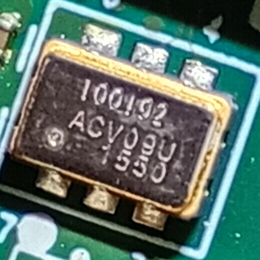

| | |
|---|---|
| Marking | `100192`, `ACV08U`(?), `1550`, the same as Y1 |
| Package / location | 6-pad ceramic, front, below the FPGA, next to the `DU-PCB-001-003` silkscreen |
| Datasheet | **TODO:** identify the maker and part |

This is probably the other 200 MHz clock.

### 1.24 Y2: Oscillator (probably 50 MHz)

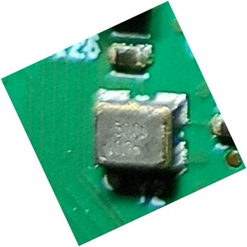

| | |
|---|---|
| Marking | Unreadable |
| Package / location | 4-pad, about 3.2 × 2.5 mm, back, near the centre (close to R126/R132) |
| Datasheet | **TODO:** identify the part |

4 pads means a single-ended output, so this is probably the 50 MHz system clock on AA28. The YPCB notes also put the 50 MHz clock on the back.

### 1.25 U31 and U32: Unpopulated

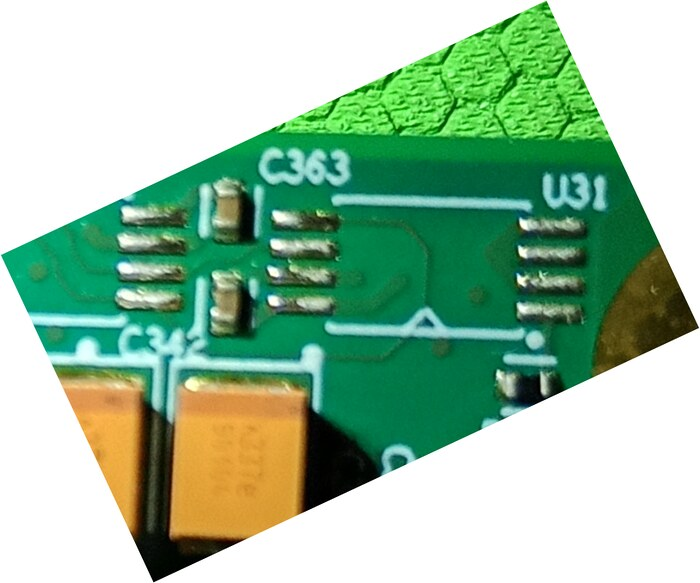

Both are empty footprints on the back near the top edge, next to C363. U32 is an 8-pad TSSOP/MSOP footprint and U31 a smaller one. They are empty on both units.

**Designators not found on any photo:** U2 and U25. These may be unused designators.

---

## 2. Connectors, LEDs and switches (seen on the photos)

| Ref | What | Notes |
|---|---|---|
| J2 | PCIe x8 edge connector | Pins A1–A49 on the back and B1–B49 on the front |
| J1 | 14-pin (2×7) shrouded header | JTAG (§7). Pin 1 is marked by a triangle next to the `J1` label; the even pins are on the row nearest the board edge |
| J3 | 4-pin white wire-to-board connector | **Fan header (confirmed on unit 0265).** An AVC **BAZA0509R2U** blower (12 V, 0.18 A, hydraulic bearing, rev `.002`) plugs in with 3 wires: black, red and yellow (probably ground, +12 V and tach); the 4th position is empty. No fan PWM or tach pin appears in the board files (TODO) |
| J4 | Unpopulated footprint | 4 SMD pads and 2 holes, left of J1. On unit 0265 it is buried under hot glue |
| J5 | Unpopulated 2×5 through-hole header | Near the bracket LEDs. Purpose unknown |
| LED3–LED6 | 4 right-angle LEDs at the bracket edge | Colors (from unit 0265, seen from the back): **red, red, green, yellow**. **The board files define only 3 user LEDs** (red, green, yellow on P30/M30/N30; §3). Which bracket LED each pin drives is unverified |
| LED7, LED8, LED9, LED12 | Small SMD LEDs | LED7 and LED8 are next to U39, LED9 next to R157 and LED12 next to J3. There may be more. None is mentioned in any file |
| SW1, SW2 | 2 ALPS tactile switches | Near the bracket. On the YPCB, SW2 is the user reset on R28 and SW1 is wired to `INIT_B` |
| SW3 | 1-position slide/DIP switch, marked `ON` | Front, far end of the card near TP3. Not mentioned in any file; function unknown (TODO) |
| TP1–TP6 | Test points | TP1, TP2, TP5 and TP6 are at the bracket end; TP3 and TP4 are at the far end |
| MH1–MH6 | Mounting holes | Six plated holes. The blower's black shroud may be part of the original heatsink assembly (not confirmed) |

---

## 3. Clocks, reset, LEDs and I²C

Sources: `part0_pins.xml`, `constraints/ypcb003381p1.xdc` and `physical_pinout.xlsx`.

| Signal | FPGA pin | I/O standard | Notes |
|---|---|---|---|
| 50 MHz system clock | AA28 | LVCMOS18 | Single-ended, probably Y2. Board interface `default_50mhz_clk0`; port `SYS_CLK` in the XDC |
| 200 MHz clock 1 (P / N) | AH27 / AH28 | Board file: `LVDS`, `DQS_BIAS=TRUE` | Bank 12, clock-capable pair. System clock for DDR3 **CH0** |
| 200 MHz clock 2 (P / N) | G25 / G26 | Board file: `LVDS`, `DQS_BIAS=TRUE` | Bank 17, clock-capable pair. System clock for DDR3 **CH1** |
| PCIe reference clock (P / N) | J8 / J7 | MGT | 100 MHz from the edge connector. Buffer it with `IBUFDSGTE` |
| PCIe `PERST#` | Y26 | LVCMOS18 | Active low |
| User reset (`SW_RESET` / `SYS_RSTN`) | R28 | LVCMOS18 | Push button, active low. On the YPCB this is SW2 |
| LED red / green / yellow | P30 / M30 / N30 | LVCMOS18, 8 mA, slow slew | GPIO bits 0 / 1 / 2, active high |
| LM73 SCL / SDA | N24 / N25 | LVCMOS18, 8 mA, slow slew | I²C bus to the LM73 (U27), probably through U26 (§1.6) |
| LM73 ALERT | P25 | LVCMOS18 | Input to the FPGA (temperature alert) |
| PCIe SMBus SCL / SDA | R26 / R27 | LVCMOS18, 8 mA, slow slew | To edge fingers B5/B6, probably through U28. The pinout sheet says U26 (§1.6) |

> [!WARNING]
> **The board file's `LVDS` standard is not valid on these pins.** Vivado accepts `LVDS` only in HP banks, and this package has only HR banks.
> - In the example design the 200 MHz pins feed MIG directly, and MIG constrains them as **`DIFF_SSTL15`**.
> - If you connect `default_200mhz_clk1/2` to `clk_wiz` or `util_ds_buf` through the board flow, override the I/O standard (for example to `DIFF_SSTL15`).
> - The presets also set `util_ds_buf` to `IBUFDSGTE`, which is a transceiver reference-clock buffer. Use `IBUFDS` for these fabric pins.

---

## 4. DDR3 memory

The card has two independent channels. Each channel is 72 bits wide: 9 x8 chips giving 64 data bits plus 8 ECC bits.

| | |
|---|---|
| Per channel | 2 GB data + 256 MB ECC |
| Whole card | **4 GB usable**, 4.5 GB raw (18 × 256 MB) |

| | CH0 | CH1 |
|---|---|---|
| Chips | U5–U13 | U1, U14–U21 |
| FPGA banks | 11, 12, 13 (address/control in bank 12) | 16, 17, 18 (address/control in bank 17) |
| System clock | 200 MHz clock 1: AH27/AH28 (bank 12) | 200 MHz clock 2: G25/G26 (bank 17) |
| Pin files | `constraints/MEMORY_CH0.ucf`, `mig_0.prj` | `constraints/MEMORY_CH1.ucf`, `mig_1.prj` |

### MIG configuration (`mig_0.prj`, `mig_1.prj`, `mig_01.prj`; MIG 7 Series v4.2)

**Speed and clocks**

| Setting | Value |
|---|---|
| Clock period | **1875 ps**: 533.33 MHz memory clock, so the interface runs at **DDR3-1066**. The chips are rated faster |
| PHY-to-controller ratio | 4:1, so `ui_clk` is about 133 MHz |
| PLL | 200 MHz input × 16 / 3 = 1066.67 MHz VCO |
| Input clock | 200 MHz differential; reference clock set to "Use System Clock" |
| `sys_rst` | Active low |

**Memory and controller**

| Setting | Value |
|---|---|
| Memory part | `DDR3_SDRAM/Components/MT41K256M8XX-125`; the equivalent part is MT41K256M8DA-125 |
| Width | 72 bits, **ECC enabled**, data mask disabled |
| Addressing | 15 row, 10 column and 3 bank address bits; `BANK_ROW_COLUMN` mapping |
| Controller | 4 bank machines, normal ordering |
| Mode registers | BL8 (fixed), sequential bursts, CL 7, CWL 6, AL 0, DLL on |
| Drive and termination | Output drive RZQ/7, RTT_NOM RZQ/4, dynamic ODT off |
| Refresh | Auto self-refresh on, full-array self-refresh, normal temperature range |
| Timing | tCKE 5, tFAW 30 ns, tRAS 35 ns, tRCD 13.75 ns, tREFI 7.8 µs, tRFC 160 ns, tRP 13.75 ns, tRRD 6 ns, tRTP 7.5 ns, tWTR 7.5 ns |
| AXI4 slave port | 512-bit data, 31-bit address (2 GB), 4-bit ID, `RD_PRI_REG` arbitration, no narrow bursts |

**Electrical and I/O**

| Setting | Value |
|---|---|
| Memory voltage option | 1.5 V (VCCAUX_IO 1.8 V) |
| DCI and termination | DCI on DQ/DQS; 50 Ω internal termination on the HR banks; internal VREF off |
| I/O power reduction | On |
| XADC | MIG instantiates the XADC for temperature tracking. The device has only one XADC, so to use it yourself, disable it in MIG and drive `device_temp_i` |
| I/O standards in the example's routed checkpoint | `SSTL15` on address, command and DQ; `DIFF_SSTL15` on CK and DQS; `IN_TERM UNTUNED_SPLIT_50` on DQ/DQS; `LVCMOS15` on `RESET#`; fast slew |

**Which preset to use:** `mig_01.prj` is one MIG core with both controllers (board interface `ddr3_sdram_ch01`, 4 GB). Its pin set is exactly the union of `mig_0.prj` and `mig_1.prj`. I checked this, and also that both `.ucf` files match their `.prj` files pin for pin.

> [!NOTE]
> **DU-PCB-specific: the presets were built for Micron chips.** The card has SK hynix H5TC2G83FFR chips, but the presets target the Micron MT41K256M8 (-125). Both parts have the same geometry: 2 Gb, x8, 8 banks, 32K rows (A[14:0]), 1K columns (A[9:0]).
> - The presets run at DDR3-1066 with JEDEC-typical timings for a 2 Gb part, so they should be conservative for a 1600-rated chip.
> - That reasoning was **not** checked against a Hynix datasheet, and the board's actual VDDQ (1.35 V or 1.5 V) is not documented anywhere in the repo. **TODO:** measure VDDQ.

### Bank and byte-group placement (from the MIG `datasheet.txt`)

| Bank | T0 | T1 | T2 | T3 |
|---|---|---|---|---|
| 11 (CH0) | DQ[23:16] | DQ[15:8] | DQ[7:0] | DQ[31:24] |
| 12 (CH0) | Addr/Ctrl-1 | Addr/Ctrl-0 | Addr/Ctrl-2 | DQ[63:56] |
| 13 (CH0) | DQ[55:48] | DQ[47:40] | DQ[39:32] | DQ[71:64] |
| 16 (CH1) | DQ[7:0] | DQ[15:8] | DQ[31:24] | DQ[71:64] |
| 17 (CH1) | Addr/Ctrl-2 | Addr/Ctrl-0 | Addr/Ctrl-1 | DQ[47:40] |
| 18 (CH1) | DQ[55:48] | DQ[63:56] | DQ[39:32] | DQ[23:16] |

<details>
<summary>DDR3 address/control pins</summary>

| Signal | CH0 | CH1 |
|---|---|---|
| A0 | AK27 | E27 |
| A1 | AN23 | C27 |
| A2 | AL24 | B28 |
| A3 | AK26 | D27 |
| A4 | AH24 | C24 |
| A5 | AH25 | D24 |
| A6 | AL26 | C25 |
| A7 | AJ24 | A24 |
| A8 | AJ25 | A25 |
| A9 | AM23 | J24 |
| A10 | AL28 | F26 |
| A11 | AL25 | D26 |
| A12 | AM25 | H25 |
| A13 | AK24 | D25 |
| A14 | AM27 | B26 |
| BA0 | AM26 | F24 |
| BA1 | AP24 | J25 |
| BA2 | AN28 | E24 |
| CK_P | AN25 | B25 |
| CK_N | AP25 | A26 |
| CKE | AP27 | A28 |
| CS# | AK28 | F28 |
| RAS# | AJ29 | E28 |
| CAS# | AP26 | E26 |
| WE# | AN27 | F25 |
| ODT | AK29 | B27 |
| RESET# | AD31 | F18 |

</details>

<details>
<summary>DDR3 data pins: which chip drives which byte lane, and which side of the board it is on</summary>

The chip-to-lane mapping comes from `physical_pinout.xlsx`. I cross-checked it against the MIG `.prj` files, and all 18 chips match. The "Side" column comes from the photos of both units.

**CH0**

| Byte | Chip | Side | Bank | DQ bits | DQ pins (bit order, low to high) | DQS P / N |
|---|---|---|---|---|---|---|
| 0 | U5 | front | 11 | 7:0 | AG17 AG16 AH17 AJ19 AH18 AH19 AJ16 AJ17 | AK16 / AK17 |
| 1 | U6 | back | 11 | 15:8 | AL20 AN17 AL19 AM16 AL18 AL16 AM20 AN18 | AM17 / AM18 |
| 2 | U7 | back | 11 | 23:16 | AL23 AN20 AK23 AP19 AN22 AN19 AM22 AP20 | AP21 / AP22 |
| 3 | U8 | front | 11 | 31:24 | AJ21 AH22 AK21 AG21 AG22 AG20 AH23 AG23 | AH20 / AJ20 |
| 4 | U9 | back | 13 | 39:32 | AJ32 AK32 AK31 AL30 AL34 AL31 AK34 AL29 | AK33 / AL33 |
| 5 | U10 | front | 13 | 47:40 | AJ34 AH32 AJ30 AH34 AF31 AG30 AG31 AF30 | AG33 / AH33 |
| 6 | U11 | front | 13 | 55:48 | AE32 AC33 AF33 AC32 AD34 AC34 AE33 AE31 | AE34 / AF34 |
| 7 | U12 | back | 12 | 63:56 | AE26 AF29 AE24 AF28 AF24 AG25 AF26 AF25 | AE27 / AE28 |
| 8 (ECC) | U13 | back | 13 | 71:64 | AN34 AP30 AM33 AN29 AP32 AP29 AM31 AP31 | AN32 / AP33 |

**CH1**

| Byte | Chip | Side | Bank | DQ bits | DQ pins (bit order, low to high) | DQS P / N |
|---|---|---|---|---|---|---|
| 0 | U1 | back | 16 | 7:0 | A29 B33 A31 C33 C32 A30 B30 A33 | B31 / B32 |
| 1 | U14 | front | 16 | 15:8 | D31 F33 D30 D29 E33 E34 E31 F34 | D34 / C34 |
| 2 | U15 | back | 18 | 23:16 | B23 A21 C23 B20 B22 A23 C20 B21 | A19 / A20 |
| 3 | U16 | front | 16 | 31:24 | G31 G32 F29 F31 E29 G33 H33 H32 | H29 / H30 |
| 4 | U17 | back | 18 | 39:32 | B18 C17 C19 B16 A18 A16 C18 B17 | D16 / D17 |
| 5 | U18 | front | 17 | 47:40 | K27 L24 K24 L28 K26 M27 L25 M26 | K28 / K29 |
| 6 | U19 | front | 18 | 55:48 | F16 E18 E16 H19 H17 H20 E17 H18 | G17 / G18 |
| 7 | U20 | back | 18 | 63:56 | D20 F21 E23 G21 G20 D21 F20 F23 | G22 / G23 |
| 8 (ECC) | U21 | front | 16 | 71:64 | L34 K34 K31 K33 L31 J30 L33 J34 | K32 / J32 |

</details>

---

## 5. BPI configuration flash

The flash (U4, §1.3) both configures the FPGA at power-up and can be read and written from user logic.

**Wiring.** The flash is connected through 25 address lines `A[25:1]`, 16 data lines `DQ[15:0]`, and the control lines `ADV#`, `CE#`, `OE#` and `WE#`, all LVCMOS18.
- There is no `A0` because the flash is word-addressed: 2^25 words × 2 bytes = 64 MB.
- No `WAIT` or `CLK` pin is mapped, so only asynchronous access is possible.

**Part summary** (from the Micron datasheet in `documents/`):

| Item | Value |
|---|---|
| Density and interface | 512 Mb, x16, non-multiplexed (part-number code `1`), 65 nm, die revision A |
| Supply | Core and I/O 1.7–2.0 V |
| Array | 256 KB uniform blocks (256 blocks), 8 partitions of 64 Mb |
| Read | 96 ns initial access; synchronous burst up to 133 MHz (not used here) |
| Program and erase | Buffered programming, 2.0 µs per word (typical); block erase 0.9 s (typical) |
| Interface standard | CFI |
| Security | 64-bit unique ID plus 2112 bits of user OTP |
| Package | 64-ball TBGA, 10 × 8 × 1.2 mm (`GC`) |
| Temperature | –40…+85 °C |
| Endurance | 100k erase cycles per block, 20 years data retention |

**In Vivado.** The board interface `bpi_flash` uses `axi_emc` with the preset below. The example design maps the flash as a 64 MB window at `0x6000_0000`.

| Setting | Value |
|---|---|
| Memory type | Linear flash, asynchronous (`C_MEM0_TYPE=2`) |
| Width | 16-bit memory (`C_MEM0_WIDTH`, `C_MAX_MEM_WIDTH`) |
| Read timing | tAVDV 96 ns, tCEDV 96 ns, tHZCE 9 ns, tHZOE 9 ns |
| Write timing | tWC 40 ns, tWP 40 ns, tWPH 20 ns, tLZWE 20 ns, write recovery 200 ns |
| Example's extra settings | 32-bit AXI, data-width matching on, synchronous burst off, no `STARTUP` primitive |

**Programming part name:** **`mt28gu512aax1e-bpi-x16`** (Micron, BPI x16).

<details>
<summary>Flash pins</summary>

| Signal | Pin | Signal | Pin | Signal | Pin |
|---|---|---|---|---|---|
| A1 | AD26 | A10 | AB26 | A19 | U33 |
| A2 | AC25 | A11 | AA26 | A20 | T31 |
| A3 | AC29 | A12 | AA31 | A21 | T30 |
| A4 | AC28 | A13 | AA30 | A22 | U31 |
| A5 | AD27 | A14 | AB33 | A23 | U30 |
| A6 | AC27 | A15 | AB32 | A24 | N34 |
| A7 | AB25 | A16 | Y32 | A25 | P34 |
| A8 | AB28 | A17 | P32 | | |
| A9 | AB27 | A18 | R32 | | |

| Signal | Pin | Signal | Pin | Signal | Pin |
|---|---|---|---|---|---|
| DQ0 | AA33 | DQ6 | W31 | DQ12 | W29 |
| DQ1 | AA34 | DQ7 | W32 | DQ13 | V28 |
| DQ2 | Y33 | DQ8 | W30 | DQ14 | W24 |
| DQ3 | Y34 | DQ9 | V25 | DQ15 | Y24 |
| DQ4 | V32 | DQ10 | W25 | | |
| DQ5 | V33 | DQ11 | V29 | | |

| Signal | Pin |
|---|---|
| ADV# | M31 |
| CE# | V30 |
| OE# | T33 |
| WE# | T34 |

</details>

---

## 6. PCI Express

The link is up to **x8 Gen2 (5.0 GT/s)**, using the hard PCIe block at `X0Y0`. The 100 MHz reference clock comes from the edge connector on J8/J7.

| Lane | RX P / N | TX P / N | GT channel |
|---|---|---|---|
| 0 | H6 / H5 | F2 / F1 | GTXE2_CHANNEL_X0Y23 |
| 1 | J4 / J3 | H2 / H1 | GTXE2_CHANNEL_X0Y22 |
| 2 | K6 / K5 | K2 / K1 | GTXE2_CHANNEL_X0Y21 |
| 3 | L4 / L3 | M2 / M1 | GTXE2_CHANNEL_X0Y20 |
| 4 | M6 / M5 | N4 / N3 | GTXE2_CHANNEL_X0Y19 |
| 5 | P6 / P5 | P2 / P1 | GTXE2_CHANNEL_X0Y18 |
| 6 | R4 / R3 | T2 / T1 | GTXE2_CHANNEL_X0Y17 |
| 7 | T6 / T5 | U4 / U3 | GTXE2_CHANNEL_X0Y16 |

Lane order runs opposite to the GT numbering: lane 0 is on X0Y23.

> **Known issue.** Vivado sometimes leaves the transceiver ports unconstrained. To fix it, add `examples/YPCB_00338_1P1_systest/YPCB_00338_1P1_systest.srcs/constrs_1/new/pcie_port.xdc` to your project.
> - It sets each TX P pin and the `GTXE2_CHANNEL` LOC for each lane.
> - Its cell paths assume an XDMA instance at `top_i/xdma_0`; edit them if your hierarchy differs.
> - `constraints/ypcb003381p1.xdc` only constrains the TX P pins, `pcie_refclk_clk_p` and `PERST#`. Vivado infers the N and RX pins from those.

---

## 7. JTAG

J1 is a 14-pin header with the standard Xilinx pinout, according to the upstream README. The FPGA is the only device in the JTAG chain (`board.xml`).

```
GND  1 | 2  VREF
GND  3 | 4  TMS
GND  5 | 6  TCK
GND  7 | 8  TDO
GND  9 | 10 TDI
GND 11 | 12 NC
GND 13 | 14 NC (some cables use it for SRST)
```

- The authors used a Xilinx-compatible cable; the Vitis debug script in the example uses a **Digilent JTAG-HS1** through `hw_server`.
- The MicroBlaze debug module sits on BSCAN `USER2`.

**Unit 0265 has a hard-wired cable.** A gray multi-conductor ribbon (one magenta conductor) is soldered to J1.
- **Signal row:** the ribbon runs to J1's board-edge row of legs, which carries the even pins (VREF, TMS, TCK, TDO, TDI in the Xilinx pinout).
- **Other joints:** there are more solder joints at J1's pin-1 corner and on two nearby capacitor pads, probably ground or reference connections.
- **Strain relief:** hot glue holds it all, covers the J4 footprint and wraps around the board edge to the back.
- **TODO:** record which conductor goes to which signal.

---

## 8. Vivado board files (`dupcb001003/1.0/`)

**Install:**
1. Copy `dupcb001003/` into `<Vivado>/<version>/data/boards/board_files/`, creating `board_files/` if needed.
2. In a new project, choose **"YPCB-00338-1P1 Accelerator Card"**. Filtering by vendor `tiferking.cn` helps find it.

> [!NOTE]
> Watch out for three things when installing:
> - **The folder is renamed but the board inside is not.** `board.xml` still declares vendor `tiferking.cn`, name `ypcb003381p1`, revision 1.0 and the display name "YPCB-00338-1P1 Accelerator Card". Install **either** `dupcb001003/` **or** TiferKing's `ypcb003381p1/`, not both. They declare the same board ID, and apart from the image and license they are identical.
> - **The board image is a Git LFS file.** In a checkout without LFS, `ypcb003381p1_image.jpg` is only a 131-byte pointer, so run `git lfs pull` first. Without it the board image in Vivado is broken, which is harmless.
> - The upstream README's "Project structure" still shows the folder as `ypcb003381p1/`.

**Identifiers**

| | |
|---|---|
| Board part | `tiferking.cn:ypcb003381p1:part0:1.0` (`board.xml` schema 2.2, file version 1.0) |
| FPGA part | `xc7k480tffg1156-2`. The silicon is marked -2LI; see §1.1 |
| Power-estimation parameters | `heat_sink_type` = medium, heat-sink temperature 20–30 °C |
| JTAG chain | `part0` only |

**Board interfaces** (shown in the *Board* tab of the block design):

| Interface | Preferred IP | Preset |
|---|---|---|
| `default_50mhz_clk0` | `clk_wiz` | `PRIM_IN_FREQ=50`, single-ended clock-capable pin |
| `default_200mhz_clk1`, `default_200mhz_clk2` | `clk_wiz`, `util_ds_buf` | `clk_wiz`: 200 MHz, differential clock-capable pin. `util_ds_buf`: `IBUFDSGTE`, which is wrong for these pins (see §3) |
| `ddr3_sdram_ch0` / `ch1` / `ch01` | `mig_7series` | `mig_0.prj` / `mig_1.prj` / `mig_01.prj` (2 GB / 2 GB / 4 GB) |
| `bpi_flash` | `axi_emc` | 16-bit linear flash with the timings in §5 |
| `led_3bits` | `axi_gpio`, `iomodule`, `microblaze_mcs` | 3 outputs on GPIO channel 1 or 2, or 3-bit GPO1–4 |
| `alert_lm73` | `axi_gpio` | 1 input with interrupt, on GPIO channel 1 or 2 |
| `iic_lm73`, `iic_pcie` | `axi_iic` | — |
| `resetn` | `proc_sys_reset` | Active low (`SW_RESET`) |
| `pci_express_x1` / `x2` / `x4` / `x8` | `xdma`, then `pcie_7x`, then `axi_pcie` | `xdma`: 5.0 GT/s at the chosen width, block `X0Y0` |
| `pcie_perstn` | `xdma`, `pcie_7x`, `axi_pcie` | Active low, type `PCIE_PERST` |
| `pcie_refclk` | `util_ds_buf` | `IBUFDSGTE`, 100 MHz |

**Automatic association rules:**
- MIG `C0_SYS_CLK` connects to `default_200mhz_clk1` and `C1_SYS_CLK` to `default_200mhz_clk2`.
- MIG `C0_DDR3` and `C1_DDR3` prefer `ddr3_sdram_ch01`.
- XDMA prefers `pci_express_x8`.
- `sys_rst_n` connects to `pcie_perstn`.
- `util_ds_buf` `CLK_IN_D` connects to `pcie_refclk`.

---

## 9. Constraints for HDL (non-block-design) flows: `constraints/`

| File | Contents |
|---|---|
| `ypcb003381p1.xdc` | PCIe TX P pins, refclk P and `PERST#`; LM73 I²C and ALERT; SMBus; LEDs; `SYS_CLK` (AA28) and `SYS_RSTN` (R28); all flash pins. Port names match the example's `top_wrapper.v`. It does **not** constrain the 200 MHz clocks or the DDR3 pins |
| `MEMORY_CH0.ucf`, `MEMORY_CH1.ucf` | DDR3 pin LOCs for each channel (117 nets each). **These are ISE-format UCF files, which Vivado does not read.** Either translate them to XDC (`set_property PACKAGE_PIN ...`) or let MIG generate the constraints from the `.prj` |
| `physical_pinout.xlsx` | One-sheet pin map: DDR pins grouped by chip designator, the 200 MHz clocks, the LM73 (labelled U22, actually U27), SMBus (labelled U26, probably U28 on this card), LEDs, `PERST#`, the 50 MHz clock and reset |

**None of the constraint files set any configuration properties**, and neither does the example's routed checkpoint. For a design that boots from flash, add something like the lines below.

The voltage settings are inferred, not documented: the flash and its pins are 1.8 V, so the configuration banks must be 1.8 V. Check them against the board before relying on them.

```tcl
set_property CFGBVS GND                          [current_design]
set_property CONFIG_VOLTAGE 1.8                  [current_design]
set_property CONFIG_MODE BPI16                   [current_design]
set_property BITSTREAM.CONFIG.BPI_SYNC_MODE Disable [current_design]
set_property BITSTREAM.GENERAL.COMPRESS TRUE     [current_design]
```

Then build a flash image:

```tcl
write_cfgmem -format mcs -size 64 -interface BPIx16 \
    -loadbit {up 0x00000000 top_wrapper.bit} -force -file top_wrapper.mcs
```

---

## 10. Example design: `examples/YPCB_00338_1P1_systest` (Vivado 2022.2)

A MicroBlaze system test that uses every board interface. It is built on the board part above, and the project uses Vivado's default synthesis and implementation settings. The project ships with:
- the block design (`top.bd`) and the generated `top_wrapper.v`;
- the hardware export `top_wrapper.xsa` (it contains `top_wrapper.bit`, `.mmi` and `.hwh` files);
- the synthesized and routed checkpoints;
- `pcie_port.xdc`.

The project file contains absolute paths from the author's machine, so install the board files first.

| Block | Configuration |
|---|---|
| MicroBlaze v11.0 | 100 MHz, 32-bit data, **36-bit addresses**, 512 KB of LMB block RAM (128K × 32, true dual port). D-cache: 4 KB, write-through, cacheable range `0x1_0000_0000`–`0x1_FFFF_FFFF`. No I-cache. Barrel shifter and hardware multiplier; no divider, FPU or MMU. Debug: 8 PC breakpoints, 2 read and 2 write watchpoints |
| MDM v3.2 | JTAG debug plus **JTAG UART** (`C_USE_UART=1`) on BSCAN USER2. This is the console; the board has no physical UART |
| AXI interrupt controller | Fast interrupts, 5 inputs. Inputs 0, 1 and 4 are level-triggered; inputs 2 and 3 are edge-triggered |
| `clk_wiz` (MMCM) | 50 MHz in, 1000 MHz VCO. `clk_out1` = 100 MHz (CPU and peripherals); `clk_out2` = 250 MHz, used only as SmartConnect `aclk4` |
| MIG | Dual controller (`ddr3_sdram_ch01`). Each channel's `ui_clk` (about 133 MHz) has its own `proc_sys_reset` |
| XDMA v4.1 | **Gen2 x8**, AXI memory-mapped, 64-bit AXI address, 128-bit data at 250 MHz. 2 H2C and 2 C2H channels (64 read IDs, 32 write IDs). BAR0 = 64 KB, 64-bit, prefetchable (DMA registers). MSI with 1 vector, 64-bit; legacy INTA; MSI-X off; max payload 256 bytes. `S_AXI_LITE` enabled. IDs: vendor `10EE`, device `7028`, subsystem `10EE:0007`, class `070001` (all XDMA defaults) |
| Interconnect | An AXI Interconnect with 9 masters (M00 interrupt controller, M01 MDM, M02/M03 MIG CH0/CH1 control, M04 GPIO, M05 IIC0, M06 IIC1, M07 XDMA `S_AXI_LITE`, M08 EMC). A SmartConnect with 2 slaves (MicroBlaze `M_AXI_DC`, XDMA `M_AXI`) and 2 masters (MIG S0, MIG S1) |
| Other | `axi_emc` (flash); 2× `axi_iic` (100 kHz, 7-bit addressing); `axi_gpio` (dual channel: channel 1 = 3 LED outputs, channel 2 = LM73 ALERT input, interrupt on) |
| Reset | `SYS_RSTN` (R28) goes to MIG `sys_rst` directly, to `clk_wiz` reset through an inverter, and to the processor reset block. The MDM's `Debug_SYS_Rst` can also reset the processor |

**Interrupt inputs:** 0 = LM73 I²C, 1 = PCIe SMBus I²C, 2 = MIG CH0 (ECC), 3 = MIG CH1 (ECC), 4 = GPIO (LM73 alert).

**MicroBlaze address map:**

| Address | Size | Peripheral |
|---|---|---|
| `0x0000_0000` | 512 KB | Local block RAM (instructions and data) |
| `0x4000_0000` | 64 KB | AXI GPIO |
| `0x4080_0000` | 64 KB | AXI IIC 0 (LM73) |
| `0x4081_0000` | 64 KB | AXI IIC 1 (PCIe SMBus) |
| `0x4120_0000` | 64 KB | AXI interrupt controller |
| `0x4140_0000` | 4 KB | MDM |
| `0x6000_0000` | 64 MB | BPI flash (AXI EMC) |
| `0x7600_0000` | 64 KB | XDMA control registers (`S_AXI_LITE`) |
| `0x7610_0000` / `0x7620_0000` | 1 MB each | MIG CH0 / CH1 control (ECC) registers |
| `0x1_0000_0000` | 2 GB | DDR3 CH0 |
| `0x1_8000_0000` | 2 GB | DDR3 CH1 |

**PCIe host view (XDMA `M_AXI`):**
- DDR3 CH0 at `0x0000_0000` (2 GB).
- DDR3 CH1 at `0x8000_0000` (2 GB).
- The flash is excluded from this address space.

### Vitis software: `examples/YPCB_00338_1P1_software.zip` (Vitis 2022.2)

Import the zip into Vitis. It contains:
- the platform `YPCB_00338_1P1_plat` (standalone 8.0 on `microblaze_0`, built from `top_wrapper.xsa`);
- the application `YPCB_00338_1P1_App`, from the *memory_tests* template (Debug configuration);
- the bitstream `top_wrapper.bit` and `top_wrapper.mmi`;
- a debugger script.

The linker script puts everything in the LMB RAM (`0x50`–`0x7FFFF`), with a 1 KB stack and a 2 KB heap.

Open the MDM JTAG UART console and press a key:

| Key | Action |
|---|---|
| `r` / `g` / `y` | Toggle the red / green / yellow LED (GPIO channel 1, bits 0 / 1 / 2) |
| `m` | Memory test on both DDR3 channels with `Xil_TestMem32/16/8` (patterns `0xAAAA5555`, `0xAA55` and `0xA5`, all test types). **It only covers the first 4 KB of each 2 GB region**, and the D-cache is not enabled |
| `t` | Read 2 bytes from the LM73 at I²C address 0x4A (the pointer register defaults to temperature) and print °C as raw / 128 |

Quirks in the app:
- The temperature's fractional part is not zero-padded, so 25.03 °C prints as `25.3`.
- Negative temperatures print incorrectly because the raw value is unsigned.

### Host software: Xilinx AR 65444 (in `documents/`)

`Xilinx_Answer_65444_Windows.pdf` and `_Files.zip` contain the Windows XDMA driver and tools.
- **Driver:** `XDMA.sys`, `.inf` and `.cat` for Windows 7 and 10 x64, in Debug and Release builds. It is test-signed, so Windows must have test signing enabled.
- **Tools:** `xdma_test`, `xdma_info`, `xdma_rw`, `simple_dma`, `streaming_dma` and `user_event`.
- **Device ID:** the driver's ID list includes `PCI\VEN_10ee&DEV_7028`, which is the example design's ID.
- **Linux:** use Xilinx's [dma_ip_drivers](https://github.com/Xilinx/dma_ip_drivers) (not included in the repo).

---

## 11. Programming

1. Connect a JTAG cable to J1.
2. **Load into the FPGA (volatile):** in Vivado Hardware Manager, program the `.bit` file.
3. **Write to the flash (persistent):** use *Add Configuration Memory Device*, choose Micron, density 512, width 16, type `bpi`, and part **`mt28gu512aax1e-bpi-x16`**. Then program the `.mcs` file from §9.

**Back up the original flash first.** These steps are from the upstream README:
1. Open the Hardware Manager and choose *Open Target → Auto Connect*.
2. Right-click `xc7k480t_0` and choose *Add Configuration Memory Device...*.
3. Filter by Micron, density 512, width 16, type bpi, and pick `mt28gu512aax1e-bpi-x16` (or a similar part).
4. Right-click the memory device and choose *Readback Configuration Memory Device...*.

---

## 12. Known issues, open questions and TODOs

**Inherited data and wrong upstream claims**
- All pin data is **inherited from YPCB-00338-1P1** (see the note at the top). The matching reference designators make shared pinouts likely, but the repo documents no test of DDR, PCIe, LEDs or the sensor on DU-PCB.
- **The FPGA is marked `L2I` (-2LI), not -2I.** The board files use `xc7k480tffg1156-2`. **TODO:** measure VCCINT (it should be 0.95 V for -2LI) and check the exact Vivado part name with `get_parts`.
- **The pinout sheet's "U22 = LM73" is wrong for this card:** the LM73 is U27 (marking `T730`).
- **Its "U26 = PCIe SMBus" is probably wrong too:** U28 sits by the SMBus fingers and U26 behind the LM73. **TODO:** run the continuity test in §1.6.

**DRAM**
- **The DRAM is SK hynix, but the MIG presets are for Micron** (§4). **TODO:** measure VDDQ.

**Hardware not covered by any file**
- **TODO:** identify U22, U23, U24, U29, U30, U34, U35/U37, U38, U39, U40 and the oscillators Y1, Y2, Y3 (§1.11–1.24).
- **4 bracket LEDs and only 3 LED pins.** **TODO:** the LED mapping, and the purpose of SW3, J4, J5 and the small SMD LEDs.
- **TODO:** the fan header's pinout and whether the FPGA can control or monitor the fan (§2).

**Tooling problems**
- **The 200 MHz clock presets are wrong for this package:** `LVDS` and `IBUFDSGTE` should not be used on HR fabric pins (§3).
- The board files still identify as YPCB-00338-1P1, so they **conflict** with TiferKing's original folder (§8).
- The constraint files contain **no configuration properties** (§9), and the `.ucf` files are ISE format.
- The memory test only checks 4 KB per channel. The example app has no XDMA code, so PCIe is tested from the host with AR 65444.

---

## 13. Datasheet quick reference

**LM73** (U27; [TI datasheet](https://www.ti.com/lit/ds/symlink/lm73.pdf), local `documents/lm73.pdf`, TI SNIS141F)
- **Supply and bus:** 2.7–5.5 V; SMBus/I²C up to 400 kHz with a bus time-out; SDA and ALERT are open-drain.
- **Addresses and marking:** the LM73-0 (marking `T730`) answers at 0x48 (ADDR floating), 0x49 (ADDR to GND) or **0x4A (ADDR to VDD)**. The LM73-1 (marking `T731`) answers at 0x4C, 0x4D or 0x4E. This board uses an LM73-0 with ADDR tied to VDD.
- **Resolution:** 11 to 14 bits; the default is 11-bit, 0.25 °C/LSB, 14 ms conversion. Data is left-justified two's complement, so °C = raw16 / 128.
- **Accuracy:** ±1 °C from −10 to 80 °C.
- **Registers:**

| Pointer | Register | Access | Reset value |
|---|---|---|---|
| 0x00 | Temperature | Read-only | `7FFCh` |
| 0x01 | Configuration | Read/write | `40h` |
| 0x02 | THIGH | Read/write | `7FE0h` (255.75 °C) |
| 0x03 | TLOW | Read/write | `8000h` |
| 0x04 | Control/status | Read/write | `08h` |
| 0x07 | ID | Read-only | `0190h` |

**MT41K256M8DA-125** (`documents/MT41K256M8DA-125.PDF`)

This is the part the MIG presets target; this card actually has the SK hynix H5TC2G83FFR (§1.2).
- **Supply:** DDR3L at 1.35 V (1.283–1.45 V), backward compatible with 1.5 V.
- **Organization:** 32M × 8 × 8 banks; rows A[14:0], columns A[9:0], banks BA[2:0]; 8K refresh every 64 ms.
- **Package:** 78-ball 8 × 10.5 mm FBGA.
- **Speed:** `-125` means tCK 1.25 ns at CL 11 (DDR3-1600), with tRCD = tRP = CL = 13.75 ns. It is backward compatible with DDR3-1066 at CL 7.

**MT28GU512AAA1EGC-0SIT**: see §1.3 and §5.

**7-series selection guide**: see §1.1.

**Xilinx documents not in the repo but referenced by these files:** [DS182](https://docs.amd.com/v/u/en-US/ds182_Kintex_7_Data_Sheet) (Kintex-7 DC/AC data sheet), DS180 (7-series overview), UG470 (configuration), UG586 (MIG), PG195 (XDMA), PG054 (7-series PCIe).

---

## 14. Repository contents

### This folder

| Path | Contents |
|---|---|
| `README.md` | This document |
| `board_front.jpg`, `board_back.jpg` | Unit 0300, from the upstream images `image/README/1784059585733.jpg` and `resources/pictures/IMG_20260623_214413.jpg`, downscaled to 2000 px |
| `unit0265_front.jpg`, `unit0265_back.jpg` | Unit 0265, from the photos taken 2026-11-10, downscaled to 2000 px |
| `unit0265_front_labeled.jpg`, `unit0265_back_labeled.jpg` | Unit 0265 with every IC labelled (3000 px wide) |
| `images/` | One cropped photo per IC (§1), all from unit 0265 |

### The submodule (`submodules/DU-PCB-001-003`)

| Path | Contents |
|---|---|
| `README.md`, `LICENSE` | Upstream overview and the MIT license (© 2026 Tifer King, Masanori Ogino, Sergey Ershov) |
| `dupcb001003/1.0/` | Vivado board files: `board.xml`, `part0_pins.xml`, `preset.xml`, `mig_0.prj`, `mig_1.prj`, `mig_01.prj`, `xitem.json`, `ypcb003381p1_image.jpg` (LFS), and a `LICENSE` (© 2026 Tifer King, Sergey Ershov) |
| `constraints/` | `ypcb003381p1.xdc`, `MEMORY_CH0.ucf`, `MEMORY_CH1.ucf`, `physical_pinout.xlsx` |
| `examples/YPCB_00338_1P1_systest/` | Vivado 2022.2 project, about 106 MB: block design, generated IP, XSA, synthesized and routed checkpoints, `pcie_port.xdc` |
| `examples/YPCB_00338_1P1_software.zip` | Vitis 2022.2 platform and application, 14 MB |
| `documents/` | 7-series selection guide; LM73; MT28GU512AAA1EGC-0SIT; MT41K256M8DA-125 (17 MB); Xilinx AR 65444 (PDF plus a 19.5 MB driver zip) |
| `image/README/` | 4 photos used by the upstream README: board, FPGA, DRAM and flash close-ups (Git LFS) |
| `resources/pictures/` | 10 original photos of unit 0300 (8 JPG and 2 DNG, up to 67 MB each; Git LFS) |

Apart from `README.md`, the two `LICENSE` files, `.gitattributes` and the photos, every file in the submodule is **identical** to [TiferKing/ypcb_00338_1p1_hack](https://github.com/TiferKing/ypcb_00338_1p1_hack). That repo is also checked out at [`submodules/ypcb_00338_1p1_hack`](../../submodules/ypcb_00338_1p1_hack).

---

## 15. History

| Date | Who | What |
|---|---|---|
| 2024-12-13 to 2025-01-01 | TiferKing | YPCB-00338-1P1 hack: board files, constraints, example project and the sensor-pin fixes |
| 2026-07-12 to 2026-07-28 | SergeRuff (Sergey Ershov) | Forked for DU-PCB-001-003: translated the README, added photos (LFS), updated the license, moved the board files to `dupcb001003/` |
| 2026-09-03 | SergeRuff | Revised the "More information" section of the README (latest commit `b8ef274`) |

## Links

**Repositories**
- Support repo: https://github.com/SergeRuff/DU-PCB-001-003
- Upstream YPCB-00338-1P1 hack: https://github.com/TiferKing/ypcb_00338_1p1_hack
- TiferKing's write-up: https://www.tiferking.cn/index.php/2024/12/19/650/
- omasanori's SCH-001-003 work: https://github.com/omasanori/sch-001-003-hack

**Tutorials**
- [AN4471, SMBus Quick Start Guide](https://www.nxp.com/docs/en/application-note/AN4471.pdf) (Freescale/NXP, Rev 1, 08/2012): SMBus electrical levels, timing, protocols and how SMBus differs from I²C

**Datasheets**
- [AMD DS182](https://docs.amd.com/v/u/en-US/ds182_Kintex_7_Data_Sheet)
- [TI LM73](https://www.ti.com/lit/ds/symlink/lm73.pdf)
- [NXP PCA9517A](https://www.nxp.com/docs/en/data-sheet/PCA9517A.pdf)
- [TI TPS40428](https://www.ti.com/lit/ds/symlink/tps40428.pdf)
- [TI CSD95378BQ5MC](https://www.ti.com/lit/ds/symlink/csd95378bq5mc.pdf)
- [TI TPS53319](https://www.ti.com/lit/ds/symlink/tps53319.pdf)
- [SK hynix H5TC2G83FFR (unofficial)](https://dtsheet.com/model/1811300)

**Vendor pages**
- Kintex-7 product page (from `board.xml`): https://www.xilinx.com/products/adaptive-socs-and-fpgas/fpga/kintex-7.html
- XDMA Windows driver source request (from AR 65444): https://www.xilinx.com/member/xdma_windows_driver.html
- Linux XDMA driver: https://github.com/Xilinx/dma_ip_drivers

**In this workspace**
- Sibling board: [YPCB-00338-1P1](../YPCB-00338-1P1-kintex7-480t/README.md)
