# DU-PCB-001-003 (SCH-001-003): Kintex-7 480T accelerator card

A PCIe x8 FPGA card with a Xilinx Kintex-7 XC7K480T, two 72-bit DDR3L ECC channels and a 64 MB BPI configuration flash, designed by Baidu USA in 2015 and built by Celestica. This document has two jobs:
- **Part A (using the card):** how to get your own designs running on it, with tested Vivado 2026.1 scripts, and what is special about this card.
- **Part B (hardware reference):** everything known about the board, chip by chip and pin by pin.

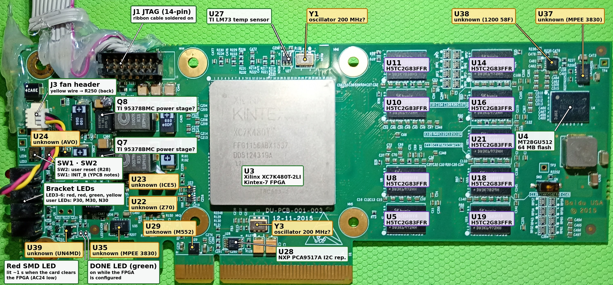

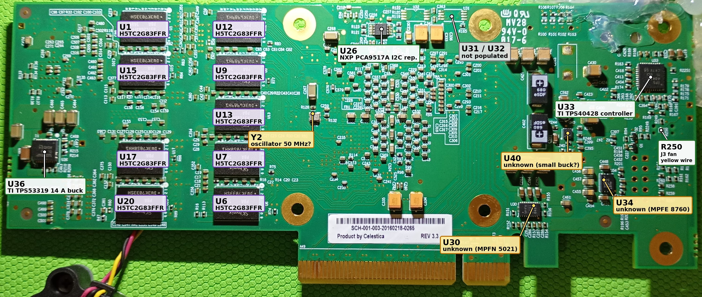

*This workspace's unit (serial `0265`), with every IC labelled.*
- **Label colours:** white box with green border = identified, yellow = unidentified (TODO), grey = not populated. The purple labels sit on the DRAM chips.
- **Also marked:** the connectors and parts identified on the card itself: J1 (JTAG), J3 (fan), SW1/SW2, the bracket LEDs, the green `DONE` and red SMD LEDs ([§3](#3-keep-alive-pin-ac24), [§12.6](#small-smd-leds-red-and-green)), and on the back R250, where the fan's yellow wire lands ([§12.8](#128-fan-header)).
- **Size:** the images are 3000 px wide; open them full size to read the small parts.
- **Details:** each IC is described in [§9](#9-integrated-circuits).

> [!IMPORTANT]
> **Every design for this card must keep FPGA pin AC24 high.** Otherwise the card clears the FPGA about 250 ms after it starts, and Vivado/Vitis report "DONE PIN is not HIGH". Add [`constraints/dupcb001003.xdc`](constraints/dupcb001003.xdc) to your project, or drag `fpga_keepalive` from the Board window into your block design. Details in [§3](#3-keep-alive-pin-ac24).

**Contents**

*Part A: Using the card*

1. [Overview](#1-overview): what the card is, what has been verified, how it relates to YPCB-00338-1P1
2. [Getting started](#2-getting-started): board files, JTAG, a first test, the example in three commands, all scripts
3. [Keep-alive pin AC24](#3-keep-alive-pin-ac24): the one rule every design must follow, and why
4. [Example: MicroBlaze-V blinker with DDR check](#4-example-microblaze-v-blinker-with-ddr-check): a complete, tested design
5. [Simulating and debugging](#5-simulating-and-debugging): RTL simulation, on-chip waveforms, the Vitis debugger
6. [Configuration flash](#6-configuration-flash): booting, backing up, building and writing images
7. [Vivado reference](#7-vivado-reference): the board files and constraint files in detail

*Part B: Hardware reference*

8. [Board map](#8-board-map): front, back and connection diagrams
9. [Integrated circuits](#9-integrated-circuits): every chip, with photo, marking and datasheet
10. [Connectors, switches and LEDs](#10-connectors-switches-and-leds)
11. [FPGA I/O banks and power](#11-fpga-io-banks-and-power): banks, VCCO, GTX quads, supply rails
12. [Interfaces and pinout](#12-interfaces-and-pinout): clocks, DDR3, flash, PCIe, I²C, LEDs, JTAG, fan, full pin map

*Part C: Background*

13. [The upstream YPCB example design](#13-the-upstream-ypcb-example-design): the 2022.2 MicroBlaze/XDMA system test and host software
14. [Known issues, open questions and TODOs](#14-known-issues-open-questions-and-todos): including measurements still to make
15. [Reference](#15-reference): repository contents, history, links

**Conventions.** **TODO** marks open work. **TODO?** marks a value that no file, photo or test backs up. "Unit 0265" is this workspace's card; "verified" means tested on it.

---

# Part A: Using the card

## 1. Overview

### 1.1 At a glance

| | |
|---|---|
| FPGA | Xilinx Kintex-7 **XC7K480T-L2FFG1156I**: the low-power -2LI grade (marked `L2I`), Vivado part `xc7k480tiffg1156-2L` ([U3](#u3-xilinx-xc7k480t-l2ffg1156i)) |
| Memory | 18 × SK hynix DDR3L, forming two independent 72-bit ECC channels: **4 GB usable** ([§12.2](#122-ddr3-memory)) |
| Configuration flash | Micron 512 Mb (64 MB) parallel NOR, BPI x16; the card boots from it ([§6](#6-configuration-flash)) |
| Host interface | PCIe Gen2 x8 ([§12.4](#124-pci-express)) |
| Other | LM73 temperature sensor, PCIe SMBus, 14-pin JTAG header, fan header, 4 bracket LEDs, 2 push buttons ([§10](#10-connectors-switches-and-leds), [§12](#12-interfaces-and-pinout)) |
| Special | Pin **AC24 must stay high** after configuration ([§3](#3-keep-alive-pin-ac24)). Vivado's built-in flash programming does not work on this card ([§6](#6-configuration-flash)) |
| Vivado support | Corrected board files, a master XDC, a tested MicroBlaze-V example and flash tools, all scripted for Vivado/Vitis 2026.1 ([§2](#2-getting-started)) |

**What has been verified on unit 0265** (2026-11-18, Vivado/Vitis 2026.1):

| Item | Status |
|---|---|
| Board files and the part `xc7k480tiffg1156-2L` | **Work.** Every design in this folder is built with them; the bitstreams load (IDCODE `23751093`) |
| JTAG (J1) | **Works**, at 15 MHz with an FTDI-based Xilinx-compatible cable |
| Keep-alive pin AC24 | **Found and handled** ([§3](#3-keep-alive-pin-ac24)) |
| User LEDs (P30, M30, N30) | **Work** |
| 50 MHz clock (AA28) and 200 MHz clock 1 (AH27/AH28) | **Work** |
| DDR3 channel 0 (preset `mig_0.prj`, DDR3-1066, ECC) | **Works**: calibrates and passes the data-bus, address-bus and 16 MB pattern tests ([§4](#4-example-microblaze-v-blinker-with-ddr-check)) |
| BPI flash pins | **Work**: the whole 64 MB was read back ([§6.2](#62-backing-up-the-flash)) |
| Configuration settings | **Confirmed** from the FPGA's status register: mode pins `010` (master BPI), bus width x16, CFGBVS = GND, PUDC_B = low |
| Writing the flash | **Not yet**: no working method ([§6.5](#65-writing-the-flash)) |
| DDR3 channel 1, 200 MHz clock 2, PCIe, both I²C buses, LM73, reset button | Untested on this card |

### 1.2 Identification

| | |
|---|---|
| Silkscreen (front) | `DU-PCB-001-003`, `12-11-2015`, `Baidu USA © 2015` |
| Label (back) | `SCH-001-003-20160218-<serial>`, `Product by Celestica`, `REV 3.3`, plus a barcode. The last field differs per board, so it is a serial number |
| Other names | SCH-001-003; "Baidu 2015 FPGA board" |
| PCB markings (back) | UL mark `MV28 94V-0 017-6`; edge text `-TGUz89-03-…` (differs per board); some units carry an ink stamp (`YS26.06` on unit 0300) |
| Support repository | [SergeRuff/DU-PCB-001-003](https://github.com/SergeRuff/DU-PCB-001-003) (MIT), checked out locally at [`submodules/DU-PCB-001-003`](../../submodules/DU-PCB-001-003) |
| Earlier work | TiferKing's YPCB-00338-1P1 hack: [repo](https://github.com/TiferKing/ypcb_00338_1p1_hack) and [blog post](https://www.tiferking.cn/index.php/2024/12/19/650/) (2024-12-19). omasanori: [sch-001-003-hack](https://github.com/omasanori/sch-001-003-hack) |

### 1.3 Relationship to YPCB-00338-1P1

The card is a close relative of the Inspur **YPCB-00338-1P1** ([sibling README](../YPCB-00338-1P1-kintex7-480t/README.md)). The DU-PCB-001-003 support repository copies TiferKing's YPCB-00338-1P1 board files, constraints and examples **byte for byte**.

> [!IMPORTANT]
> **Every pin assignment in this document comes from the YPCB-00338-1P1 files.** The ones exercised on this card so far match: the LEDs, the 50 MHz and first 200 MHz clocks, all of DDR3 channel 0, the flash and the PCIe SMBus repeater ([§1.1](#11-at-a-glance)). Treat the rest (DDR3 channel 1, PCIe lanes, I²C, LM73) as inherited, not verified. One thing the YPCB files do **not** have is the keep-alive pin AC24 ([§3](#3-keep-alive-pin-ac24)); the YPCB card does not seem to need it.
>
> **Evidence that the two boards share a layout:**
> - All 18 DRAMs carry exactly the designators the YPCB pinout sheet uses (U1 and U5–U21).
> - The upstream README says the card "has some compatibility with YPCB-00338-1P1".
> - Every pin tested so far matches.
>
> **Evidence that they differ:**
> - The sheet calls the LM73 "U22"; on this card the LM73 is **U27** ([U27](#u27-ti-lm73-0-temperature-sensor)).
> - The sheet ties the PCIe SMBus to "U26"; on this card the SMBus goes through **U28** (continuity-checked on unit 0265), and U26 serves the LM73 ([§12.5](#125-i2c-buses)).
> - This card clears the FPGA when AC24 is low; designs for the YPCB that leave unused pins floating (as openTPU's do) are cleared here.

### 1.4 The two documented units

The two boards look identical; only the lot and date codes, the U4 sticker and the modifications differ.

| | Unit 0300 (upstream repo photos) | Unit 0265 (this workspace, photographed 2026-11-10) |
|---|---|---|
| Photos | 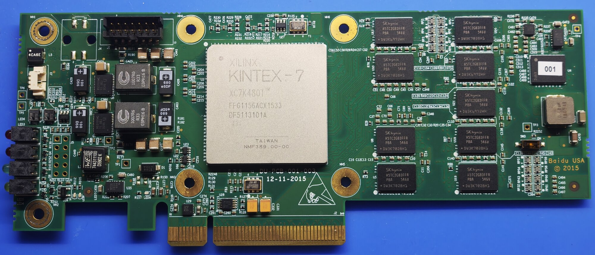 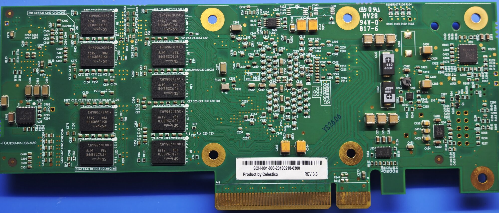 | 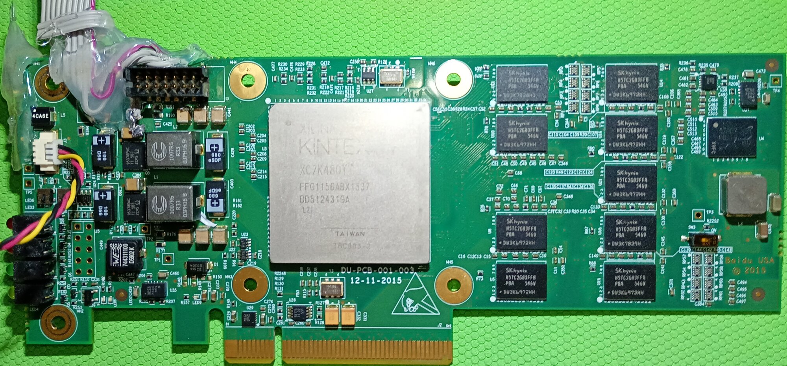 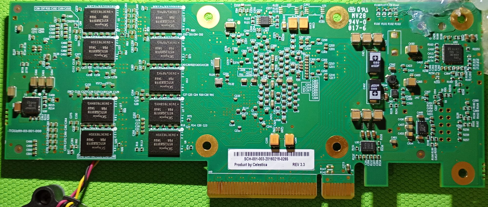 |
| Label | `SCH-001-003-20160218-0300` | `SCH-001-003-20160218-0265` |
| Edge text | `-TGUz89-03-036-930` | `-TGUz89-03-001-008` |
| FPGA marking | `FFG1156ACX1533`, `DF5113101A`, `L2I` (faint) | `FFG1156ABX1537`, `DD5124319A`, **`L2I`** (clear) |
| DRAM date codes | `546V` (front), `547V` (back) | `546V` (both sides) |
| U4 (flash) | Covered by a `001` sticker | No sticker: Micron logo, `57AB7` / `RB119` / `X9FC` |
| Modifications | None visible | Fan on J3; ribbon cable soldered to J1 ([§12.7](#127-jtag)) |
| Electrical checks | None documented | Continuity: U28 connects to the PCIe SMBus fingers ([§12.5](#which-repeater-is-which)); the fan's yellow wire on J3 goes to R250 ([§12.8](#128-fan-header)) |

---

## 2. Getting started

### 2.1 What you need

- **Vivado and Vitis 2026.1.** Everything in this folder was built and tested with them. Older versions need the board files' part (`xc7k480tiffg1156-2L`, supported since Vivado 2014.4) and will not run the MicroBlaze-V scripts unmodified.
- **A JTAG cable** for the 14-pin header J1 ([§2.3](#23-connect-jtag)).
- **Power for the card:** a PC slot or a bench supply through a riser. If the card sits in a running PC, reloading the FPGA can upset the host (the PCIe link drops), so a bench supply or a powered-off PC is the safe setup.

### 2.2 Install the board files

This folder has its own corrected board files in [`dupcb001003/1.0/`](dupcb001003/1.0/) (details in [§7.1](#71-board-files)). Either:
- copy `dupcb001003/` into `<Vivado install>/data/boards/board_files/`, creating `board_files/` if needed; or
- point Vivado at this folder, for example in `Vivado_init.tcl`: `set_param board.repoPaths [list <path-to>/boards/DU-PCB-001-003]`.

In a new project, choose **"DU-PCB-001-003 Accelerator Card"** (vendor `johndoe`). It has its own board ID, so it can be installed next to TiferKing's `ypcb003381p1` files. The scripts in this folder load the board files from the repo themselves, so they do not need the install. If you keep an installed copy, keep it identical to the repo's.

### 2.3 Connect JTAG

J1 is a standard 14-pin Xilinx header ([§12.7](#127-jtag)); the FPGA is the only device in the chain.
1. Power the card and connect the cable.
2. In Vivado: **Open Hardware Manager → Open Target → Auto Connect**. The cable and `xc7k480t` should appear.
3. Close the connection (or Vivado) before using the cable from Vitis or `xsdb`.

If no cable appears and you use a bare FTDI FT232H/FT2232H adapter, program its EEPROM as a Xilinx cable once, with only that adapter attached: `program_ftdi -write -ftdi FT232H -serial 0001 -vendor "my" -board "DUPCB" -desc "JTAG"` in the Vivado Tcl console (use `FT2232H` for that chip), then re-plug it. Unit 0265's cable identifies as `Xilinx/26SI291A` ("HelloFpga JTAG-JT2").

### 2.4 The one rule: keep AC24 high

A circuit on the card clears the FPGA if pin AC24 is low after configuration, and Vivado's default for unused pins is pull-down. So **every** design needs one of:
- [`constraints/dupcb001003.xdc`](constraints/dupcb001003.xdc) in the project (it sets `BITSTREAM.CONFIG.UNUSEDPIN Pullup`); or
- the **`fpga_keepalive`** board interface dragged into the block design (a 1-bit `axi_gpio` that outputs 1); or
- AC24 as a port of your own top level, tied or pulled high.

Without it, you see: all three bracket LEDs on, the red SMD LED blinking once, and "DONE PIN is not HIGH". The full story is in [§3](#3-keep-alive-pin-ac24).

### 2.5 Check the board with a minimal design

[`tools/board_alive/`](tools/board_alive/) builds a LEDs-only bitstream: no MIG, no processor. Inside that folder run `vivado -mode batch -source build.tcl`, then program `alive.bit` from Hardware Manager:
- LED0 (red) blinks at about 1 Hz from the FPGA's internal configuration clock, so it needs no board clock;
- LED1 (green) blinks from the 50 MHz clock (AA28);
- LED2 (yellow) blinks from 200 MHz clock 1 (AH27/AH28);
- holding the user reset button (R28) lights all three;
- the green SMD LED (`DONE`) stays on.

If all of that happens, the JTAG link, the keep-alive handling, the LED pins and both clocks are fine.

### 2.6 Build and run the example in three commands

The MicroBlaze-V blinker ([§4](#4-example-microblaze-v-blinker-with-ddr-check)) blinks the LEDs and tests DDR3 channel 0. From the repo root, with the card connected (about 30 minutes, mostly implementation):
```
vivado -mode batch -source boards/DU-PCB-001-003/examples/microblaze_v_blinky/create_project.tcl -tclargs -build
vitis  -s boards/DU-PCB-001-003/examples/microblaze_v_blinky/create_vitis.py blinky_project/design_1_wrapper.xsa
xsdb   boards/DU-PCB-001-003/examples/microblaze_v_blinky/run_on_board.tcl \
       blinky_vitis/platform/export/platform/hw/sdt/design_1_wrapper.bit blinky_vitis/blinky/build/blinky.elf
```
The last command prints every change of the LEDs. After a lamp test and about 15 s of DDR tests, a running light (`001 010 100 010 …`) means everything works.

### 2.7 Scripts at a glance

Every script in this folder. "Folder" means `boards/DU-PCB-001-003/`. All were run on unit 0265 unless noted.

| Script | Run it | Where | Produces | Details |
|---|---|---|---|---|
| [`constraints/dupcb001003.xdc`](constraints/dupcb001003.xdc) | Add it to any Vivado project (*Add Sources → constraints*, not copied) | — | Keeps AC24 high, sets CFGBVS/1.8 V and the BPI flash-boot settings; pin templates | [§3](#3-keep-alive-pin-ac24), [§7.2](#72-constraints) |
| [`tools/board_alive/build.tcl`](tools/board_alive/build.tcl) | `vivado -mode batch -source build.tcl`, then program `alive.bit` | Inside `tools/board_alive/` | `alive.bit` ([§2.5](#25-check-the-board-with-a-minimal-design)). This exact script was not run, but the same design and XDC were | [§2.5](#25-check-the-board-with-a-minimal-design) |
| [`examples/microblaze_v_blinky/create_project.tcl`](examples/microblaze_v_blinky/create_project.tcl) | `vivado -mode batch -source <folder>/examples/microblaze_v_blinky/create_project.tcl -tclargs [-dir <path>] [-build]` | Any directory; the project goes to `./blinky_project` | `blinky.xpr`. With `-build`: bitstream and `design_1_wrapper.xsa` | [§4.2](#42-build-and-run-it-with-the-scripts) |
| [`examples/microblaze_v_blinky/design_1_bd.tcl`](examples/microblaze_v_blinky/design_1_bd.tcl) | Not run directly: `create_project.tcl` sources it | — | Block design `design_1` | [§4.1](#41-what-it-is) |
| [`examples/microblaze_v_blinky/create_vitis.py`](examples/microblaze_v_blinky/create_vitis.py) | `vitis -s <folder>/examples/microblaze_v_blinky/create_vitis.py <design_1_wrapper.xsa> [workspace_dir]` | Any directory; the workspace defaults to `./blinky_vitis` | Platform `platform`, app `blinky`, `blinky/build/blinky.elf` | [§4.2](#42-build-and-run-it-with-the-scripts) |
| [`examples/microblaze_v_blinky/run_on_board.tcl`](examples/microblaze_v_blinky/run_on_board.tcl) | `xsdb <folder>/examples/microblaze_v_blinky/run_on_board.tcl <design_1_wrapper.bit> <blinky.elf> [seconds]` | Any directory, with the cable connected | Programs the FPGA, runs the ELF, prints every LED change and the keep-alive state | [§4.2](#42-build-and-run-it-with-the-scripts) |
| [`examples/microblaze_v_blinky/build_sim_elf.sh`](examples/microblaze_v_blinky/build_sim_elf.sh) | Copy it into the Vitis app folder, then `./build_sim_elf.sh` | The app folder (next to `src/`), with the platform named `platform` one level up | `build_sim/peripheral_tests_sim.elf`, the `-DSIM_BUILD` firmware for RTL simulation | [§5.2](#52-full-system-rtl-simulation) |
| [`examples/microblaze_v_blinky/tb_design_1.sv`](examples/microblaze_v_blinky/tb_design_1.sv) | Add it as a simulation source, set it as top, *Run Behavioral Simulation* | The Vivado project | PASS / FAIL / TIMEOUT in the Tcl console, plus waveforms. Compiles; a full run is not done yet | [§5.2](#52-full-system-rtl-simulation) |
| [`tools/flash_reader/build.tcl`](tools/flash_reader/build.tcl) | `vivado -mode batch -source build.tcl` | Inside `tools/flash_reader/` | `frd/` project and `top.bit`: a JTAG-to-AXI → `axi_emc` flash reader that drives AC24 high | [§6.2](#62-backing-up-the-flash) |
| [`tools/flash_reader/dump.tcl`](tools/flash_reader/dump.tcl) | `vivado -mode batch -source dump.tcl` | Inside `tools/flash_reader/`, after `build.tcl` | `raw_hex.txt`: all 64 MB of the flash (about 7 min); then it reboots the card from the flash. Read-only | [§6.2](#62-backing-up-the-flash) |
| [`tools/flash_reader/convert.py`](tools/flash_reader/convert.py) | `python3 convert.py raw_hex.txt <name>` | Anywhere | `<name>.bin` and `<name>.mcs` in Vivado's BPI x16 order; prints SHA-256, sync word, IDCODE and used size | [§6.2](#62-backing-up-the-flash) |

---

## 3. Keep-alive pin AC24

> **Every design for this card must keep FPGA pin AC24 high.** Otherwise the card clears the FPGA about 250 ms after it starts.

### 3.1 Symptom

A design loaded over JTAG completes startup ("End of startup status: HIGH"), and the green SMD LED (`DONE`) lights. Then, within about 250 ms:
- the red SMD LED near the bracket lights for about 1 s,
- `INIT_B` is pulled low for about 0.5 s,
- `DONE` drops and the FPGA is left **blank**.

It does *not* reload the flash design afterwards. Vivado reports `End of startup status: LOW` or `Device ... is not programmed (DONE status = 0)`; Vitis reports `fpga configuration failed. DONE PIN is not HIGH`. A blank FPGA lights all three bracket LEDs (see the pull-ups below). The configuration status register shows no CRC, IDCODE or security error, which rules out a bad bitstream or cable.

### 3.2 Cause

A circuit on the card watches pin **AC24** (bank 14, `IO_25_14`, LVCMOS18, a plain user I/O) and clears the FPGA when AC24 is low.
- **Why the blank FPGA and the vendor design survive:** `PUDC_B` is tied low on this card (STAT bit 28 = 0), so every user I/O has a weak pull-up before and during configuration, and AC24 is high. The vendor design in the flash also keeps it high.
- **Why ordinary designs are cleared:** after configuration, Vivado's default `BITSTREAM.CONFIG.UNUSEDPIN Pulldown` pulls AC24 low, and a floating pin is not enough to keep it high either.
- **What AC24 connects to** is not known (**TODO**, measurement 15 in [§14.1](#141-measurements-to-make-on-the-board)). Candidates: U39 next to the SMD LEDs, U24 next to the buttons, and the `INIT_B`/`PROGRAM_B` circuitry ([§9.6](#96-unidentified-ics)). The SMD LEDs' behaviour is described in [§12.6](#small-smd-leds-red-and-green).

### 3.3 How to keep AC24 high

Use at least one of these in **every** design, including images written to the flash:

| Method | How | Notes |
|---|---|---|
| **Master XDC** (simplest) | Add [`constraints/dupcb001003.xdc`](constraints/dupcb001003.xdc); its Section 1 sets `set_property BITSTREAM.CONFIG.UNUSEDPIN Pullup [current_design]` | Pulls up every unused pin, AC24 included. Works for any flow |
| **Board interface** (block designs) | In the **Board** window, drag **`fpga_keepalive`** into the design, or run *Connection Automation* on an `axi_gpio`'s `GPIO` and pick `fpga_keepalive`. Connect its `S_AXI` like any peripheral | A 1-bit, output-only `axi_gpio` with `C_DOUT_DEFAULT = 0x1` (preset `fpga_keepalive_preset`), on a port `fpga_keepalive` placed on AC24. Never write 0 to it. Tested with every other pin pulled down, with normal clocks **and** with its clock stopped and reset held: the output is high from the end of configuration either way |
| **Your own port** | Make AC24 a top-level port and drive it with a constant 1 (`assign fpga_keepalive = 1'b1;`, or an `xlconstant`), or make it an input with `PULLUP true`. The XDC has commented templates | **Do not** drive it from a register or an `axi_gpio` that starts at 0: AC24 would be low right after configuration |

The methods can be combined. In the board files, AC24 is pin `FPGA_KEEPALIVE`, component `fpga_keepalive` and board interface `fpga_keepalive` ([§7.1](#71-board-files)).

**Flash images** must follow the rule too. An image that pulls AC24 low boots at every power-up and is then cleared, so the card looks dead until a design is loaded over JTAG. The flash itself is not damaged and can be rewritten over JTAG with a design that keeps AC24 high ([§6](#6-configuration-flash)).

### 3.4 How it was found

On unit 0265, 2026-11-18, over JTAG:

| Test | Result |
|---|---|
| A design driving only the 3 LED pins, unused pins at Vivado's default (pull-down) | Cleared |
| Same design, JTAG clock lowered from 15 to 3 MHz | Cleared, so it is not the cable |
| `boot_hw_device` (configure from the flash) | Stays configured, so power and the FPGA are fine |
| Same LED design with `UNUSEDPIN Pullup` | Stays configured; the LEDs blink from the 50 MHz, 200 MHz and internal clocks, green SMD LED on |
| All 393 free user I/Os made inputs with selectable weak pulls, then bisected (18 bitstreams) | **Only AC24 pulled down: cleared. All 392 others pulled down with AC24 up: stable** |
| Design using [`constraints/dupcb001003.xdc`](constraints/dupcb001003.xdc) Sections 1 and 2 (`UNUSEDPIN Pullup`, CFGBVS GND, 1.8 V, BPI16, compressed) | Stays configured |
| `fpga_keepalive` board interface alone, all other pins pulled down; normal clocks, and also with the GPIO's clock stopped and reset held | Stays configured in both cases |
| Vivado's flash helper (*Add Configuration Memory Device*), default pull-none | Cleared |
| Vivado's flash helper with `PROGRAM.UNUSED_PIN_TERMINATION {pull-up}` (`bpi_xc7k480t_pullup.bit`) | **Also cleared. Cause unknown** (TODO) |
| A custom JTAG-to-AXI + `axi_emc` flash reader with AC24 **driven** high ([`tools/flash_reader/`](tools/flash_reader/)) | Stays configured, and reads the flash |

---

## 4. Example: MicroBlaze-V blinker with DDR check

A minimal MicroBlaze-V system that blinks the bracket LEDs and checks that DDR3 channel 0 reads back what was written. It needs no UART: the LEDs report everything. It was brought up on unit 0265 on 2026-11-18. Sources: [`examples/microblaze_v_blinky/`](examples/microblaze_v_blinky/).

### 4.1 What it is

**Hardware** (block design `design_1`, from [`design_1_bd.tcl`](examples/microblaze_v_blinky/design_1_bd.tcl), using this folder's board files):

| Block | Configuration |
|---|---|
| MicroBlaze-V (`microblaze_riscv_0`) | 100 MHz (`clk_wiz` from the 50 MHz board clock), 16 KB local BRAM at `0x0`, 8 KB I- and D-caches over the DDR range (D-cache **write-back**), MDM for JTAG debug |
| `axi_gpio_0` | `0x4000_0000`, 1 channel, 3 outputs → board interface `led_3bits` |
| `mig_7series_0` | Board interface `ddr3_sdram_ch0`, preset `mig_0.prj`: 2 GB at `0x8000_0000`, 72-bit with **ECC on**, 200 MHz clock 1, reset from `resetn` (R28). `init_calib_complete` is not wired to anything |
| `axi_gpio_keepalive` | `0x4001_0000`, board interface `fpga_keepalive`: 1-bit output, default 1, on AC24 ([§3](#3-keep-alive-pin-ac24)); never written by the firmware. [`constraints/dupcb001003.xdc`](constraints/dupcb001003.xdc) is added as well |

**Firmware** ([`blinky.c`](examples/microblaze_v_blinky/blinky.c), [`lscript.ld`](examples/microblaze_v_blinky/lscript.ld)), a Vitis standalone application:
- Everything (code, data, stack) is linked into the **16 KB local BRAM**, not DDR. The firmware keeps running and reporting on the LEDs even if the DDR is broken, and the DDR test cannot overwrite the program. It uses about 10.5 KB.
- Every DDR write is flushed out of the D-cache and every read is invalidated first, so the test checks the DDR and not the cache.
- It finds the LED GPIO by instance name (`XPAR_AXI_GPIO_0_BASEADDR`), so the keep-alive GPIO is never touched.
- Settings at the top of the file: `LED_ACTIVE_LOW`, `DDR_FILL_BYTES` (16 MB by default), the blink speeds, and `SIM_BUILD` for simulation ([§5.2](#52-full-system-rtl-simulation)).

### 4.2 Build and run it with the scripts

1. **Vivado project:** [`create_project.tcl`](examples/microblaze_v_blinky/create_project.tcl) loads the board files from the repo, so no install is needed.
   ```
   vivado -mode batch -source boards/DU-PCB-001-003/examples/microblaze_v_blinky/create_project.tcl -tclargs -build
   ```
   - It creates `./blinky_project/blinky.xpr` (`-dir <path>` puts it elsewhere), builds `design_1`, adds `axi_gpio_keepalive` through the `fpga_keepalive` board interface, and references `constraints/dupcb001003.xdc`.
   - With `-build` it also runs implementation and writes `blinky_project/design_1_wrapper.xsa` (bitstream included). Without it, it only creates the project, in about a minute.
2. **Vitis platform and application:** [`create_vitis.py`](examples/microblaze_v_blinky/create_vitis.py).
   ```
   vitis -s boards/DU-PCB-001-003/examples/microblaze_v_blinky/create_vitis.py blinky_project/design_1_wrapper.xsa [workspace_dir]
   ```
   - It creates the standalone platform `platform` on `microblaze_riscv_0` (no stdin/stdout) and the application `blinky` from the empty template, imports `blinky.c` and the BRAM-only `lscript.ld`, and builds both: `blinky_vitis/blinky/build/blinky.elf`.
   - The workspace defaults to `./blinky_vitis`. The calls are the ones the Vitis IDE records in its workspace journal.
3. **Load and watch:** [`run_on_board.tcl`](examples/microblaze_v_blinky/run_on_board.tcl).
   ```
   xsdb run_on_board.tcl blinky_vitis/platform/export/platform/hw/sdt/design_1_wrapper.bit blinky_vitis/blinky/build/blinky.elf
   ```
   It programs the FPGA, loads the ELF, and prints every change of the LED register through the debug module, so the result is visible without looking at the card. Opening the workspace in the Vitis IDE and pressing **Run** works too.

**Verified on unit 0265 (2026-11-18):** the whole chain ran from scratch: `create_project.tcl -build` (timing met, worst slack +0.548 ns), `create_vitis.py`, `run_on_board.tcl`. The lamp test ran, DDR tests 1 and 2 took well under 0.1 s each, test 3 took about 14 s, and then the running light started: **DDR3 channel 0 reads back correctly**. The keep-alive GPIO read 1 throughout.

This is volatile: after a power cycle, load it again. To boot it from the flash, see [§6.4](#64-building-a-flash-image).

### 4.3 What the LEDs mean

1. **Lamp test:** LED0, LED1 and LED2 light one at a time, then all three together.
2. **DDR tests:** the test number shows in binary, steady, while each test runs. Tests 1 and 2 are over in a blink; test 3 takes about 14 s in the default `-O0` build.
   - `001`: data bus (one bit set or cleared at a time, over a 64-byte block, so every DQ line in every beat);
   - `010`: address bus (power-of-two offsets over the whole 2 GB);
   - `011`: fill 16 MB with an address pattern and its inverse, then read back.
3. **Running light back and forth (0-1-2-1-0…): PASS.** The system is up and the DDR reads back correctly.

If it does not get there:

| What you see | Meaning |
|---|---|
| All LEDs flash together N times, pause, repeat | DDR test N failed |
| Frozen on one test pattern, usually `001` | The CPU hung on a DDR access: the MIG never finished calibration, because the AXI port stalls until it has. Check the clock, the reset polarity and the pinout. The board files' MIG preset uses SSTL15 (1.5 V) I/O, although the DDR3L could run at 1.35 V ([§14](#14-known-issues-open-questions-and-todos)) |
| All three LEDs on, the red SMD LED blinked, "DONE PIN is not HIGH" | The design is not keeping AC24 high ([§3](#3-keep-alive-pin-ac24)) |
| Nothing lights | Check `LED_ACTIVE_LOW`, the LED pins and the JTAG log, then try the minimal design ([§2.5](#25-check-the-board-with-a-minimal-design)) |

**Limits of the DDR check:**
- With ECC on, the MIG corrects single-bit errors silently, so the firmware only catches multi-bit and address faults. `app_ecc_single_err` would show corrections if wired to a GPIO.
- The MicroBlaze-V D-cache cannot be disabled, and DDR writes leave it as full cache lines, so the DDR byte-mask lines cannot be tested from software.

### 4.4 Building it by hand in the IDE

If you build your own project instead of using the scripts:
1. **Vivado:** make sure the design keeps AC24 high (drag in `fpga_keepalive`, or add `constraints/dupcb001003.xdc` without copying it, so repo fixes apply). **Generate Bitstream**, then **File → Export → Export Hardware** with the bitstream included.
2. **Vitis:** create (or update) the **platform** from the `.xsa`: standalone, `microblaze_riscv_0`, no stdin/stdout. Create an application, replace its sources with `blinky.c` and its `lscript.ld` with the one here (BRAM only). Build the platform, then **Clean** and **Build** the application.
3. **Run:** select the application and click **Run**. Vitis loads the bitstream, resets the processor, writes the ELF into BRAM through the MDM, and starts it.

**How the work flows between the tools:** Vivado builds the hardware and exports the `.xsa` (bitstream, address map, `.mmi`). Vitis builds the ELF and programs bitstream and ELF together over JTAG; no new bitstream is made. Go back to Vivado only when the hardware changes, then update the platform from the new `.xsa`.

---

## 5. Simulating and debugging

### 5.1 Choosing a mode

Three ways to watch the [§4](#4-example-microblaze-v-blinker-with-ddr-check) firmware run on its hardware:

| Mode | Where | What you see | Needs the card? | Best for |
|---|---|---|---|---|
| [Full-system RTL simulation](#52-full-system-rtl-simulation) | Vivado XSim | Waveforms of everything: CPU, AXI buses, GPIO, MIG, DDR3 pins | No | Seeing the whole system work before using the card; MIG and AXI details |
| [On-chip waveforms (System ILA)](#53-on-chip-waveforms-system-ila) | Vivado Hardware Manager | Real waveforms captured inside the running FPGA | Yes | Real bus traffic on the card |
| [Vitis debugger](#54-vitis-debugger-on-the-card) | Vitis | Breakpoints, stepping, registers, DDR memory | Yes | Finding which check fails (breakpoint on `return -1`) |

> **Why not Vitis hardware emulation or QEMU?** Vitis `hw_emu` is for Versal/Alveo acceleration kernels, not a MicroBlaze-V standalone design. Vitis 2026.1 ships a RISC-V QEMU, but it has no model of `axi_gpio` or the MIG. For this design, RTL simulation is the hardware emulation.

### 5.2 Full-system RTL simulation

The real MicroBlaze-V RTL runs the ELF from its BRAM, talking to the real AXI GPIO and MIG RTL, which talks to DDR3 chip models. MIG switches to fast calibration (`SIM_BYPASS_INIT_CAL = "FAST"`) in simulation by itself.

**Files** (in [`examples/microblaze_v_blinky/`](examples/microblaze_v_blinky/)):

| File | What it is |
|---|---|
| `tb_design_1.sv` | Testbench for a top level named `design_1_wrapper`:<br>- drives the 50 MHz and 200 MHz clocks and `resetn`;<br>- attaches 9 Micron DDR3 x8 models (one 72-bit rank);<br>- reads `init_calib_complete` by hierarchy;<br>- decodes the LED sequence and ends the run with PASS, FAIL in test N, or a TIMEOUT that says where it stuck |
| `build_sim_elf.sh` | Builds a simulation copy of the firmware with `-DSIM_BUILD`: every "millisecond" becomes 1 µs, and test 3 fills 4 KB; otherwise the run would take days of simulated time. The normal build is untouched |
| `ddr3_model.sv`, `ddr3_model_parameters.vh` | Not in the repo. MIG generates them in `<project>.gen/.../design_1_mig_7series_0_1/example_design/sim/`, configured for this memory (MT41K256M8, 2 Gb, x8) |

**Steps:**
1. **Build the simulation firmware:** copy `build_sim_elf.sh` into the Vitis application folder and run it. The output is `build_sim/peripheral_tests_sim.elf`; re-run it after every firmware change.
2. **Add the simulation sources** (*Add Sources → simulation sources*): `tb_design_1.sv`, plus `ddr3_model.sv` and `ddr3_model_parameters.vh` with "Copy sources into project" checked, so they survive a MIG regenerate. Right-click `tb_design_1` → **Set as Top** (sim_1). These files do not affect synthesis.
3. **Attach the firmware:** **Tools → Associate ELF Files → Simulation Sources** → `microblaze_riscv_0` → the simulation ELF. (This is separate from the Design Sources ELF used for a flash bitstream.)
4. **Settings → Simulation:** set `xsim.simulate.runtime` to `3ms` (the testbench ends itself; this is an upper limit). Optionally check `xsim.simulate.log_all_signals`, which lets you add any signal after the run, at the cost of speed and disk.
5. **Run Behavioral Simulation.** The first compile takes a while. The Tcl console prints:
   ```
   MIG calibration complete
   LED = 001 / 010 / 100 / 111 / 000      (lamp test)
   lamp test done, DDR tests starting
   DDR test 1 running / 2 / 3
   *** PASS: all DDR tests passed, running light started ***
   ```
   The other endings are `*** FAIL: DDR test N failed ***` and the TIMEOUT messages: calibration never completed, stuck before the lamp test (is the ELF associated?), or stuck in test N.

**Waveforms worth adding** (Scope → Objects → *Add to Wave Window*, then *Restart* and *Run All*):

| Signal / instance | Why |
|---|---|
| `tb_design_1/led` | What the card will show |
| `tb_design_1/calib_done` | MIG calibration (not wired out in the block design) |
| `dut/design_1_i/axi_gpio_0/s_axi_*` | Every LED write |
| `dut/design_1_i/mig_7series_0/s_axi_*` | DDR traffic as 512-bit AXI bursts |
| `tb_design_1/gen_ddr3[0]/u_ddr3` → `dq`, `dqs`, `addr`, `ba`, `ras_n`, `cas_n`, `we_n` | DDR3 pins on chip 0 |
| `microblaze_riscv_0` ILMB/DLMB address signals | Effectively the program counter |

```tcl
add_wave /tb_design_1/led /tb_design_1/calib_done
add_wave /tb_design_1/dut/design_1_i/axi_gpio_0/s_axi_*
add_wave /tb_design_1/dut/design_1_i/mig_7series_0/s_axi_*
restart
run all
```

**More tricks:**
- **AXI transaction view:** in the block design, right-click an AXI connection → **Mark Simulation**; it then shows up as decoded transactions.
- **Map addresses to C code:** `riscv32-xilinx-elf-objdump -d -S peripheral_tests_sim.elf > blinky_sim.lst`, then look up the ILMB addresses.
- **Provoke a failure:** for example `add_force /tb_design_1/ddr3_dq[5] 0`.
- **After a firmware change:** run `build_sim_elf.sh` again, then **Relaunch Simulation**. After a block-design change, run the simulation again; Vivado regenerates its files.

**Status:** the testbench compiles cleanly in `xvlog` and the simulation ELF builds. A full simulation run has not been done yet (**TODO**).

### 5.3 On-chip waveforms (System ILA)

1. **Add the probes:** in the block design, right-click these connections → **Debug**: `led_3bits` (or `gpio_io_o`), the AXI connection into `axi_gpio_0/S_AXI`, and optionally the one into `mig_7series_0/S_AXI` (512 bits wide, so many BRAMs).
2. **Run Connection Automation**, which adds a System ILA. Clock the CPU side from `clk_wiz_0/clk_out1`; the MIG side runs on `ui_clk`. Optionally probe `init_calib_complete`.
3. **Build and export:** **Generate Bitstream**, **Export Hardware**, then update the Vitis platform. The probe file is `<project>.runs/impl_1/design_1_wrapper.ltx`.
4. **Capture:**
   1. In Vitis, set `"stopAtEntry": true` in the application's `_ide/launch.json` and click **Debug**. The FPGA is programmed and the CPU halts at `main()`.
   2. In Vivado, **Open Hardware Manager → Auto Connect** (it shares Vitis's `hw_server`). Set the probes file and **Refresh Device**.
   3. Set a trigger, for example GPIO `WVALID == 1`, or LEDs `== 3'b011` (test 3 starts), and click **Run Trigger**.
   4. **Resume** in Vitis.

Programming from Vitis resets the ILA, so always program first, then arm the trigger, then resume.

### 5.4 Vitis debugger on the card

Click **Debug** instead of **Run**, with `"stopAtEntry": true`. The debugger uses the MDM over JTAG and needs no UART. Useful things:
- **Breakpoints** on the `return -1` lines of each test, to see exactly which check fails.
- **Variables/Registers**, for the failing address and value.
- **Memory** view at `0x8000_0000`. The D-cache sits in front of DDR, so the debugger may show cached values.
- **Step over** `leds(...)` and watch the LEDs change.

---

## 6. Configuration flash

> Every bitstream for this card, whether loaded over JTAG or written to the flash, must keep **AC24 high** ([§3](#3-keep-alive-pin-ac24)). Vivado's built-in flash tools (*Add Configuration Memory Device*, then *Readback* or *Program Configuration Memory Device*) **do not work on this card**: their helper design is cleared about 250 ms after it loads, even with the pull-up variant selected.

### 6.1 How the card boots

- **At power-up** the FPGA configures itself from the flash: the mode pins are strapped to `010` (master BPI) and the bus-width detection reads x16, both read from the FPGA's status register on unit 0265. The flash is the Micron MT28GU512 on U4 ([§12.3](#123-bpi-configuration-flash)).
- **Over JTAG** a design is loaded until the next power cycle: program the `.bit` from Vivado Hardware Manager, or run it from Vitis or `xsdb`. JTAG loading always works (as long as the design keeps AC24 high); it never touches the flash.
- `boot_hw_device` in Hardware Manager (or a power cycle) reloads the flash design.

### 6.2 Backing up the flash

Use [`tools/flash_reader/`](tools/flash_reader/) instead of Vivado's readback. It is a small design (JTAG-to-AXI master → `axi_emc` → flash) that drives AC24 high, and it only ever reads the flash. Inside that folder:
1. `vivado -mode batch -source build.tcl` builds it (about 10 minutes).
2. `vivado -mode batch -source dump.tcl` loads it and reads all 64 MB over JTAG in 1 KB bursts into `raw_hex.txt` (about 7 s per MB, about 8 minutes in total), then reboots the card from the flash.
3. `python3 convert.py raw_hex.txt my_flash_backup` writes `my_flash_backup.bin` and `.mcs` in Vivado's BPI x16 byte order (each flash word high byte first, bit-swapped as stored), and prints the SHA-256, the sync word, the IDCODE and how much of the flash is used.

### 6.3 What unit 0265's flash holds

The backup of unit 0265 (2026-11-18) is in [`flash_backup/`](flash_backup/), with checksums and a README:
- the vendor's xc7k480t bitstream at `0x0` (about 17.9 MB, uncompressed). It keeps AC24 high, which is why the card does not clear it;
- a vendor record in the last block (`0x3FC0000`): ASCII `CS-H00-100-3026120810-62 5` plus about 130 bytes of binary data, probably a Celestica part/serial record;
- nothing else (`0xFF`).

SHA-256 of the `.bin`: `1df5e6abfb2ca37014a2957c4e2993d2aded3a7c0ce857297a649e0e8cd6173e`.

### 6.4 Building a flash image

1. **Add [`constraints/dupcb001003.xdc`](constraints/dupcb001003.xdc) (Sections 1 and 2):** `UNUSEDPIN Pullup`; `CFGBVS GND` and `CONFIG_VOLTAGE 1.8` (confirmed: STAT reads CFGBVS = 0); `CONFIG_MODE BPI16` (confirmed: mode pins `010`, bus width x16); `BPI_SYNC_MODE Disable`; compression.
2. **For MicroBlaze firmware**, put the ELF into the bitstream first. This works when the program runs from local BRAM, as in [§4](#4-example-microblaze-v-blinker-with-ddr-check):
   - **Tools → Associate ELF Files → Design Sources** → the processor (for example `microblaze_riscv_0`) → your `.elf`, then **Generate Bitstream**; or
   - without re-running implementation: `updatemem -meminfo <design>.mmi -bit <design>.bit -data <app>.elf -proc <design>_i/microblaze_riscv_0 -out download.bit`. The `.mmi` comes with the `.xsa` or the implementation run.
3. **Check over JTAG** that the bitstream keeps AC24 high: load it and confirm that it stays configured (green SMD LED on, `DONE` = 1 after a few seconds).
4. **Make the image:**
   ```tcl
   write_cfgmem -format mcs -size 64 -interface BPIx16 \
       -loadbit {up 0x00000000 top_wrapper.bit} -force -file top_wrapper.mcs
   ```

### 6.5 Writing the flash

No tested method exists yet (**TODO**). The options, in order of preference:
1. **Extend `tools/flash_reader` into a writer.** The design already drives `WE#`, and `axi_emc` passes writes through, so the MT28GU program sequence can run as AXI writes from Tcl. For each 256 KB block: clear status (`0x50`); unlock (`0x60`, `0xD0`); erase (`0x20`, `0xD0`, then poll status for `0x80`); buffered program (`0xE8`, count, data, `0xD0`, then poll); read array (`0xFF`). Then verify with `dump.tcl`. AC24 stays driven high throughout.
2. **Rebuild openFPGALoader's BPI bridge** (`bpiOverJtag`, used by `-b ypcb003381p1`) with `UNUSEDPIN Pullup` and AC24 driven high.
3. **Find out why Vivado's pull-up helper is still cleared.** Once fixed, Vivado's own *Program Configuration Memory Device* (with `PROGRAM.UNUSED_PIN_TERMINATION {pull-up}`) would work.

**To restore the original flash,** write `flash_backup/unit0265_flash_2026-11-18.bin` (or the unpacked `.mcs`) to the whole flash, so that the vendor record in the last block comes back too. Then power-cycle the card or run `boot_hw_device`, and check that `DONE` stays high.

---

## 7. Vivado reference

### 7.1 Board files

This folder's board files in [`dupcb001003/1.0/`](dupcb001003/1.0/) are a corrected copy of the submodule's, which are TiferKing's YPCB-00338-1P1 board files under a new folder name. Installation is in [§2.2](#22-install-the-board-files). They are verified on unit 0265 ([§1.1](#11-at-a-glance)).

**Identifiers**

| | |
|---|---|
| Board part | `johndoe:dupcb001003:part0:1.0` (`board.xml` schema 2.2, file version 1.0) |
| Board revision | 3.3, from the `REV 3.3` on the board label |
| FPGA part | **`xc7k480tiffg1156-2L`**: the -2LI (0.95 V) speed specifications ([U3](#u3-xilinx-xc7k480t-l2ffg1156i)) |
| Power-estimation parameters | `heat_sink_type` = medium, heat-sink temperature 20–30 °C |
| JTAG chain | `part0` only |

**What differs from the submodule's board files**

| File | Change |
|---|---|
| `board.xml`, `xitem.json` | Vendor `johndoe` instead of `tiferking.cn`, name `dupcb001003` instead of `ypcb003381p1`, display name, description, URL and credits (TiferKing, Sergey Ershov) |
| `board.xml`, `part0_pins.xml` | FPGA part `xc7k480tiffg1156-2L` instead of `xc7k480tffg1156-2` |
| `mig_0.prj`, `mig_1.prj`, `mig_01.prj` | Target FPGA `xc7k480ti-ffg1156/-2L` instead of `xc7k480t-ffg1156/-2`. Nothing else changed: same pins, timing and Micron memory part ([§12.2](#mig-presets)) |
| `part0_pins.xml` | The 200 MHz clocks use `DIFF_SSTL15` instead of `LVDS`, which is invalid on this chip ([§12.1](#121-clocks-and-reset)) |
| `preset.xml` | `util_ds_buf` on the 200 MHz clocks is `IBUFDS` instead of `IBUFDSGTE` (the transceiver buffer). The PCIe reference clock keeps `IBUFDSGTE` |
| `board.xml` | Compatible board revision 3.3 (from the label) instead of 1.0 |
| `board.xml` | Component descriptions name the parts and designators: U3, U27 (`LM73CIMKX-0`) behind U26, the PCIe SMBus behind U28, U4 |
| `dupcb001003_image.jpg` | Photo of unit 0265 (a real JPEG, not an LFS pointer) |
| `part0_pins.xml`, `board.xml`, `preset.xml` | **Added:** pin `FPGA_KEEPALIVE` (AC24), component and board interface `fpga_keepalive`, preset `fpga_keepalive_preset` (1-bit output-only `axi_gpio`, default 1) ([§3](#3-keep-alive-pin-ac24)). The interface's 1-bit `TRI_O` port must not carry `left`/`right` attributes: Vivado rejects the whole `board.xml` if it does |

Apart from the added AC24 pin, all pins are unchanged.

**Board interfaces** (shown in the *Board* tab of the block design):

| Interface | Preferred IP | Preset |
|---|---|---|
| `default_50mhz_clk0` | `clk_wiz` | `PRIM_IN_FREQ=50`, single-ended clock-capable pin |
| `default_200mhz_clk1`, `default_200mhz_clk2` | `clk_wiz`, `util_ds_buf` | `clk_wiz`: 200 MHz, differential clock-capable pin. `util_ds_buf`: `IBUFDS` (the submodule's files say `IBUFDSGTE`, which is wrong; [§12.1](#121-clocks-and-reset)) |
| `ddr3_sdram_ch0` / `ch1` / `ch01` | `mig_7series` | `mig_0.prj` / `mig_1.prj` / `mig_01.prj` (2 GB / 2 GB / 4 GB; [§12.2](#mig-presets)) |
| `bpi_flash` | `axi_emc` | 16-bit linear flash with the timings in [§12.3](#123-bpi-configuration-flash) |
| `led_3bits` | `axi_gpio`, `iomodule`, `microblaze_mcs` | 3 outputs on GPIO channel 1 or 2, or 3-bit GPO1–4 |
| `alert_lm73` | `axi_gpio` | 1 input with interrupt, on GPIO channel 1 or 2 |
| `iic_lm73`, `iic_pcie` | `axi_iic` | — |
| `resetn` | `proc_sys_reset` | Active low (`SW_RESET`) |
| `pci_express_x1` / `x2` / `x4` / `x8` | `xdma`, then `pcie_7x`, then `axi_pcie` | `xdma`: 5.0 GT/s at the chosen width, block `X0Y0` |
| `pcie_perstn` | `xdma`, `pcie_7x`, `axi_pcie` | Active low, type `PCIE_PERST` |
| `pcie_refclk` | `util_ds_buf` | `IBUFDSGTE`, 100 MHz |
| `fpga_keepalive` | `axi_gpio` | 1 output on AC24, `C_DOUT_DEFAULT = 0x1` ([§3](#3-keep-alive-pin-ac24)) |

**Automatic association rules:**
- MIG `C0_SYS_CLK` connects to `default_200mhz_clk1` and `C1_SYS_CLK` to `default_200mhz_clk2`.
- MIG `C0_DDR3` and `C1_DDR3` prefer `ddr3_sdram_ch01`.
- XDMA prefers `pci_express_x8`.
- `sys_rst_n` connects to `pcie_perstn`.
- `util_ds_buf` `CLK_IN_D` connects to `pcie_refclk`.

### 7.2 Constraints

**Use [`constraints/dupcb001003.xdc`](constraints/dupcb001003.xdc).** It is a master XDC for this card, verified on unit 0265 (a design using Sections 1 and 2 stays configured after a JTAG load):
- **Section 1 (required):** keeps AC24 high ([§3](#3-keep-alive-pin-ac24)) and sets CFGBVS/CONFIG_VOLTAGE.
- **Section 2:** flash-boot settings ([§6.4](#64-building-a-flash-image)).
- **Section 3:** commented pin templates for the clocks, LEDs, reset, I²C, SMBus, PCIe and the flash, generated from `part0_pins.xml`.

Add it to block-design projects too: board automation sets pins but no bitstream properties. DDR3 pins are not in it; MIG generates them from the board presets.

The submodule's `constraints/` folder (inherited from the YPCB) provides:

| File | Contents |
|---|---|
| `ypcb003381p1.xdc` | PCIe TX P pins, refclk P and `PERST#`; LM73 I²C and ALERT; SMBus; LEDs; `SYS_CLK` (AA28) and `SYS_RSTN` (R28); all flash pins. Port names match the example's `top_wrapper.v`. It does **not** constrain the 200 MHz clocks or the DDR3 pins |
| `MEMORY_CH0.ucf`, `MEMORY_CH1.ucf` | DDR3 pin LOCs for each channel (117 nets each). **These are ISE-format UCF files, which Vivado does not read.** Either translate them to XDC (`set_property PACKAGE_PIN ...`) or let MIG generate the constraints from the `.prj` |
| `physical_pinout.xlsx` | One-sheet pin map: DDR pins grouped by chip, the 200 MHz and 50 MHz clocks, LM73, SMBus, LEDs, `PERST#` and reset. Two of its designators are wrong for this card; the corrected content is in [§12.9](#129-full-pin-map) |

For transceiver placement, also add `pcie_port.xdc` ([§12.4](#124-pci-express)).

---

# Part B: Hardware reference

## 8. Board map

These diagrams are Mermaid sketches, not to scale; positions are approximate and read off the photos of both units.
- **Colours:** green = identified IC, purple = DDR3L, yellow = unidentified (TODO), blue = connector, grey = other, dashed outline = unpopulated.
- **Details:** each IC is described in [§9](#9-integrated-circuits).

### 8.1 Front side

Component side up, bracket on the left, PCIe fingers at the bottom.

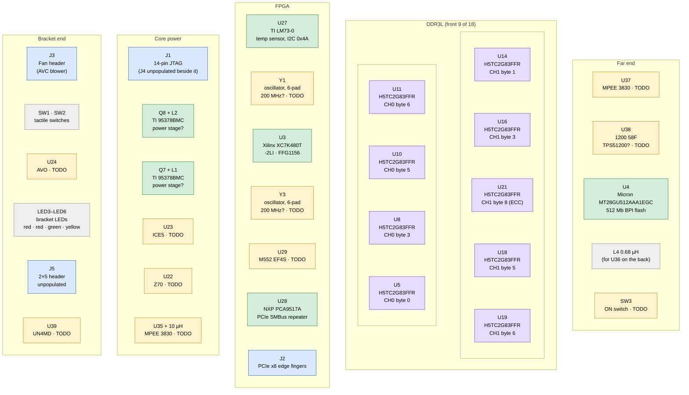

### 8.2 Back side

Drawn **as seen when the card is flipped** (like the back photo): the far end is on the left and the bracket on the right.

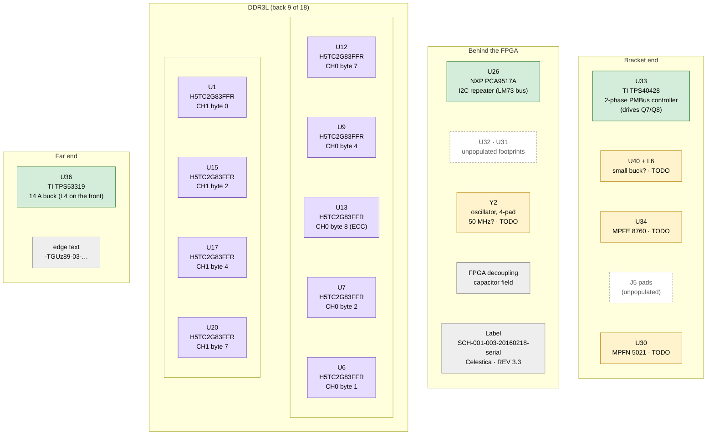

### 8.3 How the chips connect

- **Solid lines** come from the repo's pin data (`part0_pins.xml`, the MIG `.prj` files, the XDC), plus one link checked on the board: the PCIe SMBus through U28.
- **Dashed lines** are inferred or unverified: the oscillator-to-pin assignment, the power rails, the LM73's repeater (U26, by elimination), the LED mapping and which switch is which.

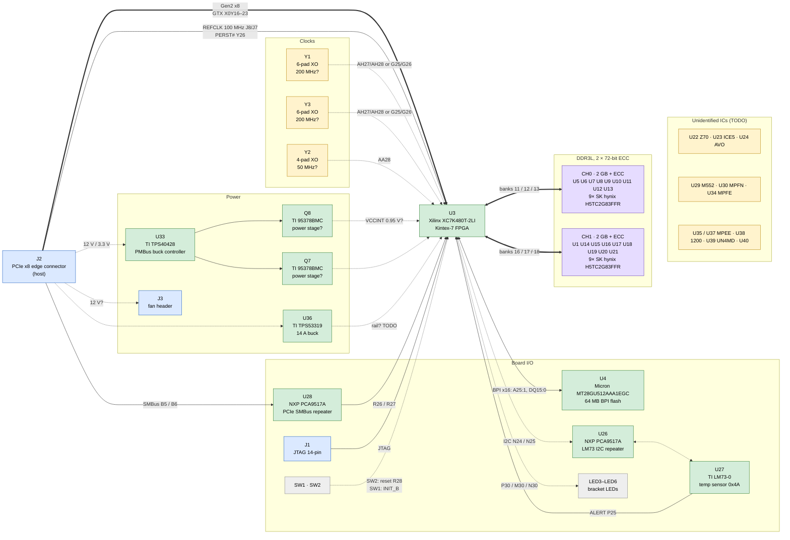

---

## 9. Integrated circuits

Every IC found on the photos, grouped by function. The photos come from unit 0265.

| Group | Ref | Part | Status |
|---|---|---|---|
| [FPGA](#91-fpga) | [U3](#u3-xilinx-xc7k480t-l2ffg1156i) | Xilinx XC7K480T-L2FFG1156I | Identified |
| [Memory](#92-memory) | [U1, U5–U21](#u1-u5u21-sk-hynix-h5tc2g83ffr-pba-ddr3l) | 18× SK hynix H5TC2G83FFR-PBA DDR3L | Identified; no official datasheet link (TODO) |
| | [U4](#u4-micron-mt28gu512aaa1egc-0sit-flash) | Micron MT28GU512AAA1EGC-0SIT BPI flash | Identified |
| [Board management](#93-board-management) | [U27](#u27-ti-lm73-0-temperature-sensor) | TI LM73CIMKX-0 temperature sensor | Identified |
| | [U26](#u26-nxp-pca9517a-i2c-repeater), [U28](#u28-nxp-pca9517a-i2c-repeater) | NXP PCA9517A I²C repeaters | Identified. U28 = PCIe SMBus (continuity-checked), U26 = LM73 bus (by elimination) |
| [Power](#94-power) | [U33](#u33-ti-tps40428-buck-controller) | TI TPS40428 buck controller | Identified |
| | [Q8](#q8-power-stage-marked-95378bmc), [Q7](#q7-power-stage-marked-95378bmc) | Marked `95378BMC` (TI) | Marking matches TI's CSD95378B power stage, package doesn't (TODO?) |
| | [U36](#u36-ti-tps53319-buck-converter) | TI TPS53319 buck converter | Identified |
| [Oscillators](#95-oscillators) | [Y1](#y1-oscillator-probably-200-mhz), [Y3](#y3-oscillator-probably-200-mhz), [Y2](#y2-oscillator-probably-50-mhz) | Unknown makers | TODO |
| [Unidentified](#96-unidentified-ics) | U22, U23, U24, U29, U30, U34, U35, U37, U38, U39, U40 | — | TODO |
| [Unpopulated](#97-unpopulated-footprints) | U31, U32 | — | Empty footprints |

### 9.1 FPGA

#### U3: Xilinx XC7K480T-L2FFG1156I

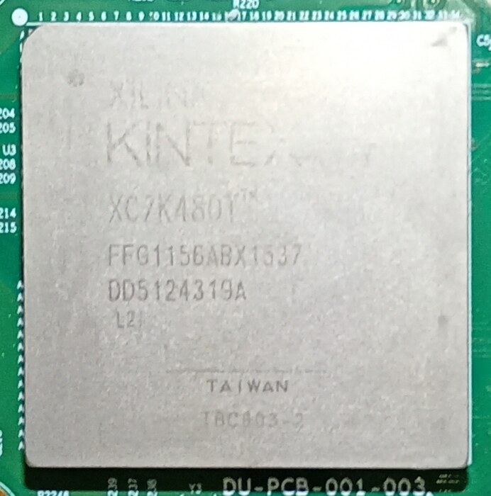

| | |
|---|---|
| Marking | `XILINX KINTEX-7`, `XC7K480T`, `FFG1156ABX1537` (date code 2015, week 37), `DD5124319A`, **`L2I`**, `TAIWAN` |
| Package / location | FFG1156 (35 × 35 mm, 1.0 mm pitch), front, centre. The silkscreen `U3` sits at its left edge |
| Datasheets | [DS182, Kintex-7 DC and AC switching characteristics](https://docs.amd.com/v/u/en-US/ds182_Kintex_7_Data_Sheet); local [7-series product selection guide](../../submodules/DU-PCB-001-003/documents/7-series-product-selection-guide.pdf) |

**Speed grade: -2LI, Vivado part `xc7k480tiffg1156-2L`.**
- **Marking:** the line under the lot code reads **`L2I`**, clearly on unit 0265 and faintly on unit 0300. In the DS180 ordering scheme that is speed grade `-L2` (the low-power -2L) and temperature range `I` (industrial), so the ordering code is **XC7K480T-L2FFG1156I**. The upstream README says "XC7K480T-2FFG1156I", and the submodule's board files target the plain `xc7k480tffg1156-2`.
- **Core voltage:** DS182 says -2L industrial devices run only at **VCCINT = 0.95 V**, where they have the same speed specifications as -2, except where noted. **TODO:** measure VCCINT ([§14.1](#141-measurements-to-make-on-the-board)).
- **Vivado part:** DS182 (v2.19, "Selecting the Correct Speed Grade and Voltage in the Vivado Tools") names a -2LI part as the device name, then `i`, then the package, then the speed grade; its example is `xc7k325tiffg900-2L`. For this chip that gives **`xc7k480tiffg1156-2L`**, supported since Vivado 2014.4. The look-alikes are other grades: `xc7k480tffg1156-2L` is -2LE at 1.0 V and `xc7k480tlffg1156-2L` is -2LE at 0.9 V. This folder's board files use `xc7k480tiffg1156-2L` ([§7.1](#71-board-files)); every design in this folder is built for it, and the bitstreams load on unit 0265.

**Resources** (from the selection guide):

| | |
|---|---|
| Logic | 477,760 logic cells, 74,650 slices, 597,200 CLB flip-flops |
| Memory | 955 × 36 Kb block RAM (34,380 Kb in total), 6,788 Kb distributed RAM |
| DSP and clocking | 1,920 DSP48E1 slices, 8 CMTs |
| Hard blocks | 1 PCIe Gen2 block, 1 XADC, 1 AES/HMAC configuration block |
| Transceivers | 32 GTX. The family maximum is 12.5 Gb/s; the limit depends on speed grade, see DS182 |
| I/O | 400 HR I/Os in 8 banks, **no HP banks**, up to 192 differential pairs ([§11.1](#111-io-banks)) |

### 9.2 Memory

#### U1, U5–U21: SK hynix H5TC2G83FFR-PBA DDR3L

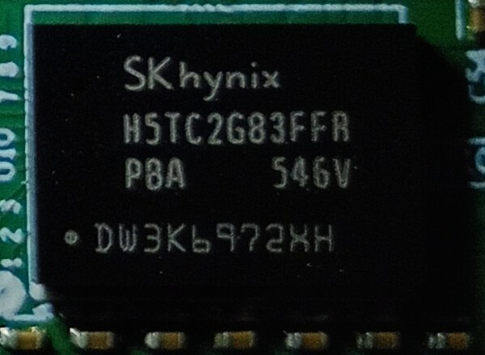

| | |
|---|---|
| Marking | `SKhynix`, `H5TC2G83FFR`, `PBA`, a date code (`546V` or `547V`) and a lot code (`DW3K6972HH`, `DW3K7028H1` and others) |
| Package | 78-ball FBGA (x8); 9 chips on each side of the card |
| Datasheet | **TODO:** SK hynix no longer hosts it. An unofficial copy of the FFR family datasheet (Rev 1.0, Nov 2012) is listed at [dtsheet.com](https://dtsheet.com/model/1811300) |

**What the part is:** a 2 Gb (256M × 8) DDR3L chip, 1.35 V and 1.5 V capable, with 8 banks, 32K rows and 1K columns.
- **Speed bin:** `PB` is very likely the DDR3L-1600 (11-11-11) bin. `A` should be the commercial-temperature suffix. **TODO?** confirm both in the FFR datasheet.
- **On YPCB-00338-1P1** these positions hold Micron MT41K256M8DA-125:K chips, which have the same geometry. The MIG presets still target the Micron part ([§12.2](#micron-presets-on-sk-hynix-chips)).
- **Positions:** which chip serves which byte lane, and which side it is on, is listed in [§12.2](#byte-lanes-and-pins).

#### U4: Micron MT28GU512AAA1EGC-0SIT flash

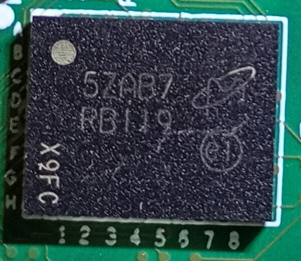

| | |
|---|---|
| Marking (unit 0265) | Micron logo, `57AB7`, **`RB119`** (Micron FBGA code), `X9FC`. On unit 0300 the chip is under a `001` sticker |
| Package / location | 64-ball TBGA, 10 × 8 mm (8 × 8 ball grid on the silkscreen); front, far end of the card |
| Datasheet | Local copy: [256Mb/512Mb/1Gb StrataFlash, Micron Rev I](../../submodules/DU-PCB-001-003/documents/MT28GU512AAA1EGC-0SIT.pdf). Part page: [Octopart](https://octopart.com/part/micron/MT28GU512AAA1EGC-0SIT). **TODO:** link Micron's official page, or decode `RB119` with Micron's FBGA decoder |

**What the part is:** a 512 Mb (64 MB) parallel NOR flash, x16, 1.7–2.0 V, 96 ns initial access. It holds the FPGA configuration and can also be read and written from user logic. Specifications, pins and Vivado settings are in [§12.3](#123-bpi-configuration-flash).

### 9.3 Board management

#### U27: TI LM73-0 temperature sensor

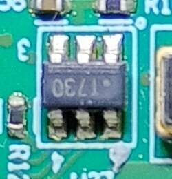

| | |
|---|---|
| Marking | **`T730`** = LM73CIMK(X)**-0**, according to TI's orderable addendum (the `-1` variant is marked `T731`) |
| Package / location | SOT-23-6, front, top edge, next to Y1 |
| Datasheet | [TI LM73](https://www.ti.com/lit/ds/symlink/lm73.pdf) (SNIS141F), local [copy](../../submodules/DU-PCB-001-003/documents/lm73.pdf) |

**What the part is:** an I²C/SMBus temperature sensor.
- **Supply and bus:** 2.7–5.5 V supply; SMBus/I²C up to 400 kHz, with a bus time-out; SDA and ALERT are open-drain.
- **Address 0x4A:** the LM73-0 answers at 0x48 (ADDR floating), 0x49 (ADDR to GND) or **0x4A (ADDR to VDD)**; the LM73-1 at 0x4C, 0x4D or 0x4E. This board uses 0x4A, so ADDR is tied to VDD.
- **Data:** 11 to 14 bits; the default is 11-bit, 0.25 °C/LSB, 14 ms per conversion. Values are left-justified two's complement, so °C = raw16 / 128. Accuracy is ±1 °C from −10 to 80 °C.
- **Wiring:** SCL N24, SDA N25, ALERT P25. SCL/SDA go through U26 (by elimination, since U28 is on the PCIe SMBus; [§12.5](#125-i2c-buses)).
- **Correction:** the YPCB pinout sheet calls the LM73 "U22". On this card U22 is a different part ([U22](#u22-z70)).

| Pointer | Register | Access | Reset value |
|---|---|---|---|
| 0x00 | Temperature | Read-only | `7FFCh` |
| 0x01 | Configuration | Read/write | `40h` |
| 0x02 | THIGH | Read/write | `7FE0h` (255.75 °C) |
| 0x03 | TLOW | Read/write | `8000h` |
| 0x04 | Control/status | Read/write | `08h` |
| 0x07 | ID | Read-only | `0190h` |

#### U26: NXP PCA9517A I2C repeater

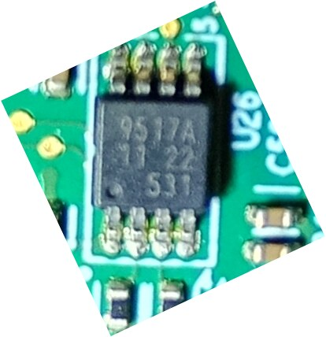

| | |
|---|---|
| Marking | `9517A`, `11 22`, `S31`. NXP uses the top mark `9517A` for the PCA9517ADP (TSSOP8) |
| Package / location | TSSOP-8 (3 mm), back, near the top edge, **directly behind the LM73** |
| Datasheet | [NXP PCA9517A](https://www.nxp.com/docs/en/data-sheet/PCA9517A.pdf) (Rev 4.1, 2016). TI makes a second source: [TI PCA9517A](https://www.ti.com/lit/ds/symlink/pca9517a.pdf) |

**What the part is:** a level-translating I²C/SMBus repeater for **one** bus; its two channels are that bus's SCL and SDA.
- **Port A** is the low-voltage side (0.9–5.5 V). **Port B** is the 2.7–5.5 V side.
- **TSSOP8 pinout:** 1 VCC(A), 2 SCLA, 3 SDAA, 4 GND, 5 EN, 6 SDAB, 7 SCLB, 8 VCC(B).
- **Which bus:** the LM73 bus. U28 was continuity-checked to the PCIe SMBus, so U26 serves the LM73 by elimination, which matches its placement. The YPCB sheet's "U26 = PCIe SMBus" is wrong for this card ([§12.5](#which-repeater-is-which)).

#### U28: NXP PCA9517A I2C repeater

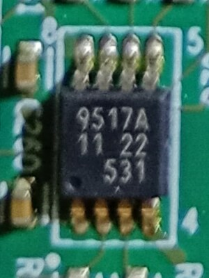

| | |
|---|---|
| Marking | `9517A`, `11 22`, `S31` |
| Package / location | TSSOP-8, front, next to the PCIe edge connector, below Y3 |
| Datasheet | [NXP PCA9517A](https://www.nxp.com/docs/en/data-sheet/PCA9517A.pdf) |

The same part as U26. It serves the **PCIe SMBus** (SMCLK on finger B5, SMDAT on B6): a continuity test on unit 0265 confirmed it, and it sits next to the short segment of the edge connector that carries those fingers. See [§12.5](#125-i2c-buses).

### 9.4 Power

What each regulator supplies is not documented; the rails are summarised in [§11.3](#113-supplies-and-regulators).

#### U33: TI TPS40428 buck controller

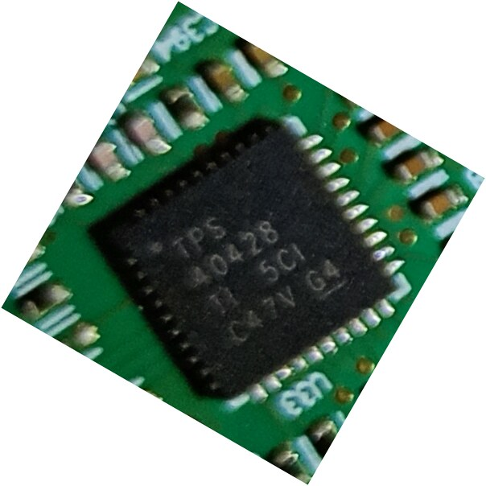

| | |
|---|---|
| Marking | `TPS 40428`, `TI 5CI`, `C47V G4` |
| Package / location | 40-pin QFN, back, bracket end |
| Datasheet | [TI TPS40428](https://www.ti.com/lit/ds/symlink/tps40428.pdf) |

**What the part is:** a dual-output or two-phase synchronous buck controller with PMBus. It is "driverless": it drives external smart power stages, probably Q7 and Q8.
- **Probable rail:** with Q7/Q8 and the 0.33 µH inductors L1/L2 (marked `1007R6 R33`), it most likely produces the FPGA core rail, VCCINT (0.95 V for -2LI). **Not verified.**
- **PMBus:** pins 5 (SMBALERT), 6 (PMBDATA) and 7 (PMBCLK), with SMBus logic levels (VIH 2.1 V, VIL 0.8 V) and rated to 5.5 V. Where they are wired is unknown (**TODO**). If they reach the FPGA or the host, `READ_VOUT` (0x8B) and `READ_IOUT` (0x8C) would report the core rail's voltage and current.
- **PMBus address:** set by resistors from pin 11 (ADDR1) and pin 12 (ADDR0) to ground. Each picks one octal digit: 8.45 kΩ = 0, 16.2 kΩ = 1, 25.5 kΩ = 2, 37.4 kΩ = 3, 54.9 kΩ = 4, 84.5 kΩ = 5, 133 kΩ = 6, 200 kΩ = 7. The 7-bit address is 8 × ADDR1 + ADDR0. Out-of-range values give 0x7F.

#### Q8: power stage (marked 95378BMC)

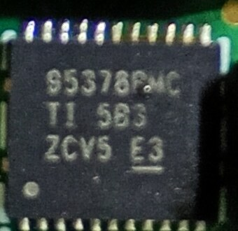

| | |
|---|---|
| Marking | `95378BMC`, `TI 5B3`, `ZCV5 E3` |
| Package / location | About 22 leads on its two long sides, plain epoxy top; front, left of the FPGA (the upper of the two), feeding inductor L2 |
| Datasheet | Probably [TI CSD95378BQ5MC](https://www.ti.com/lit/ds/symlink/csd95378bq5mc.pdf). **TODO?** see the note below |

**What the part probably is:** a synchronous buck smart power stage (driver plus high- and low-side FETs), forming one phase of the U33 regulator.

> **Conflict:** the marking matches TI's naming for the CSD95378BQ5MC. But TI lists that part as a **12-pin** 5 × 6 mm SON with a metal DualCool top, while the chip on the board has about 22 leads and a plain top. The exact part is unconfirmed (**TODO?**).

#### Q7: power stage (marked 95378BMC)

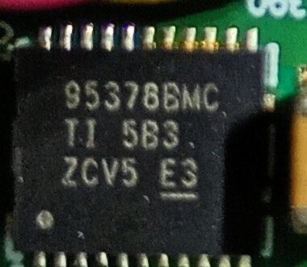

| | |
|---|---|
| Marking | `95378BMC`, `TI 5B3`, `ZCV5 E3` |
| Package / location | Same package as Q8; front, the lower of the two, feeding inductor L1 |
| Datasheet | Same as Q8 (**TODO?**) |

The same part as Q8: the second phase (or second output) of the U33 regulator.

#### U36: TI TPS53319 buck converter

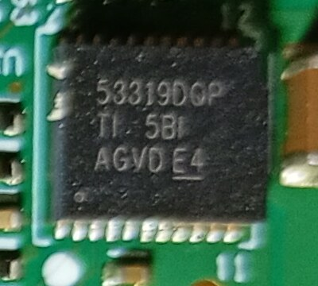

| | |
|---|---|
| Marking | `53319DQP`, `TI 5BI`, `AGVD E4` (the same on both units) |
| Package / location | 22-pin LSON-CLIP (5 × 6 mm), back, far end of the card |
| Datasheet | [TI TPS53319](https://www.ti.com/lit/ds/symlink/tps53319.pdf) |

**What the part is:** a 14 A synchronous buck converter with integrated MOSFETs and Eco-mode. Its inductor is probably **L4** (0.68 µH), on the front directly opposite. **TODO:** which rail it produces (perhaps the DDR3 or an auxiliary rail).

### 9.5 Oscillators

The repo defines three clocks: two 200 MHz differential clocks and one 50 MHz single-ended clock ([§12.1](#121-clocks-and-reset)). The package shapes suggest which oscillator is which.

#### Y1: oscillator, probably 200 MHz

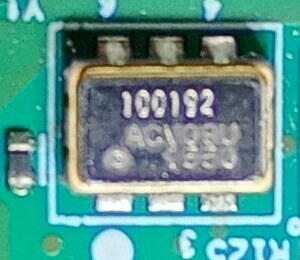

| | |
|---|---|
| Marking | `100192`, `ACV08U`(?), `1550` |
| Package / location | 6-pad ceramic, roughly 7 × 5 mm; front, top edge, between U27 and MH6 |
| Datasheet | **TODO:** identify the maker and part |

6-pad packages are typical of differential (LVDS) oscillators, so this is probably one of the two 200 MHz clocks: AH27/AH28 (CH0) or G25/G26 (CH1).

#### Y3: oscillator, probably 200 MHz

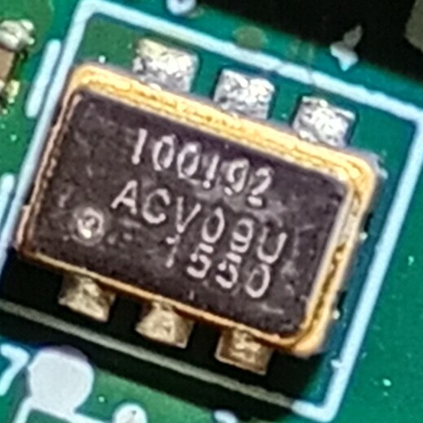

| | |
|---|---|
| Marking | `100192`, `ACV08U`(?), `1550`, the same as Y1 |
| Package / location | 6-pad ceramic, front, below the FPGA, next to the `DU-PCB-001-003` silkscreen |
| Datasheet | **TODO:** identify the maker and part |

Probably the other 200 MHz clock.

#### Y2: oscillator, probably 50 MHz

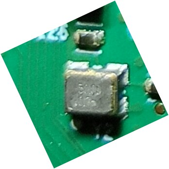

| | |
|---|---|
| Marking | Unreadable |
| Package / location | 4-pad, roughly 3.2 × 2.5 mm; back, near the centre (close to R126/R132) |
| Datasheet | **TODO:** identify the part |

4 pads means a single-ended output, so this is probably the 50 MHz system clock on AA28. The YPCB notes also put the 50 MHz clock on the back.

### 9.6 Unidentified ICs

Markings were read from the photos; web searches found nothing for them. **TODO:** identify all of these.

#### U22 (`Z70`)

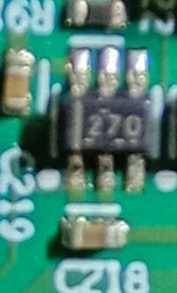

| | |
|---|---|
| Marking | `Z70` (it could also read `270` or `Z7Q`) |
| Package / location | SOT-23-6, front, below the FPGA's lower-left corner, next to U23 |

The YPCB pinout sheet calls U22 the LM73, but the LM73 is U27 on this card.

#### U23 (`ICE5`)

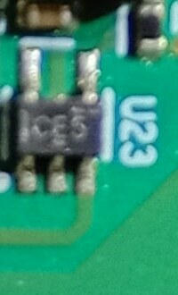

| | |
|---|---|
| Marking | `ICE5` |
| Package / location | SOT-23-5, front, directly above U22 |

#### U24 (`AVO`)

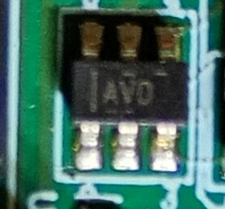

| | |
|---|---|
| Marking | `AVO`, with a bar at one end (unit 0300's photo reads like `DAY`); the orientation is uncertain |
| Package / location | SOT-23-6, front, next to SW1/SW2 near the bracket |

Being next to the push buttons, it could be a reset or supervisor IC.

#### U29 (`M552 EF4S`)

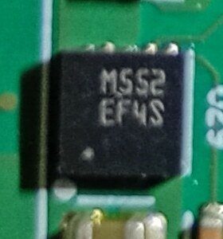

| | |
|---|---|
| Marking | `M552`, `EF4S` |
| Package / location | Small QFN/DFN, front, right above the short segment of the PCIe edge connector (pins B1–B11) |

#### U30 (`MPFN 5021 B485`)

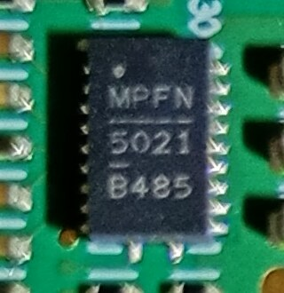

| | |
|---|---|
| Marking | `MPFN`, `5021`, `B485` (the same on both units) |
| Package / location | Leadless, pins on two sides (about 20 pins); back, near the edge connector at the bracket end |

#### U34 (`MPFE 8760 501E`)

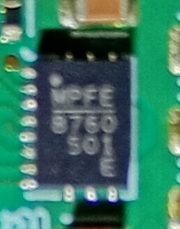

| | |
|---|---|
| Marking | `MPFE`, `8760`, `501E` |
| Package / location | QFN/DFN, back, bracket end, next to J5's pads |

It has the same marking style as U30, U35 and U37.

#### U35 (`MPEE 3830 854 M`)

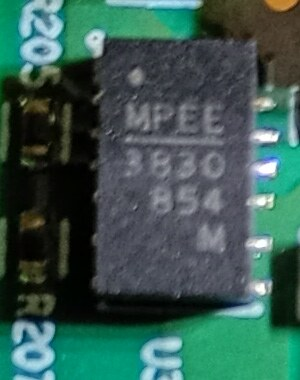

| | |
|---|---|
| Marking | `MPEE`, `3830`, `854`, `M` |
| Package / location | DFN (pins on two sides), front, bracket end, next to the Würth 744311100 10 µH inductor |

It is the same part as U37. The 10 µH power inductor next to it suggests a DC-DC converter or controller.

#### U37 (`MPEE 3830 854 M`)

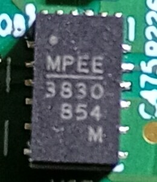

| | |
|---|---|
| Marking | `MPEE`, `3830`, `854`, `M` |
| Package / location | DFN, front, far end of the card, next to U4 and TP4 |

The same part as U35.

#### U38 (`1200 58F S06Z`)

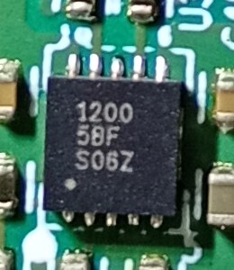

| | |
|---|---|
| Marking | `1200`, `58F`, `S06Z` |
| Package / location | Small QFN (roughly 3 × 3 mm), front, far end of the card near U37 |
| Datasheet | If it is a TPS51200: [TI TPS51200](https://www.ti.com/lit/ds/symlink/tps51200.pdf) |

**Lead:** possibly a TI **TPS51200** DDR termination regulator. Distributor listings give its top marking as `1200`, and it comes in a 3 × 3 mm 10-pin SON. It would make the DDR3 VTT and VTTREF (both VDDQ / 2) from VDDQ. **TODO?** confirm by measuring its pins against the datasheet pinout.

#### U39 (`UN4MD`)

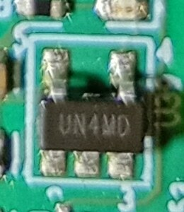

| | |
|---|---|
| Marking | `UN4MD` |
| Package / location | SOT-23-5, front, bracket end, next to the LED stack and LED7/LED8 |

#### U40 (marking unreadable)

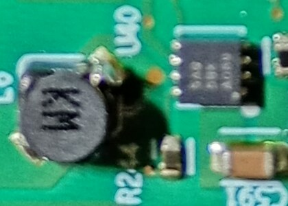

| | |
|---|---|
| Marking | Unreadable on the photos |
| Package / location | Small 8-pin package, back, next to the small inductor L6 |

With L6 next to it, it is probably a small buck converter.

### 9.7 Unpopulated footprints

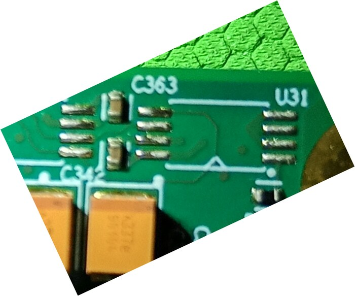

- **U31 and U32** are empty footprints on the back near the top edge, next to C363, on both units. U32 is an 8-pad TSSOP/MSOP footprint and U31 a smaller one.
- **U2 and U25** appear on no photo; they may be unused designators.
- **J4 and J5** (connectors) are also unpopulated ([§10](#10-connectors-switches-and-leds)).

---

## 10. Connectors, switches and LEDs

Everything here was seen on the photos. The pins behind the LEDs and buttons are in [§12.6](#126-leds-and-buttons).

| Ref | What | Notes |
|---|---|---|
| J2 | PCIe x8 edge connector | Pins A1–A49 on the back and B1–B49 on the front; B1 is the finger nearest the bracket on the short segment ([§12.4](#124-pci-express)) |
| J1 | 14-pin (2×7) shrouded header | JTAG ([§12.7](#127-jtag)). Pin 1 is marked by a triangle next to the `J1` label; the even pins are on the row nearest the board edge |
| J3 | 4-pin white wire-to-board connector | **Fan header** (confirmed on unit 0265, which has an AVC BAZA0509R2U blower on it). The yellow wire goes to R250 on the back. Wiring and open questions in [§12.8](#128-fan-header) |
| J4 | Unpopulated footprint | 4 SMD pads and 2 holes, left of J1. On unit 0265 it is buried under hot glue |
| J5 | Unpopulated 2×5 through-hole header | Near the bracket LEDs. Purpose unknown |
| LED3–LED6 | 4 right-angle LEDs at the bracket edge | **Red, red, green, yellow** (unit 0265, seen from the back). The board files define only 3 user LEDs ([§12.6](#126-leds-and-buttons)) |
| LED7, LED8, LED9, LED12 | Small SMD LEDs | LED7 and LED8 are next to U39, LED9 next to R157 and LED12 next to J3. There may be more. None is mentioned in any file. **LED7/LED8 colours (unit 0265, seen lit):** the one nearer the PCIe edge connector is **green**, the one nearer the bracket (I/O side) is **red**. Which designator is which is not recorded (TODO). Observed behaviour in [§12.6](#small-smd-leds-red-and-green) |
| SW1, SW2 | 2 ALPS tactile switches | Near the bracket. According to the YPCB notes (TiferKing's blog), SW2 is the user reset on R28 and SW1 drives `INIT_B` ([§12.6](#126-leds-and-buttons)) |
| SW3 | 1-position slide/DIP switch, marked `ON` | Front, far end of the card near TP3. Not mentioned in any file; function unknown (TODO) |
| TP1–TP6 | Test points | TP1, TP2, TP5 and TP6 are at the bracket end; TP3 and TP4 are at the far end |
| MH1–MH6 | Mounting holes | Six plated holes. The blower's black shroud may be part of the original heatsink assembly (not confirmed) |

---

## 11. FPGA I/O banks and power

The XC7K480T in the FFG1156 package has:
- **8 HR (high-range) I/O banks**, numbered 11–18, with 50 I/Os each;
- the dedicated configuration bank **0**;
- **8 GTX quads**, numbered 111–118.

It has **no HP banks**, so `LVDS` (only `LVDS_25` at 2.5 V VCCO), DCI and VCCAUX_IO don't exist on this device. Several upstream settings assume they do ([§12.1](#121-clocks-and-reset), [§12.2](#mig-presets)).

**How the tables were built.**
- **Banks:** every pin used by the board files and MIG presets was looked up in Xilinx's package file [`xc7k480tffg1156pkg.txt`](https://www.xilinx.com/support/packagefiles/k7packages/xc7k480tffg1156pkg.txt).
- **VCCO:** inferred from the I/O standards on each bank's pins in the example design, since all standards in one bank must share one VCCO. **Nobody has measured these on this card.**

### 11.1 I/O banks

| Bank | Type | VCCO | Why we think so | Pins assigned / I/Os | What is on it |
|---|---|---|---|---|---|
| 0 | Dedicated configuration | Probably 1.8 V (**TODO?** measure) | CFGBVS reads GND (so 1.8 V or 1.5 V), and the 1.8 V flash is on the configuration pins. J1's VREF pin (pin 2) normally sits at VCCO_0, so measure there | 21 dedicated pins | JTAG TCK/TMS/TDI/TDO to [J1](#127-jtag); CCLK, DONE, PROGRAM_B; INIT_B (SW1 on the YPCB); mode pins M[2:0] (read `010`, master BPI); CFGBVS (reads GND); PUDC_B (reads low: pull-ups during configuration); XADC dedicated inputs (the XADC is used by [MIG](#mig-presets)) |
| 11 | HR | 1.5 V (**TODO?** measure) | `SSTL15` / `DIFF_SSTL15` in the example design | 40 / 50 | [DDR3 CH0](#122-ddr3-memory) byte lanes 0–3: DQ[31:0], DQS0–3 |
| 12 | HR | 1.5 V (**TODO?** measure) | As bank 11 | 38 / 50 | DDR3 CH0 address, command and CK; CH0 byte lane 7 (DQ[63:56]); [200 MHz clock 1](#121-clocks-and-reset) on AH27/AH28, an SRCC pair, fed by [Y1 or Y3](#y1-oscillator-probably-200-mhz) |
| 13 | HR | 1.5 V (**TODO?** measure) | As bank 11, plus `LVCMOS15` on RESET# | 41 / 50 | DDR3 CH0 byte lanes 4–6 and ECC lane 8 (DQ[71:32]); CH0 RESET# on AD31 |
| 14 | HR, multi-function configuration | 1.8 V | `LVCMOS18` in the board files; must match the 1.8 V [flash](#u4-micron-mt28gu512aaa1egc-0sit-flash) | 35 / 50 | [BPI flash](#123-bpi-configuration-flash) DQ[15:0] (pins D00–D15), A[16:1] (pins A00–A15) and CE# (FCS_B); [50 MHz clock](#y2-oscillator-probably-50-mhz) on AA28 (MRCC); [PCIe PERST#](#124-pci-express) on Y26 (MRCC); the [keep-alive pin AC24](#3-keep-alive-pin-ac24) |
| 15 | HR, multi-function configuration | 1.8 V | `LVCMOS18` in the board files | 21 / 50 | [BPI flash](#123-bpi-configuration-flash) A[25:17] (pins A16–A24), ADV# (ADV_B), OE# (FOE_B), WE# (FWE_B); [user LEDs and reset](#126-leds-and-buttons) P30/M30/N30 and R28; [LM73](#u27-ti-lm73-0-temperature-sensor) SCL N24, SDA N25, ALERT P25; [PCIe SMBus](#125-i2c-buses) R26/R27 |
| 16 | HR | 1.5 V (**TODO?** measure) | As bank 11 | 40 / 50 | [DDR3 CH1](#122-ddr3-memory) byte lanes 0, 1, 3 and ECC lane 8 |
| 17 | HR | 1.5 V (**TODO?** measure) | As bank 11 | 38 / 50 | DDR3 CH1 address, command and CK; CH1 byte lane 5; [200 MHz clock 2](#121-clocks-and-reset) on G25/G26, an SRCC pair, fed by [Y1 or Y3](#y3-oscillator-probably-200-mhz) |
| 18 | HR | 1.5 V (**TODO?** measure) | As bank 11, plus `LVCMOS15` on RESET# | 41 / 50 | DDR3 CH1 byte lanes 2, 4, 6, 7; CH1 RESET# on F18 |

**Notes**
- **Flash address numbering:** the FPGA's configuration address pins A00–A24 drive flash A1–A25, because the flash is word-addressed. The `D16`–`D31` names on the bank-14 address pins only matter in x32 modes.
- **Why `axi_emc` can reach the flash:** banks 14 and 15 read the flash during configuration and become ordinary user I/O afterwards. That is what lets `axi_emc` use the same pins.
- **Unassigned pins:** 9 to 29 I/Os per bank appear in no file. The small SMD LEDs, SW3, U24 and the fan header may connect to some of them (**TODO?**).
- **DDR3 voltage:** the DDR banks are assumed to run at 1.5 V because the example design uses `SSTL15` and was built for that. The DRAMs are DDR3L and would also run at 1.35 V, so measure VCCO/VDDQ before relying on it.

### 11.2 GTX quads

| Quad (bank) | Channels | Used for | Reference clock |
|---|---|---|---|
| 116 | GTXE2_CHANNEL_X0Y20–X0Y23 | [PCIe](#124-pci-express) lanes 0–3 (lane 0 is on X0Y23) | MGTREFCLK0_116 on J8/J7: the 100 MHz PCIe reference clock from the edge connector |
| 115 | X0Y16–X0Y19 | PCIe lanes 4–7 (lane 4 is on X0Y19) | Shares quad 116's clock. Its own MGTREFCLK0/1 pins (R8/R7, U8/U7) appear in no file (**TODO?**). This quad also holds MGTRREF/MGTAVTTRCAL (T9/T10), the GTX calibration-resistor pins |
| 111–114, 117, 118 | X0Y0–X0Y15, X0Y24–X0Y31 | Not used by any file. The card has no other high-speed connector, so probably unconnected (**TODO?**) | — |

### 11.3 Supplies and regulators

| Rail | Value | Source / likely regulator |
|---|---|---|
| VCCINT | 0.95 V? | The FPGA is marked -2LI ([U3](#u3-xilinx-xc7k480t-l2ffg1156i)). Probably [U33](#u33-ti-tps40428-buck-controller) with [Q7/Q8](#q8-power-stage-marked-95378bmc). **TODO?** measure |
| VCCBRAM | **TODO?** | — |
| VCCAUX | 1.8 V | Fixed for the 7-series (DS182) |
| VCCAUX_IO | Not present | This package has no HP banks and no VCCAUX_IO pins |
| VCCO_0, VCCO_11 … VCCO_18 | See [§11.1](#111-io-banks) | — |
| DDR3 VDDQ | 1.5 V? (or 1.35 V) | Follows the bank-11/12/13/16/17/18 VCCO. Possibly [U36](#u36-ti-tps53319-buck-converter). **TODO?** measure |
| DDR3 VREF | 0.75 V? | MIG uses an external VREF (internal VREF disabled), so the DDR banks' VREF pins need VCCO/2. **TODO?** measure |
| DDR3 VTT | 0.75 V? | Termination for the address and command lines, VDDQ / 2. Possibly [U38](#u38-1200-58f-s06z) if it is a TPS51200. **TODO?** measure |
| MGTAVCC / MGTAVTT / MGTVCCAUX | **TODO?** (DS182 nominal: 1.0 V / 1.2 V / 1.8 V) | The package has two GTX power groups, G10 and G11 |

Other converters ([U35](#u35-mpee-3830-854-m) with its 10 µH inductor, [U40](#u40-marking-unreadable) with L6) probably produce auxiliary rails (**TODO?**).

---

## 12. Interfaces and pinout

Sources: `part0_pins.xml`, the MIG `.prj` files, `constraints/ypcb003381p1.xdc` and `physical_pinout.xlsx`. Bank numbers come from [§11.1](#111-io-banks).

### 12.1 Clocks and reset

| Signal | FPGA pin (bank) | I/O standard | Notes |
|---|---|---|---|
| 50 MHz system clock | AA28 (14) | LVCMOS18 | Single-ended, probably from [Y2](#y2-oscillator-probably-50-mhz). Board interface `default_50mhz_clk0`; port `SYS_CLK` in the XDC |
| 200 MHz clock 1 (P / N) | AH27 / AH28 (12) | `DIFF_SSTL15`, `DQS_BIAS=TRUE` | SRCC pair. System clock for DDR3 **CH0**; from [Y1 or Y3](#y1-oscillator-probably-200-mhz) |
| 200 MHz clock 2 (P / N) | G25 / G26 (17) | `DIFF_SSTL15`, `DQS_BIAS=TRUE` | SRCC pair. System clock for DDR3 **CH1**; from [Y1 or Y3](#y3-oscillator-probably-200-mhz) |
| PCIe reference clock (P / N) | J8 / J7 (quad 116) | MGT | 100 MHz from the edge connector. Buffer it with `IBUFDSGTE` |
| PCIe `PERST#` | Y26 (14) | LVCMOS18 | Active low |

The user reset button (R28) is listed with the LEDs in [§12.6](#126-leds-and-buttons).

> [!WARNING]
> **The submodule's board files get the 200 MHz clocks wrong.** They give the pins `LVDS`, which Vivado accepts only in HP banks (this package has only HR banks, [§11](#11-fpga-io-banks-and-power)), and set `util_ds_buf` to `IBUFDSGTE`, a transceiver reference-clock buffer. This folder's board files use `DIFF_SSTL15`, as MIG does in the example design, and `IBUFDS` ([§7.1](#71-board-files)). With the submodule's files, override both yourself.

### 12.2 DDR3 memory

The card has two independent channels. Each channel is 72 bits wide: 9 x8 chips ([U1, U5–U21](#u1-u5u21-sk-hynix-h5tc2g83ffr-pba-ddr3l)) giving 64 data bits plus 8 ECC bits.

| | CH0 | CH1 |
|---|---|---|
| Capacity | 2 GB data + 256 MB ECC | 2 GB data + 256 MB ECC |
| Chips | U5–U13 | U1, U14–U21 |
| FPGA banks | 11, 12, 13 (address/control in bank 12) | 16, 17, 18 (address/control in bank 17) |
| System clock | 200 MHz clock 1: AH27/AH28 (bank 12) | 200 MHz clock 2: G25/G26 (bank 17) |
| Pin files | `constraints/MEMORY_CH0.ucf`, `mig_0.prj` | `constraints/MEMORY_CH1.ucf`, `mig_1.prj` |

In total that is **4 GB usable** and 4.5 GB raw (18 × 256 MB). **CH0 with `mig_0.prj` is verified on unit 0265**: it calibrates at DDR3-1066 and passes the [example's](#4-example-microblaze-v-blinker-with-ddr-check) memory tests. CH1 is untested.

#### MIG presets

The board files offer three presets (MIG 7 Series v4.2): `mig_0.prj`, `mig_1.prj` and `mig_01.prj`.
- **Which to use:** `mig_01.prj` is one MIG core with both controllers (board interface `ddr3_sdram_ch01`, 4 GB).
- **Pin check:** its pin set is exactly the union of `mig_0.prj` and `mig_1.prj`, and both `.ucf` files match their `.prj` files pin for pin (checked with a script).
- **Target FPGA:** the submodule's presets target `xc7k480t-ffg1156/-2`; this folder's copies target `xc7k480ti-ffg1156/-2L` and are otherwise identical.

**Speed and clocks**

| Setting | Value |
|---|---|
| Clock period | **1875 ps**: 533.33 MHz memory clock, so the interface runs at **DDR3-1066**. The chips are rated faster |
| PHY-to-controller ratio | 4:1, so `ui_clk` is about 133 MHz |
| PLL | 200 MHz input × 16 / 3 = 1066.67 MHz VCO |
| Input clock | 200 MHz differential; reference clock set to "Use System Clock" |
| `sys_rst` | Active low |

**Memory and controller**

| Setting | Value |
|---|---|
| Memory part | `DDR3_SDRAM/Components/MT41K256M8XX-125`; the equivalent part is MT41K256M8DA-125 |
| Width | 72 bits, **ECC enabled**, data mask disabled |
| Addressing | 15 row, 10 column and 3 bank address bits; `BANK_ROW_COLUMN` mapping |
| Controller | 4 bank machines, normal ordering |
| Mode registers | BL8 (fixed), sequential bursts, CL 7, CWL 6, AL 0, DLL on |
| Drive and termination | Output drive RZQ/7, RTT_NOM RZQ/4, dynamic ODT off |
| Refresh | Auto self-refresh on, full-array self-refresh, normal temperature range |
| Timing | tCKE 5, tFAW 30 ns, tRAS 35 ns, tRCD 13.75 ns, tREFI 7.8 µs, tRFC 160 ns, tRP 13.75 ns, tRRD 6 ns, tRTP 7.5 ns, tWTR 7.5 ns |
| AXI4 slave port | 512-bit data, 31-bit address (2 GB), 4-bit ID, `RD_PRI_REG` arbitration, no narrow bursts |

**Electrical and I/O**

| Setting | Value |
|---|---|
| Memory voltage option | 1.5 V. The preset also sets VCCAUX_IO = 1.8 V, which has no effect: this package has no VCCAUX_IO pins |
| DCI and termination | The DCI option is set, but HR banks have no DCI; the 50 Ω untuned split on-die termination is what gets used. Internal VREF is off, so the DDR banks' VREF pins need an external 0.75 V reference (**TODO?** measure) |
| I/O power reduction | On |
| XADC | MIG instantiates the XADC for temperature tracking. The device has only one XADC, so to use it yourself, disable it in MIG and drive `device_temp_i` |
| I/O standards in the example's routed checkpoint | `SSTL15` on address, command and DQ; `DIFF_SSTL15` on CK and DQS; `IN_TERM UNTUNED_SPLIT_50` on DQ/DQS; `LVCMOS15` on `RESET#`; fast slew |

#### Micron presets on SK hynix chips

> [!NOTE]
> **The presets were built for the YPCB's Micron chips.** This card has SK hynix H5TC2G83FFR chips; the presets target the Micron MT41K256M8DA-125.
>
> **What the two parts share:**
> - **Geometry:** both are 2 Gb, x8, with 8 banks, 32K rows (A[14:0]) and 1K columns (A[9:0]); 8K refresh every 64 ms.
> - **Supply:** both are DDR3L at 1.35 V (Micron: 1.283–1.45 V) that also work at 1.5 V. Both come in a 78-ball FBGA (Micron: 8 × 10.5 mm).
> - **Speed:** the Micron `-125` is DDR3-1600 at CL 11 (tRCD = tRP = CL = 13.75 ns) and backward compatible with DDR3-1066 at CL 7 ([local datasheet](../../submodules/DU-PCB-001-003/documents/MT41K256M8DA-125.PDF)).
>
> **Why this should work:** the presets run at DDR3-1066 with JEDEC-typical 2 Gb timings, which should be conservative for a 1600-rated Hynix chip.
>
> **Caveats:** that reasoning was **not** checked against a Hynix datasheet, and the board's actual VDDQ (1.35 V or 1.5 V) is undocumented. **TODO:** measure VDDQ.

#### Byte lanes and pins

Bank and byte-group placement, from the MIG `datasheet.txt`:

| Bank | T0 | T1 | T2 | T3 |
|---|---|---|---|---|
| 11 (CH0) | DQ[23:16] | DQ[15:8] | DQ[7:0] | DQ[31:24] |
| 12 (CH0) | Addr/Ctrl-1 | Addr/Ctrl-0 | Addr/Ctrl-2 | DQ[63:56] |
| 13 (CH0) | DQ[55:48] | DQ[47:40] | DQ[39:32] | DQ[71:64] |
| 16 (CH1) | DQ[7:0] | DQ[15:8] | DQ[31:24] | DQ[71:64] |
| 17 (CH1) | Addr/Ctrl-2 | Addr/Ctrl-0 | Addr/Ctrl-1 | DQ[47:40] |
| 18 (CH1) | DQ[55:48] | DQ[63:56] | DQ[39:32] | DQ[23:16] |

Every DDR3 pin, for both channels and all 18 chips, is listed in [§12.9](#129-full-pin-map).

### 12.3 BPI configuration flash

The flash ([U4](#u4-micron-mt28gu512aaa1egc-0sit-flash)) holds the power-up configuration: the mode pins read `010` (master BPI, x16), and unit 0265's flash starts with the vendor bitstream ([§6](#6-configuration-flash)). After configuration the same pins are ordinary user I/O, so user logic can read and write the flash too.

**Wiring.** The flash is connected through 25 address lines `A[25:1]`, 16 data lines `DQ[15:0]`, and the control lines `ADV#`, `CE#`, `OE#` and `WE#`, all LVCMOS18 in banks 14 and 15.
- There is no `A0` because the flash is word-addressed: 2^25 words × 2 bytes = 64 MB.
- No `WAIT` or `CLK` pin is mapped, so only asynchronous access is possible.

**Part summary** (from the Micron datasheet in `documents/`):

| Item | Value |
|---|---|
| Density and interface | 512 Mb, x16, non-multiplexed (part-number code `1`), 65 nm, die revision A |
| Supply | Core and I/O 1.7–2.0 V |
| Array | 256 KB uniform blocks (256 blocks), 8 partitions of 64 Mb |
| Read | 96 ns initial access; synchronous burst up to 133 MHz (not used here) |
| Program and erase | Buffered programming, 2.0 µs per word (typical); block erase 0.9 s (typical) |
| Interface standard | CFI |
| Security | 64-bit unique ID plus 2112 bits of user OTP |
| Package | 64-ball TBGA, 10 × 8 × 1.2 mm (`GC`) |
| Temperature | –40…+85 °C |
| Endurance | 100k erase cycles per block, 20 years data retention |

**In Vivado.** The board interface `bpi_flash` uses `axi_emc` with the preset below. The example design maps the flash as a 64 MB window at `0x6000_0000`. To program it, see [§6](#6-configuration-flash).

| Setting | Value |
|---|---|
| Memory type | Linear flash, asynchronous (`C_MEM0_TYPE=2`) |
| Width | 16-bit memory (`C_MEM0_WIDTH`, `C_MAX_MEM_WIDTH`) |
| Read timing | tAVDV 96 ns, tCEDV 96 ns, tHZCE 9 ns, tHZOE 9 ns |
| Write timing | tWC 40 ns, tWP 40 ns, tWPH 20 ns, tLZWE 20 ns, write recovery 200 ns |
| Example's extra settings | 32-bit AXI, data-width matching on, synchronous burst off, no `STARTUP` primitive |

<details>
<summary>Flash pins</summary>

| Signal | Pin | Signal | Pin | Signal | Pin |
|---|---|---|---|---|---|
| A1 | AD26 | A10 | AB26 | A19 | U33 |
| A2 | AC25 | A11 | AA26 | A20 | T31 |
| A3 | AC29 | A12 | AA31 | A21 | T30 |
| A4 | AC28 | A13 | AA30 | A22 | U31 |
| A5 | AD27 | A14 | AB33 | A23 | U30 |
| A6 | AC27 | A15 | AB32 | A24 | N34 |
| A7 | AB25 | A16 | Y32 | A25 | P34 |
| A8 | AB28 | A17 | P32 | | |
| A9 | AB27 | A18 | R32 | | |

| Signal | Pin | Signal | Pin | Signal | Pin |
|---|---|---|---|---|---|
| DQ0 | AA33 | DQ6 | W31 | DQ12 | W29 |
| DQ1 | AA34 | DQ7 | W32 | DQ13 | V28 |
| DQ2 | Y33 | DQ8 | W30 | DQ14 | W24 |
| DQ3 | Y34 | DQ9 | V25 | DQ15 | Y24 |
| DQ4 | V32 | DQ10 | W25 | | |
| DQ5 | V33 | DQ11 | V29 | | |

| Signal | Pin |
|---|---|
| ADV# | M31 |
| CE# | V30 |
| OE# | T33 |
| WE# | T34 |

</details>

### 12.4 PCI Express

The link is up to **x8 Gen2 (5.0 GT/s)**, using the hard PCIe block at `X0Y0` and GTX quads 115/116 ([§11.2](#112-gtx-quads)). The 100 MHz reference clock comes from the edge connector on J8/J7, and `PERST#` arrives on Y26.

| Lane | RX P / N | TX P / N | GT channel |
|---|---|---|---|
| 0 | H6 / H5 | F2 / F1 | GTXE2_CHANNEL_X0Y23 |
| 1 | J4 / J3 | H2 / H1 | GTXE2_CHANNEL_X0Y22 |
| 2 | K6 / K5 | K2 / K1 | GTXE2_CHANNEL_X0Y21 |
| 3 | L4 / L3 | M2 / M1 | GTXE2_CHANNEL_X0Y20 |
| 4 | M6 / M5 | N4 / N3 | GTXE2_CHANNEL_X0Y19 |
| 5 | P6 / P5 | P2 / P1 | GTXE2_CHANNEL_X0Y18 |
| 6 | R4 / R3 | T2 / T1 | GTXE2_CHANNEL_X0Y17 |
| 7 | T6 / T5 | U4 / U3 | GTXE2_CHANNEL_X0Y16 |

Lane order runs opposite to the GT numbering: lane 0 is on X0Y23. The PCIe SMBus (SMCLK on B5, SMDAT on B6) is covered in [§12.5](#125-i2c-buses).

> **Known issue.** Vivado sometimes leaves the transceiver ports unconstrained. To fix it, add `examples/YPCB_00338_1P1_systest/YPCB_00338_1P1_systest.srcs/constrs_1/new/pcie_port.xdc` to your project.
> - It sets each TX P pin and the `GTXE2_CHANNEL` LOC for each lane.
> - Its cell paths assume an XDMA instance at `top_i/xdma_0`; edit them if your hierarchy differs.
> - `constraints/ypcb003381p1.xdc` only constrains the TX P pins, `pcie_refclk_clk_p` and `PERST#`. Vivado infers the N and RX pins from those.

### 12.5 I2C buses

The FPGA drives two separate I²C buses, each through its own [PCA9517A](https://www.nxp.com/docs/en/data-sheet/PCA9517A.pdf) repeater. For SMBus background, see [NXP/Freescale AN4471, "SMBus Quick Start Guide"](https://www.nxp.com/docs/en/application-note/AN4471.pdf).

| Bus (board interface) | FPGA pins (bank 15) | Other end | Repeater | Who controls it |
|---|---|---|---|---|
| `iic_lm73` | SCL N24, SDA N25; ALERT P25 | [LM73](#u27-ti-lm73-0-temperature-sensor) U27, address 0x4A | [U26](#u26-nxp-pca9517a-i2c-repeater), by elimination | The FPGA (the only controller) |
| `iic_pcie` | SCL R26, SDA R27 | PCIe edge connector: SMCLK on B5, SMDAT on B6 | [U28](#u28-nxp-pca9517a-i2c-repeater), continuity-checked. The YPCB sheet wrongly says U26 | The host. Its system-management controller (BMC) is normally the master, and the card answers as a target |

The SCL/SDA pins use `LVCMOS18` with 8 mA drive and slow slew; ALERT is an `LVCMOS18` input. The example design gives each bus its own `axi_iic` core: IIC 0 at `0x4080_0000`, IIC 1 at `0x4081_0000` ([§13.1](#131-vivado-project)).

**ALERT** is not an I²C line, so it does not need the repeater. Because it is open-drain, it can be pulled up to 1.8 V directly for the FPGA (**TODO?** confirm on the board).

#### Why two I2C repeaters?

**Short answer:** each repeater carries one bus, and there are two buses.

1. **There are two independent buses**, on different FPGA pins (table above).
2. **Both buses need level translation.**
   - The FPGA pins are `LVCMOS18` in a 1.8 V bank. 7-series HR inputs tolerate only VCCO + 0.55 V (DS182), about 2.35 V here, so a 3.3 V bus would overstress them.
   - SMBus requires a nominal bus voltage of 2.7–5.5 V with fixed logic thresholds: VIL ≤ 0.8 V, VIH ≥ 2.1 V (AN4471, Table 2). The PCIe SMBus runs at 3.3 V.
   - The LM73 needs a 2.7–5.5 V supply, and its open-drain bus is pulled up to that supply.
   - So each bus gets a PCA9517A: **port A** on the FPGA's 1.8 V side, **port B** on the 3.3 V side.
3. **One PCA9517A carries one bus.** "2 channel" in the datasheet means SCL and SDA of a single bus, so two buses need two chips.
4. **Why not merge the sensor onto the host's SMBus and save a chip?**
   - **Ownership:** the PCIe SMBus belongs to the host and can be shared with other cards. On a private bus, the host never sees the LM73 or collides with address 0x4A, and the FPGA is the only controller on the sensor's bus.
   - **Power:** the host's SMBus may stay alive while the card is switched off. AN4471 says powered-down devices must not load the bus. The PCA9517A's I²C pins go high-impedance when it is unpowered (datasheet feature list), so a switched-off card stays invisible to the host.
   - **Capacitance:** each side of a PCA9517A may carry up to 400 pF, so the card's internal wiring does not add to the host bus's load.

#### Which repeater is which?

**U28 is the PCIe SMBus repeater; U26 is the LM73's.** A continuity test on unit 0265 showed U28 connected to the PCIe SMBus. U26 is the only other repeater, and it sits **directly behind the LM73**, so it serves the LM73 bus.

The YPCB pinout sheet lists the PCIe SMBus pins under "U26", so its designators are wrong here. That is its second error on this card, after the LM73 ("U22").

To repeat the check on another unit, or to confirm U26 directly with the LM73 rows below, test with the board unpowered and the multimeter in continuity mode.
- **Finding the fingers:** PCIe finger B1 is the one nearest the bracket on the short segment, on the front side.
- **Finding pin 1:** on the TSSOP8 repeaters, pin 1 is the corner next to the dot.

| Probe from | Probe to (try both chips) | A beep means |
|---|---|---|
| Edge finger B5 (SMCLK) | U28 pin 7 (SCLB); U26 pin 7 | That chip is the PCIe SMBus repeater |
| Edge finger B6 (SMDAT) | U28 pin 6 (SDAB); U26 pin 6 | Confirms it |
| U27 pin 4 (LM73 SMBCLK) | U26 pin 7 (SCLB); U28 pin 7 | That chip is the LM73 repeater |
| U27 pin 6 (LM73 SMBDAT) | U26 pin 6 (SDAB); U28 pin 6 | Confirms it |

LM73 (SOT-23-6) pinout: 1 ADDR, 2 GND, 3 VDD, 4 SMBCLK, 5 ALERT, 6 SMBDAT.

### 12.6 LEDs and buttons

| Signal | FPGA pin (bank) | I/O standard | Notes |
|---|---|---|---|
| LED red / green / yellow | P30 / M30 / N30 (15) | LVCMOS18, 8 mA, slow slew | GPIO bits 0 / 1 / 2, active high. Board interface `led_3bits` |
| User reset (`SW_RESET` / `SYS_RSTN`) | R28 (15) | LVCMOS18 | Push button, active low; the board files name it `SW_RESET`. SW2 according to the YPCB notes. Board interface `resetn` |
| `INIT_B` | Bank 0 (dedicated) | — | SW1 according to the YPCB notes, which say pressing it resets the whole chip. Not in any repo file |

The card has **4 bracket LEDs** (red, red, green, yellow) but the board files define only 3 user LEDs. All three LED pins (P30, M30, N30) are confirmed working on unit 0265: a test bitstream blinking each pin from a different clock lit three bracket LEDs. Still unverified (**TODO**): which pin lights which bracket LED, and what drives the 4th bracket LED and the small SMD LEDs. The switches are described in [§10](#10-connectors-switches-and-leds).

While the FPGA is blank, all three bracket LEDs are **on**. The card ties PUDC_B low (STAT bit 28 = 0), so every user I/O has its weak pull-up during and before configuration, and the LEDs are active high.

#### Small SMD LEDs (red and green)

Two small SMD LEDs next to U39 (LED7/LED8, [§10](#10-connectors-switches-and-leds)), as seen on unit 0265:

| Colour | Position | Observed behaviour |
|---|---|---|
| **Green** | Nearer the PCIe edge connector | On, and stays on, whenever the FPGA is configured: with the flash design, and with a JTAG-loaded design that keeps running. Probably the `DONE` indicator (not confirmed by tracing) |
| **Red** | Nearer the bracket (I/O side) | Lit for about 1 s right after a JTAG-loaded design started and the card then cleared the FPGA. Off while a design keeps running. Probably driven by the reset/supervisor circuit (U39 or U24 are candidates, not confirmed) |

The red LED's flash is the card clearing the FPGA because pin AC24 was low; see [§3](#3-keep-alive-pin-ac24).

### 12.7 JTAG

J1 is a 14-pin header with the standard Xilinx pinout, according to the upstream README. The FPGA is the only device in the JTAG chain (`board.xml`), and the JTAG pins sit in bank 0 ([§11.1](#111-io-banks)).

```
GND  1 | 2  VREF
GND  3 | 4  TMS
GND  5 | 6  TCK
GND  7 | 8  TDO
GND  9 | 10 TDI
GND 11 | 12 NC
GND 13 | 14 NC (some cables use it for SRST)
```

The authors used a Xilinx-compatible cable; the Vitis debug script in the example uses a **Digilent JTAG-HS1** through `hw_server`.

**Unit 0265 has a hard-wired cable.** A gray multi-conductor ribbon (one magenta conductor) is soldered to J1.
- **Signal row:** the ribbon runs to J1's board-edge row of legs, which carries the even pins (VREF, TMS, TCK, TDO, TDI in the Xilinx pinout).
- **Other joints:** there are more solder joints at J1's pin-1 corner and on two nearby capacitor pads, probably ground or reference connections.
- **Strain relief:** hot glue holds it all, covers the J4 footprint and wraps around the board edge to the back.
- **TODO:** record which conductor goes to which signal.

### 12.8 Fan header

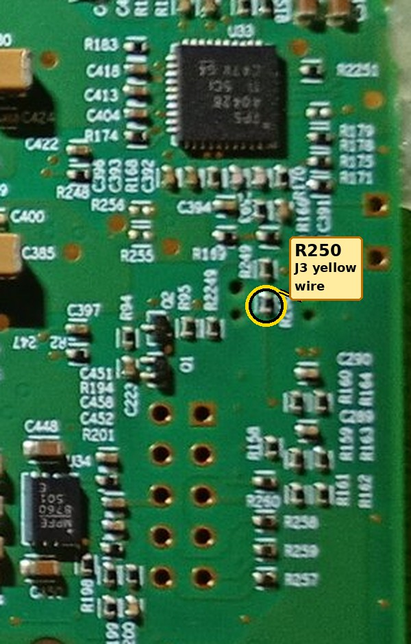

J3 is a 4-pin white header on the front, at the bracket end. No board file defines a fan pin.

On unit 0265 an AVC **BAZA0509R2U** blower is plugged in: 12 V, 0.18 A, hydraulic bearing, revision `.002`. It has three wires, and J3's 4th position is empty.

| Wire | Probable function | Where it goes |
|---|---|---|
| Black | Ground | TODO? |
| Red | +12 V | TODO? |
| Yellow | Speed signal: tach output or PWM input (**TODO**, see below) | One side of **R250** on the back (checked on unit 0265). Not traced past R250 |

**Where R250 is:** on the back at the bracket end, just below U33's lower-right corner, directly under R249. The unpopulated J5 pads (2 × 5 holes) are below it, and transistors Q1 and Q2 are just to its left (photo above).

**Tach or PWM?** A 3-wire fan normally has no PWM input; its third wire is the tach output, an open-collector signal that pulses twice per revolution. To tell which it is here, unplug the fan, power the board and measure J3's yellow-wire pin:
- a steady voltage (e.g. 3.3 V or 12 V) means the board pulls it up and reads it: a **tach input**;
- 0 V, or a square wave on a scope, means the board drives it: a **PWM output**.

**Next steps (board unpowered):**
1. Measure R250's value.
2. Beep R250's other side against Q1 and Q2, the J5 pads, U33 and the 3.3 V and 1.8 V rails (a pull-up would show here).
3. If it disappears into a via and nothing beeps, it probably goes to an unassigned FPGA pin ([§11.1](#111-io-banks)), likely through Q1/Q2 or another level shifter, because the FPGA's I/O banks run at 1.8 V or less. A test bitstream that watches all unassigned pins while the fan spins would find it: the tach pin toggles at twice the fan's revolutions per second.

### 12.9 Full pin map

The corrected content of `constraints/physical_pinout.xlsx`. The pins match `part0_pins.xml`, `ypcb003381p1.xdc` and the MIG presets, but like them they are inherited from the YPCB-00338-1P1 ([§1.3](#13-relationship-to-ypcb-00338-1p1)). PCIe lanes, flash and JTAG are not in the sheet; see [§12.4](#124-pci-express), [§12.3](#123-bpi-configuration-flash) and [§12.7](#127-jtag).

**Sensors, buses, LEDs, clocks and reset**

| Group | Signal | FPGA pin | Bank | Notes |
|---|---|---|---|---|
| [U27](#u27-ti-lm73-0-temperature-sensor) LM73 | I²C SCL | N24 | 15 | Through repeater [U26](#u26-nxp-pca9517a-i2c-repeater) |
| | I²C SDA | N25 | 15 | Through U26 |
| | ALERT | P25 | 15 | Open-drain |
| PCIe SMBus via [U28](#u28-nxp-pca9517a-i2c-repeater) | SMCLK (edge finger B5) | R26 | 15 | |
| | SMDAT (edge finger B6) | R27 | 15 | |
| [LEDs](#126-leds-and-buttons) | Red, GPIO bit 0 | P30 | 15 | Active high |
| | Green, GPIO bit 1 | M30 | 15 | Active high |
| | Yellow, GPIO bit 2 | N30 | 15 | Active high |
| PCIe | `PERST#` | Y26 | 14 | Active low |
| [Keep-alive](#3-keep-alive-pin-ac24) | `FPGA_KEEPALIVE` | AC24 | 14 | **Must stay high** after configuration, or the card clears the FPGA |
| [Clocks](#121-clocks-and-reset) | 50 MHz `SYS_CLK` | AA28 | 14 | Probably from [Y2](#y2-oscillator-probably-50-mhz) |
| | 200 MHz clock 1 (CH0), P / N | AH27 / AH28 | 12 | |
| | 200 MHz clock 2 (CH1), P / N | G25 / G26 | 17 | |
| Reset | User reset `SYS_RSTN` | R28 | 15 | Push button, active low |

**DDR3 address and control** (CH0 in bank 12, CH1 in bank 17; `RESET#` is in bank 13 for CH0 and bank 18 for CH1)

| Signal | CH0 | CH1 |
|---|---|---|
| A0 | AK27 | E27 |
| A1 | AN23 | C27 |
| A2 | AL24 | B28 |
| A3 | AK26 | D27 |
| A4 | AH24 | C24 |
| A5 | AH25 | D24 |
| A6 | AL26 | C25 |
| A7 | AJ24 | A24 |
| A8 | AJ25 | A25 |
| A9 | AM23 | J24 |
| A10 | AL28 | F26 |
| A11 | AL25 | D26 |
| A12 | AM25 | H25 |
| A13 | AK24 | D25 |
| A14 | AM27 | B26 |
| BA0 | AM26 | F24 |
| BA1 | AP24 | J25 |
| BA2 | AN28 | E24 |
| CK_P | AN25 | B25 |
| CK_N | AP25 | A26 |
| CKE | AP27 | A28 |
| CS# | AK28 | F28 |
| RAS# | AJ29 | E28 |
| CAS# | AP26 | E26 |
| WE# | AN27 | F25 |
| ODT | AK29 | B27 |
| RESET# | AD31 | F18 |

**DDR3 data, by chip**

**CH0**

| Byte | Chip | Side | Bank | DQ bits | DQ pins (bit order, low to high) | DQS P / N |
|---|---|---|---|---|---|---|
| 0 | U5 | front | 11 | 7:0 | AG17 AG16 AH17 AJ19 AH18 AH19 AJ16 AJ17 | AK16 / AK17 |
| 1 | U6 | back | 11 | 15:8 | AL20 AN17 AL19 AM16 AL18 AL16 AM20 AN18 | AM17 / AM18 |
| 2 | U7 | back | 11 | 23:16 | AL23 AN20 AK23 AP19 AN22 AN19 AM22 AP20 | AP21 / AP22 |
| 3 | U8 | front | 11 | 31:24 | AJ21 AH22 AK21 AG21 AG22 AG20 AH23 AG23 | AH20 / AJ20 |
| 4 | U9 | back | 13 | 39:32 | AJ32 AK32 AK31 AL30 AL34 AL31 AK34 AL29 | AK33 / AL33 |
| 5 | U10 | front | 13 | 47:40 | AJ34 AH32 AJ30 AH34 AF31 AG30 AG31 AF30 | AG33 / AH33 |
| 6 | U11 | front | 13 | 55:48 | AE32 AC33 AF33 AC32 AD34 AC34 AE33 AE31 | AE34 / AF34 |
| 7 | U12 | back | 12 | 63:56 | AE26 AF29 AE24 AF28 AF24 AG25 AF26 AF25 | AE27 / AE28 |
| 8 (ECC) | U13 | back | 13 | 71:64 | AN34 AP30 AM33 AN29 AP32 AP29 AM31 AP31 | AN32 / AP33 |

**CH1**

| Byte | Chip | Side | Bank | DQ bits | DQ pins (bit order, low to high) | DQS P / N |
|---|---|---|---|---|---|---|
| 0 | U1 | back | 16 | 7:0 | A29 B33 A31 C33 C32 A30 B30 A33 | B31 / B32 |
| 1 | U14 | front | 16 | 15:8 | D31 F33 D30 D29 E33 E34 E31 F34 | D34 / C34 |
| 2 | U15 | back | 18 | 23:16 | B23 A21 C23 B20 B22 A23 C20 B21 | A19 / A20 |
| 3 | U16 | front | 16 | 31:24 | G31 G32 F29 F31 E29 G33 H33 H32 | H29 / H30 |
| 4 | U17 | back | 18 | 39:32 | B18 C17 C19 B16 A18 A16 C18 B17 | D16 / D17 |
| 5 | U18 | front | 17 | 47:40 | K27 L24 K24 L28 K26 M27 L25 M26 | K28 / K29 |
| 6 | U19 | front | 18 | 55:48 | F16 E18 E16 H19 H17 H20 E17 H18 | G17 / G18 |
| 7 | U20 | back | 18 | 63:56 | D20 F21 E23 G21 G20 D21 F20 F23 | G22 / G23 |
| 8 (ECC) | U21 | front | 16 | 71:64 | L34 K34 K31 K33 L31 J30 L33 J34 | K32 / J32 |

---

# Part C: Background

## 13. The upstream YPCB example design

The submodule ships TiferKing's Vivado/Vitis 2022.2 system test for the YPCB-00338-1P1. It is the most complete design for this card family (both DDR3 channels, XDMA, I²C, flash), but it was built for the YPCB, has not been run on this card, and **does not keep AC24 high**: add [`constraints/dupcb001003.xdc`](constraints/dupcb001003.xdc) before trying it here ([§3](#3-keep-alive-pin-ac24)). For a tested starting point, use [§4](#4-example-microblaze-v-blinker-with-ddr-check) instead.

### 13.1 Vivado project

`examples/YPCB_00338_1P1_systest` is a Vivado 2022.2 MicroBlaze system test that uses every board interface. It is built on the submodule's board part `tiferking.cn:ypcb003381p1:part0:1.0` (part `xc7k480tffg1156-2`), with Vivado's default synthesis and implementation settings. To use it with this folder's board files ([§7.1](#71-board-files)), change the project's board part and let Vivado upgrade the IP. The project ships with:
- the block design (`top.bd`) and the generated `top_wrapper.v`;
- the hardware export `top_wrapper.xsa` (it contains `top_wrapper.bit`, `.mmi` and `.hwh` files);
- the synthesized and routed checkpoints;
- `pcie_port.xdc`.

The project file contains absolute paths from the author's machine, so install board files before opening it.

| Block | Configuration |
|---|---|
| MicroBlaze v11.0 | 100 MHz, 32-bit data, **36-bit addresses**, 512 KB of LMB block RAM (128K × 32, true dual port). D-cache: 4 KB, write-through, cacheable range `0x1_0000_0000`–`0x1_FFFF_FFFF`. No I-cache. Barrel shifter and hardware multiplier; no divider, FPU or MMU. Debug: 8 PC breakpoints, 2 read and 2 write watchpoints |
| MDM v3.2 | JTAG debug plus **JTAG UART** (`C_USE_UART=1`) on BSCAN USER2. This is the console; the board has no physical UART |
| AXI interrupt controller | Fast interrupts, 5 inputs. Inputs 0, 1 and 4 are level-triggered; inputs 2 and 3 are edge-triggered |
| `clk_wiz` (MMCM) | 50 MHz in, 1000 MHz VCO. `clk_out1` = 100 MHz (CPU and peripherals); `clk_out2` = 250 MHz, used only as SmartConnect `aclk4` |
| MIG | Dual controller (`ddr3_sdram_ch01`). Each channel's `ui_clk` (about 133 MHz) has its own `proc_sys_reset` |
| XDMA v4.1 | **Gen2 x8**, AXI memory-mapped, 64-bit AXI address, 128-bit data at 250 MHz. 2 H2C and 2 C2H channels (64 read IDs, 32 write IDs). BAR0 = 64 KB, 64-bit, prefetchable (DMA registers). MSI with 1 vector, 64-bit; legacy INTA; MSI-X off; max payload 256 bytes. `S_AXI_LITE` enabled. IDs: vendor `10EE`, device `7028`, subsystem `10EE:0007`, class `070001` (all XDMA defaults) |
| Interconnect | An AXI Interconnect with 9 masters (M00 interrupt controller, M01 MDM, M02/M03 MIG CH0/CH1 control, M04 GPIO, M05 IIC0, M06 IIC1, M07 XDMA `S_AXI_LITE`, M08 EMC). A SmartConnect with 2 slaves (MicroBlaze `M_AXI_DC`, XDMA `M_AXI`) and 2 masters (MIG S0, MIG S1) |
| Other | `axi_emc` (flash); 2× `axi_iic` (100 kHz, 7-bit addressing); `axi_gpio` (dual channel: channel 1 = 3 LED outputs, channel 2 = LM73 ALERT input, interrupt on) |
| Reset | `SYS_RSTN` (R28) goes to MIG `sys_rst` directly, to `clk_wiz` reset through an inverter, and to the processor reset block. The MDM's `Debug_SYS_Rst` can also reset the processor |

**Interrupt inputs:** 0 = LM73 I²C, 1 = PCIe SMBus I²C, 2 = MIG CH0 (ECC), 3 = MIG CH1 (ECC), 4 = GPIO (LM73 alert).

**MicroBlaze address map:**

| Address | Size | Peripheral |
|---|---|---|
| `0x0000_0000` | 512 KB | Local block RAM (instructions and data) |
| `0x4000_0000` | 64 KB | AXI GPIO |
| `0x4080_0000` | 64 KB | AXI IIC 0 (LM73) |
| `0x4081_0000` | 64 KB | AXI IIC 1 (PCIe SMBus) |
| `0x4120_0000` | 64 KB | AXI interrupt controller |
| `0x4140_0000` | 4 KB | MDM |
| `0x6000_0000` | 64 MB | BPI flash (AXI EMC) |
| `0x7600_0000` | 64 KB | XDMA control registers (`S_AXI_LITE`) |
| `0x7610_0000` / `0x7620_0000` | 1 MB each | MIG CH0 / CH1 control (ECC) registers |
| `0x1_0000_0000` | 2 GB | DDR3 CH0 |
| `0x1_8000_0000` | 2 GB | DDR3 CH1 |

**PCIe host view (XDMA `M_AXI`):**
- DDR3 CH0 at `0x0000_0000` (2 GB).
- DDR3 CH1 at `0x8000_0000` (2 GB).
- The flash is excluded from this address space.

### 13.2 Vitis software

Import `examples/YPCB_00338_1P1_software.zip` (Vitis 2022.2) into Vitis. It contains:
- the platform `YPCB_00338_1P1_plat` (standalone 8.0 on `microblaze_0`, built from `top_wrapper.xsa`);
- the application `YPCB_00338_1P1_App`, from the *memory_tests* template (Debug configuration);
- the bitstream `top_wrapper.bit` and `top_wrapper.mmi`;
- a debugger script.

The linker script puts everything in the LMB RAM (`0x50`–`0x7FFFF`), with a 1 KB stack and a 2 KB heap.

Open the MDM JTAG UART console and press a key:

| Key | Action |
|---|---|
| `r` / `g` / `y` | Toggle the red / green / yellow LED (GPIO channel 1, bits 0 / 1 / 2) |
| `m` | Memory test on both DDR3 channels with `Xil_TestMem32/16/8` (patterns `0xAAAA5555`, `0xAA55` and `0xA5`, all test types). **It only covers the first 4 KB of each 2 GB region**, and the D-cache is not enabled |
| `t` | Read 2 bytes from the LM73 at I²C address 0x4A (the pointer register defaults to temperature) and print °C as raw / 128 |

Quirks in the app:
- The temperature's fractional part is not zero-padded, so 25.03 °C prints as `25.3`.
- Negative temperatures print incorrectly because the raw value is unsigned.

### 13.3 Host software

The app has no XDMA code, so test PCIe from the host. `documents/Xilinx_Answer_65444_Windows.pdf` and `_Files.zip` (Xilinx AR 65444) contain the Windows XDMA driver and tools.
- **Driver:** `XDMA.sys`, `.inf` and `.cat` for Windows 7 and 10 x64, in Debug and Release builds. It is test-signed, so Windows must have test signing enabled.
- **Tools:** `xdma_test`, `xdma_info`, `xdma_rw`, `simple_dma`, `streaming_dma` and `user_event`.
- **Device ID:** the driver's ID list includes `PCI\VEN_10ee&DEV_7028`, which is the example design's ID.
- **Linux:** use Xilinx's [dma_ip_drivers](https://github.com/Xilinx/dma_ip_drivers) (not included in the repo).

---

## 14. Known issues, open questions and TODOs

**Open questions**
- **Is the rest of the inherited pinout right for this card?** All pin data comes from the YPCB-00338-1P1 files ([§1.3](#13-relationship-to-ypcb-00338-1p1)). Verified so far: the LEDs, the 50 MHz and first 200 MHz clocks, DDR3 CH0, the flash and the PCIe SMBus repeater ([§1.1](#11-at-a-glance)). Untested: DDR3 CH1, the second 200 MHz clock, PCIe, I²C, the LM73 and the reset button.
- **What does AC24 connect to, and why is Vivado's pull-up flash helper still cleared?** ([§3](#3-keep-alive-pin-ac24), measurement 15.)
- **Answered:** the Vivado part `xc7k480tiffg1156-2L` and this folder's board files work: every design in this folder is built with them and loads on unit 0265.

**Known issues**
- **The submodule's board files** declare TiferKing's board ID (`tiferking.cn:ypcb003381p1`), target `xc7k480tffg1156-2`, and give the 200 MHz clocks `LVDS` and `IBUFDSGTE`. All of these are fixed in this folder's copy ([§7.1](#71-board-files)).
- **The MIG presets target Micron MT41K256M8, but the card has SK hynix H5TC2G83FFR chips** ([§12.2](#micron-presets-on-sk-hynix-chips)).
- **The MIG presets use SSTL15 (1.5 V) I/O** although the card's DDR3L is listed as 1.35 V. Measurement 3 (VDDQ) settles which is right.
- **`physical_pinout.xlsx` has two wrong designators:** "U22" for the LM73 (it is U27) and "U26" for the SMBus repeater (it is U28). The corrected content is in [§12.9](#129-full-pin-map).
- **Pin AC24 must stay high** after configuration, or the card clears the FPGA. Fixed by Section 1 of [`constraints/dupcb001003.xdc`](constraints/dupcb001003.xdc) ([§3](#3-keep-alive-pin-ac24)).
- **Vivado's built-in flash programming does not work on this card:** its helper is cleared even with `PROGRAM.UNUSED_PIN_TERMINATION {pull-up}`. Reading works with [`tools/flash_reader/`](tools/flash_reader/); writing is TODO ([§6](#6-configuration-flash)).
- **Constraints:** the submodule's files set no configuration properties, and the DDR3 `.ucf` files are ISE format. [`constraints/dupcb001003.xdc`](constraints/dupcb001003.xdc) sets them ([§7.2](#72-constraints), [§6](#6-configuration-flash)).
- **Upstream example coverage:** its memory test checks only 4 KB per channel, and there is no XDMA test ([§13](#13-the-upstream-ypcb-example-design)).

### 14.1 Measurements to make on the board

Voltages need the board powered, in a PC slot (a riser cable makes the back reachable). Continuity and resistance checks need it unpowered.

| # | What | How / where | Expected, and what it settles |
|---|---|---|---|
| 1 | VCCINT, VCCAUX, VCCBRAM | Vivado Hardware Manager reads them from the XADC over JTAG, even with no bitstream loaded | VCCINT 0.95 V confirms -2LI; VCCAUX 1.8 V ([§11.3](#113-supplies-and-regulators)) |
| 2 | Mode pins M[2:0] | Hardware Manager: the device's configuration status register (STAT bits 10:8 in UG470) | **Done (unit 0265): `010`**, master BPI; bus width x16, CFGBVS GND, PUDC_B low ([§12.3](#123-bpi-configuration-flash)) |
| 3 | DDR3 VDDQ, VREF and VTT | DRAM decoupling capacitors; the output side of L4 (U36); U38's pins | VDDQ 1.5 or 1.35 V decides the MIG voltage setting; VREF and VTT should be VDDQ / 2. A VDDQ / 2 output on U38 supports the TPS51200 lead ([U38](#u38-1200-58f-s06z)) |
| 4 | Every regulator's output | The output side of each inductor: L1/L2 (Q7/Q8), L4 (U36), the 10 µH next to U35, L6 (U40) | Maps each regulator to its rail ([§11.3](#113-supplies-and-regulators)) |
| 5 | Bank 0 voltage (VCCO_0) | J1 pin 2 (VREF) | Probably 1.8 V; CFGBVS must match ([§11.1](#111-io-banks)) |
| 6 | Repeater and sensor supplies | U26/U28 pin 1 (VCCA) and pin 8 (VCCB); U27 pins 1 (ADDR), 3 (VDD) and 5 (ALERT) | 1.8 V and 3.3 V sides; ADDR = VDD (address 0x4A); ALERT's idle level ([§12.5](#125-i2c-buses)) |
| 7 | Oscillators | Y1, Y3 and Y2 output pads with a scope, and their supply pads | 200, 200 and 50 MHz; LVDS or LVPECL levels ([§9.5](#95-oscillators)) |
| 8 | U26 directly | Continuity: U27 pin 4 → U26 pin 7, U27 pin 6 → U26 pin 6 | Confirms U26 is the LM73 repeater ([§12.5](#which-repeater-is-which)) |
| 9 | U33's PMBus | Continuity from U33 pins 5–7 to J5, fingers B5/B6 and both sides of U26/U28; resistance from pins 11 and 12 to ground | Whether the core-rail telemetry is reachable, and U33's address ([U33](#u33-ti-tps40428-buck-controller)) |
| 10 | Fan signal | J3's yellow-wire pin with the fan unplugged and the board powered; then R250's other side | Tach input or PWM output, and where it goes ([§12.8](#128-fan-header)) |
| 11 | J5, SW3, SW1/SW2 and U24 | Voltages on J5's pins and on SW3 in both positions; continuity from the switches to U24 | What these parts do ([§10](#10-connectors-switches-and-leds)) |
| 12 | LEDs | A test bitstream driving the 3 LED pins; diode mode for the 4th bracket LED and the SMD LEDs | Which LED each pin lights ([§12.6](#126-leds-and-buttons)). Partly done on unit 0265: all 3 LED pins work, and the SMD LEDs are green (PCIe side) and red (bracket side) ([§12.6](#small-smd-leds-red-and-green)). Still open: the pin-to-LED mapping and the LED7/LED8 designators |
| 13 | JTAG ribbon on unit 0265 | Continuity from each conductor to J1 | Records the hard-wired cable ([§12.7](#127-jtag)) |
| 14 | Q7/Q8 package | Count the leads and measure the body | Settles the `95378BMC` package conflict ([Q8](#q8-power-stage-marked-95378bmc)) |
| 15 | FPGA pin AC24 | Unpowered: continuity from AC24's ball area / nearby vias to U39, U24, SW1, `INIT_B` and `PROGRAM_B`. Powered: scope AC24 while loading a design with AC24 pulled down | What clears the FPGA when AC24 goes low ([§12.6](#small-smd-leds-red-and-green)) |

### 14.2 Parts to identify

U22, U23, U24, U29, U30, U34, U35/U37, U38, U39 and U40, and the oscillators Y1, Y2 and Y3 ([§9.5](#95-oscillators), [§9.6](#96-unidentified-ics)). A loupe or USB microscope with low-angle light may read the unreadable markings (Y2, U40).

---

## 15. Reference

### 15.1 Repository contents

**This folder**

| Path | Contents |
|---|---|
| `README.md` | This document |
| `dupcb001003/1.0/` | Corrected Vivado board files, board part `johndoe:dupcb001003:part0:1.0` ([§7.1](#71-board-files)) |
| `constraints/dupcb001003.xdc` | Master XDC: required AC24/config settings, flash-boot settings, pin templates ([§7.2](#72-constraints)) |
| `examples/microblaze_v_blinky/` | MicroBlaze-V blinker with DDR check: `create_project.tcl` + `design_1_bd.tcl` (Vivado project), `create_vitis.py` (Vitis platform and app), `run_on_board.tcl` (xsdb load and LED monitor), `blinky.c`, `lscript.ld`, the testbench `tb_design_1.sv`, `build_sim_elf.sh` ([§4](#4-example-microblaze-v-blinker-with-ddr-check), [§5](#5-simulating-and-debugging)) |
| `tools/board_alive/` | LEDs-only sanity bitstream (LED pins, both clocks, reset button) ([§4](#4-example-microblaze-v-blinker-with-ddr-check)) |
| `tools/flash_reader/` | JTAG flash reader (block design, wrapper, pins, build/dump Tcl, `convert.py`) ([§6](#6-configuration-flash)) |
| `flash_backup/` | 64 MB backup of unit 0265's flash (2026-11-18): `.bin`, gzipped `.mcs`, the vendor sector, `SHA256SUMS` and a README describing the contents ([§6](#6-configuration-flash)) |
| `images/unit0265_front_labeled.jpg`, `images/unit0265_back_labeled.jpg` | Unit 0265 with every IC labelled (3000 px wide) |
| `images/unit0265_front.jpg`, `images/unit0265_back.jpg` | Unit 0265, from the photos taken 2026-11-10, downscaled to 2000 px |
| `images/board_front.jpg`, `images/board_back.jpg` | Unit 0300, from the upstream images `image/README/1784059585733.jpg` and `resources/pictures/IMG_20260623_214413.jpg`, downscaled to 2000 px |
| `images/` (everything else) | Cropped photos from unit 0265: one per IC ([§9](#9-integrated-circuits)), plus `r250_fan.jpg` ([§12.8](#128-fan-header)) |

**The submodule (`submodules/DU-PCB-001-003`)**

| Path | Contents |
|---|---|
| `README.md`, `LICENSE` | Upstream overview and the MIT license (© 2026 Tifer King, Masanori Ogino, Sergey Ershov) |
| `dupcb001003/1.0/` | Vivado board files: `board.xml`, `part0_pins.xml`, `preset.xml`, `mig_0.prj`, `mig_1.prj`, `mig_01.prj`, `xitem.json`, `ypcb003381p1_image.jpg` (LFS), and a `LICENSE` (© 2026 Tifer King, Sergey Ershov) |
| `constraints/` | `ypcb003381p1.xdc`, `MEMORY_CH0.ucf`, `MEMORY_CH1.ucf`, `physical_pinout.xlsx` |
| `examples/YPCB_00338_1P1_systest/` | Vivado 2022.2 project, about 106 MB: block design, generated IP, XSA, synthesized and routed checkpoints, `pcie_port.xdc` |
| `examples/YPCB_00338_1P1_software.zip` | Vitis 2022.2 platform and application, 14 MB |
| `documents/` | 7-series selection guide; LM73; MT28GU512AAA1EGC-0SIT; MT41K256M8DA-125 (17 MB); Xilinx AR 65444 (PDF plus a 19.5 MB driver zip) |
| `image/README/` | 4 photos used by the upstream README: board, FPGA, DRAM and flash close-ups (Git LFS) |
| `resources/pictures/` | 10 original photos of unit 0300 (8 JPG and 2 DNG, up to 67 MB each; Git LFS) |

Apart from `README.md`, the two `LICENSE` files, `.gitattributes` and the photos, every file in the submodule is **identical** to [TiferKing/ypcb_00338_1p1_hack](https://github.com/TiferKing/ypcb_00338_1p1_hack). That repo is also checked out at [`submodules/ypcb_00338_1p1_hack`](../../submodules/ypcb_00338_1p1_hack).

### 15.2 History

| Date | Who | What |
|---|---|---|
| 2024-12-13 to 2025-01-01 | TiferKing | YPCB-00338-1P1 hack: board files, constraints, example project and the sensor-pin fixes |
| 2026-07-12 to 2026-07-28 | SergeRuff (Sergey Ershov) | Forked for DU-PCB-001-003: translated the README, added photos (LFS), updated the license, moved the board files to `dupcb001003/` |
| 2026-09-03 | SergeRuff | Revised the "More information" section of the README (latest commit `b8ef274`) |
| 2026-11-10 to 2026-11-11 | This workspace | Photographed unit 0265, wrote this README, made the corrected board files in `dupcb001003/` |
| 2026-11-18 | This workspace | First designs on unit 0265: found the keep-alive pin AC24; added the master XDC, the `fpga_keepalive` board interface, the MicroBlaze-V example with scripts, the flash reader, and the flash backup; verified the board files, DDR3 CH0 and the configuration settings |

### 15.3 Links

**Repositories**
- Support repo: https://github.com/SergeRuff/DU-PCB-001-003
- Upstream YPCB-00338-1P1 hack: https://github.com/TiferKing/ypcb_00338_1p1_hack
- TiferKing's write-up: https://www.tiferking.cn/index.php/2024/12/19/650/
- omasanori's SCH-001-003 work: https://github.com/omasanori/sch-001-003-hack

**Tutorials**
- [AN4471, SMBus Quick Start Guide](https://www.nxp.com/docs/en/application-note/AN4471.pdf) (Freescale/NXP, Rev 1, 08/2012): SMBus electrical levels, timing, protocols and how SMBus differs from I²C

**Datasheets**
- [AMD DS182, Kintex-7 DC and AC switching characteristics](https://docs.amd.com/v/u/en-US/ds182_Kintex_7_Data_Sheet)
- [TI LM73](https://www.ti.com/lit/ds/symlink/lm73.pdf)
- [NXP PCA9517A](https://www.nxp.com/docs/en/data-sheet/PCA9517A.pdf)
- [TI TPS40428](https://www.ti.com/lit/ds/symlink/tps40428.pdf)
- [TI CSD95378BQ5MC](https://www.ti.com/lit/ds/symlink/csd95378bq5mc.pdf) (probable match for Q7/Q8)
- [TI TPS53319](https://www.ti.com/lit/ds/symlink/tps53319.pdf)
- [TI TPS51200](https://www.ti.com/lit/ds/symlink/tps51200.pdf) (possible match for U38)
- [SK hynix H5TC2G83FFR (unofficial)](https://dtsheet.com/model/1811300)
- Local copies in the submodule's `documents/`: 7-series selection guide, LM73, MT28GU512AAA1EGC-0SIT, MT41K256M8DA-125, Xilinx AR 65444
- Other Xilinx documents referenced by these files (not in the repo): DS180 (7-series overview), UG470 (configuration), UG586 (MIG), PG195 (XDMA), PG054 (7-series PCIe)

**Vendor pages**
- Xilinx package pinout for the XC7K480T-FFG1156 (pin to bank map): https://www.xilinx.com/support/packagefiles/k7packages/xc7k480tffg1156pkg.txt
- Kintex-7 product page (from `board.xml`): https://www.xilinx.com/products/adaptive-socs-and-fpgas/fpga/kintex-7.html
- XDMA Windows driver source request (from AR 65444): https://www.xilinx.com/member/xdma_windows_driver.html
- Linux XDMA driver: https://github.com/Xilinx/dma_ip_drivers

**In this workspace**
- Sibling board: [YPCB-00338-1P1](../YPCB-00338-1P1-kintex7-480t/README.md)
